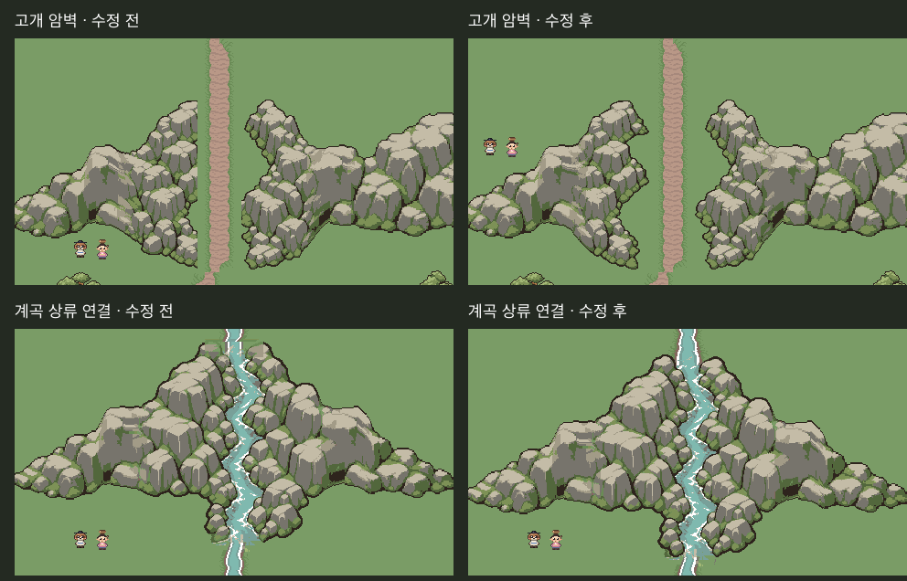

# 고개·계곡 접속부 수정 v2

사용자 “계곡 위쪽 부분과 강의 연결…길 왼쪽이 어색하게 잘린” 지적을 반영했다. **사용자 “좋다.”로 수정본 포함 최종 그림 승인 (2026-10-29) / 본편 미적용**.

왼쪽은 이전 커밋 `0cf50ea04`의 실제 검토 캡처, 오른쪽은 수정 후 새로 촬영한 Unity Edit 화면이다. 카메라 위치/크기는 동일하다. 고개가 넓어지면서 크기 비교용 정지 캐릭터는 새 암벽과 겹치지 않는 빈자리로 이동했다. 본편 NPC 위치를 바꾼 것이 아니다.

## 고개

원인은 통로 확보를 위해 x104..151을 직사각형으로 지우던 처리였다. 왼쪽 암벽의 원래 돌출부까지 잘라 수직 절단선이 생겼다.

이 지우기 처리를 제거했다. 원화에서 이미 나뉘어 있는 두 온전한 암벽을 native 크기 그대로 바깥쪽으로 배치하고 `mountain-pass-whole-walls-master.*`320×256에 전체 형태를 보존했다. 그 조립 원본의 역할 영역을 내보내 기존 능선 접속부만 정리한다. 안쪽 암벽을 자르거나 찌그러뜨리지 않는다. 고개 파일 크기256×256·길 위치·통로 확보 기준48px는 유지했다.

추가 검사: 두 벽 전체 원본의 불투명 픽셀 수 보존, 접속부 바깥 안쪽 암벽 픽셀과 원화의RGBA 일치,48px 빈 통로/32px 길 중심 여유 유지.

## 계곡 상류

원인은 물 연결 함수가 좁은 스트립 안의 물뿐 아니라 바위 둑도 함께 덮고, 기존 강가 무늬를 짧은 구간에 억지로 맞추던 것이었다.

물 접속 처리에서 원래 바위7색 픽셀은 보호했다. 상류에16px 유입 구간을 더해 일반 강 폭에서 원래 계곡 물길로 완만하게 연결했다. 바위와 본래 물길은 그 아래에 온전히 남는다. 계곡은256×272가 되었고 동서 암반 접속 y는16px다. 연결된 산자락·하류·호수 배치도 원본 생성기에서 이에 맞춰16px 아래로 옮겼다. 수원/폭포 에셋은 바꾸지 않았다.

추가 검사: 계곡 둑 바위 픽셀 보존, 첫40줄의 물 폭15~25px, 물길 단절 없음. 원래 물길·바위의 위치를16px 옮긴 것이며 실제 고도 시스템은 아니다.

## 확인

- 변경된 에셋 PNG는 `mountain-pass`, `stream-valley`뿐. 이전22종 지문과 비교해 다른20종 불변 확인.
- 22종 PNG/Aseprite 재출력·Package 복사본RGBA 일치.
- 호환 접속227쌍·수원→호수 물픽셀 연결·기존 강 출구RGBA 일치.
- Unity Edit480×270 8장+전체1440×1472 1장 재촬영, 전체프레임 참조 합성과RGBA차이0. 콘솔오류0, 원래씬 복귀·dirty상태 유지·본편쓰기0.
- 실제 플레이/런타임 충돌·가림/본편 통합/빌드 미실행. 수정 그림 승인은 후속 사용자 “좋다.”로 기록했다.

원본은 `Tools/ArtTrials/mountain_range_final.lua`·`.py`다. `Before/`에는 이전 PNG·검사 지문을 보존했다. 새 AI 원화를 생성하지 않고 기존 Aseprite native 제작 원본을 수정했다. 생성물만 손으로 고치지 않았다.
