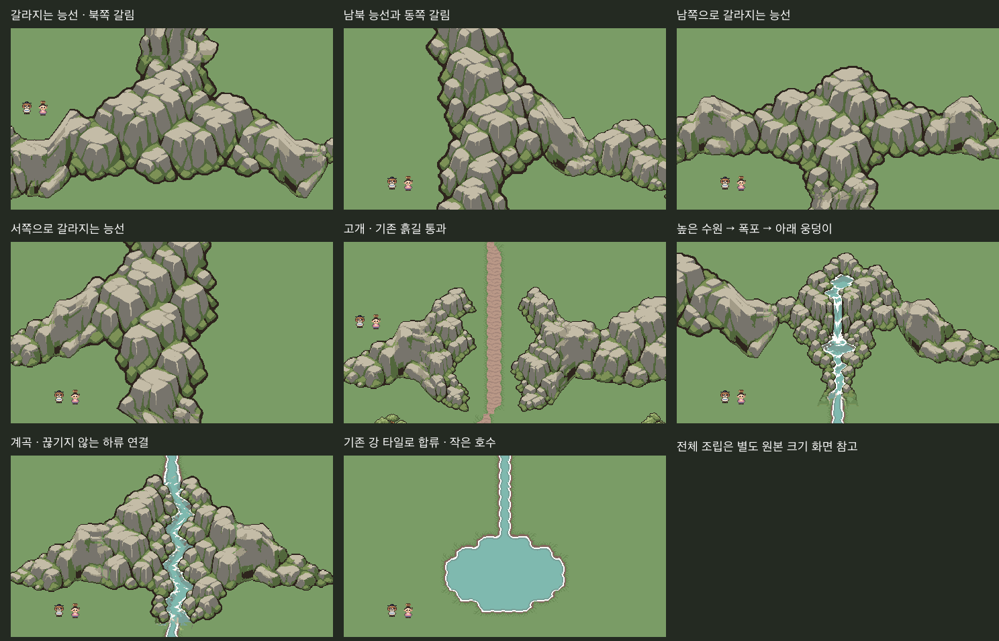

# 산맥 에셋 — 최종 검토 묶음

**고개·계곡 수정 v2 포함 산맥22종 최종 그림 승인 (2026-10-29 “좋다.”) / 본편 미적용**.

[승인본](../Approved/MountainRange-Final-v2/README.md)에 PNG/Aseprite22쌍·접속단면4종·검토판·픽셀지문을 동결했다. 승인 범위는 제출한 그림과 조립 표현이며 런타임 통합 검증은 별도다.

사용자 후속 지적의 고개 절단선과 계곡 상류 접속을 수정했다. [수정 전후와 원인](Corrections-v2/README.md), [Unity 전후 비교](Corrections-v2/unity-before-after.png). 이 페이지의 전체 그림/Package는 수정본이다.

사용자 “계속 작업 진행해. 최종 작업만 검토할게.”에 따라 중간 승인 요청 없이 기존 S2b를 포함해 갈림·고개·계곡·수원·폭포·강 연결과 전체 조립을 마쳤다. 이전에 승인한 원본은 그대로 보존했다. 이 묶음이 후속 아트의 최종 검토 대상이며 검사가 그림 승인을 대신하지 않는다.



- [산맥 전체 Unity 원본 크기 화면1440×1472](unity-overview-1440x1472.png)
- [22종 전체 에셋 시트 — native 크기](all-assets-sheet.png)
- [네 방향 모서리 참고 화면 — 직전 S2b 촬영, 원본 유지](../MountainRange-S2b/game-board.png)
- [PNG/Aseprite·접속 규격 묶음](Package/catalogue.json)
- [검사 결과](checks.json)

전체 배치는 에셋과 연결을 검토하기 위해 새로 만든 **검토 전용 장면**이다. 기존13맵의 세계 배치나 본편을 교체하는 결과물이 아니다. 집·나무·벼·흙길·강/호수 바닥은 기존 승인 그림/기존 타일을 그대로 썼다. 새 산맥의 크기는 플레이어·사람 NPC와 나란히 확인할 수 있다.

## 구성

총 **조립 모듈22종**, PNG/Aseprite22쌍을 `Package/`에 모았다.

| 종류 | 수 | 상태 |
|---|---:|---|
| 동서 끝·중앙 능선(S1) | 4 | 이전 진행 기준 승인본 유지 |
| 완만한 북/남 굽힘(S2a) | 2 | 이전 승인본 유지 |
| 남북 끝·중앙 + 직각 모서리(S2b) | 7 | 이번 최종 묶음으로 그림 검토 |
| 네 방향 세 갈래 갈림 | 4 | 신규, 이번 최종 검토 |
| 고개·계곡·높은 수원/폭포 | 3 | 신규, 이번 최종 검토 |
| 하류 반복·기존 강 타일 합류 | 2 | 신규, 이번 최종 검토 |

이번 신규9종의 native 크기:

| 파일 이름 | 크기 | 역할 |
|---|---|---|
| branch-w-e-n / branch-w-e-s | 각각384×256 | 동서 능선에서 북/남으로 갈라짐 |
| branch-n-s-w / branch-n-s-e | 각각256×384 | 남북 능선에서 서/동으로 갈라짐 |
| mountain-pass | 256×256 | 절벽 사이 남북 통로, 빈 폭48px 확보 |
| stream-valley | 256×272 | 동서 산줄기 사이로 남북 하류가 흐르는 계곡 |
| spring-waterfall | 256×256 | 높은 선반의 수원·짧은 상류·낙차·아래 웅덩이·남쪽 출수 |
| river-straight / river-outlet | 각각64×64 | 계곡 하류 반복·기존 강 타일로 위상 맞춰 합류 |

기존 독립 돌산·짧은 암벽·산자락3종(`Approved/RockMountain-v1`)은 계속 별도 승인본으로 보존하며 이22개 조립 모듈과 구별한다.

## 제작 원본

내장 **imagegen**으로 갈림4개·고개1개·계곡1개·수원/폭포1개의 새 원화를 만들었다. 프롬프트와 원화7쌍은 `AI/`에 모두 저장했다. 승인한 능선/모서리는 재질·형태·빛 방향 참고였고 회전·반전하거나 일부를 떼어 새 물체로 쓰지 않았다.

`Tools/ArtTrials/mountain_range_final.lua`는 원화 전체를 nearest native 격자·고정 팔레트로 정리한 뒤, 처음부터 조립용으로 기획한 마스터의 역할 영역을 내보낸다. `*-source-master.*`, `*-before-ports.*`에 제작 과정을 남겼다. 고개는256×256 캔버스에서 안쪽 암벽을 직사각형으로 지우던 처리를 없애고 두 온전한 벽을 바깥쪽으로 배치해48px 통로를 확보했다.320×256 전체벽 제작 원본을 별도로 보존했다. 계곡은 바위 둑을 덮지 않도록 보호하고16px 유입 구간을 추가해256×272로 정리했다.

- 바위는 기존 이끼바위의7색이다. 물이 포함되는 조각에는 현재 jade 강 타일의 물/강가6색을 추가해 최대13색으로 제한했다.
- `river-straight`·`river-outlet`·물 연결 단면은 기존16×16 강가/초원 조립 타일을 사용해 만든 전용 연결 에셋이다. 원래 승인 타일은 바꾸지 않았다.
- 동서/남북 암반 접속은 S1/S2b 단면을 유지한다. 물 연결은64×16, 기존 바닥 강으로 나가는 접속은 별도 위상 단면이다. 생성 중 색 바꾸기/크기 변경으로 경계를 감추지 않는다. native 제작 단계에 모든 접속을 구워 두고 맵에서는 PNG를 그대로 배치한다.
- `catalogue.json`은 검토용 접속/출처 목록이다. **본편 A2 등록이나 런타임 연결을 완료한 것으로 취급하지 않는다.** 승인 후 적용할 때 기존 A2 형식으로 등록·검사해야 한다.

## 전체 조립

원본 `Tools/ArtTrials/mountain_range_final.py`가22종 목록·포트·배치·검사·참조 이미지·패키지·검토판을 생성한다. 검토 장면에서:

1. 서쪽 능선의 고개를 기존 흙길이 남북으로 가로지른다.
2. 큰 능선은 북쪽으로 갈라지고, 그 위에서 다시 동쪽으로 갈라진다.
3. 동쪽 산의 높은 선반에 수원이 있고 절벽 아래로 폭포가 떨어진다.
4. 아래 웅덩이에서 나온 물이 낮은 계곡을 통과해 기존 강 타일과 작은 호수로 이어진다.
5. 나무·집·벼와 비교해 산악 에셋의 크기·그림체를 확인한다.

네 방향 갈림은 모두 개별 게임 크기 검토에 포함했다. 산맥의 진행 방향을 조립하는 세트이며, 임의로 넓은 산악 면적을 채우는 범용 면 오토타일/실제 고도 시스템은 아니다.

## 실행한 검사

**정적/파일/픽셀 검사**

- 22종 크기·이진알파·허용 팔레트 통과. PNG/Aseprite22쌍 재출력 디코딩RGBA 일치, 패키지 복사본 픽셀 일치.
- 기존 S1/S2a 승인6종 및 S2b7종의 원본 픽셀 지문 유지.
- 같은 규격·서로 맞는 방향의 **227가지 접속 쌍**이 공통 단면과RGBA 일치. 이는 포트 호환 검사이며227가지 완성 맵 승인/보행 검사가 아니다.
- 갈림4종이 하나의 연결된 암반 덩어리로 유지됨. 고개의48px 빈 공간과 전체 배치에서32px 길 중심 영역을 픽셀로 확인.
- 수원→폭포→계곡→호수의 물/포말 픽셀이 하나의 연결 성분으로 이어짐. 하류 출구에서 기존 바닥 강 타일로 나가는 단면도RGBA 일치.
- v2 추가: 고개 안쪽 암벽·전체벽 원본 픽셀 보존, 계곡 바위 둑 픽셀 보존·유입 폭15~25px, 변경 에셋2종/나머지20종 불변 확인.
- PNG 동일성은 파일 바이트가 아닌 크기와 디코딩RGBA로 검사했다.

**Unity Edit 검사**

- 새 임시 씬에서480×270 게임 크기8장,1440×1472 전체1장 촬영. 전체 화면은 더 넓은 범위를 native 픽셀 크기로 촬영한 것으로 에셋을 축소한 것이 아니다.
- 9장 모두 동일 배치 목록의 참조 합성과 전체프레임RGBA차이0. 검토 코드 실행 성공·콘솔오류0. 촬영 후 원래 씬 복귀·dirty상태 유지·본편쓰기0.
- 겹치는 나무의 동일 sortingOrder가 촬영/참조 사이에 다른 순서로 보이는 문제는 **검토 씬에서 명시적인 배치 순서**를 지정해 수정하고9장을 재촬영했다. 본편 가림 코드를 고친 것은 아니다.

검사 기록: `checks.json`, `Docs/Validation/MountainRange-Final-2026-10-29.md`.

**확인하지 않은 것:** 실제 플레이·캐릭터 보행·런타임 충돌/가림·폭포 애니메이션·본편 통합·전체 프로젝트 회귀·빌드. 검토의 플레이어/NPC는 정지 스프라이트다. 이번 범위는 에셋 제작·조립·그림 검토다. 시장/NPC/상품/시설/퀘스트 ID와 저장 데이터, 본편 Maps/Scenes/공용 파일은 변경하지 않았다.

## 재생성

```sh
aseprite -b --script-param root="$PWD" --script Tools/ArtTrials/mountain_range_final.lua
python Tools/ArtTrials/mountain_range_final.py --prepare
```

`--prepare`는 새 배치와 참조를 만들고 기존 캡처를 통과한 것으로 취급하지 않는다. `unity-review.cs.txt`를 Unity execute_code에서 실행한 뒤 `python Tools/ArtTrials/mountain_range_final.py`로 실제 새 캡처를 비교한다. `views.tsv`와 배치JSON/TSV는 Python이 생성한다. 생성물만 손으로 고치지 않는다. 기존 캡처와 다른 새 원본을 만들면 참조만 바꿔 통과 처리하지 말고 Unity도 다시 촬영한다.

최종 그림 승인을 기록했다. 후속 작업은 본편 A2 등록·배치 적용과 실제 보행/충돌/가림 검증이며 이번 승인 기록에서는 본편을 변경하지 않았다.
