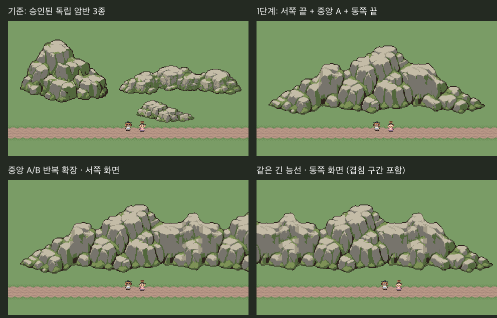

# 산맥 1단계 — 동서 연결 능선

**다음 단계 진행 기준으로 승인 (2026-10-29 “계속 진행해.”) / 본편 미적용**.

S1 원본4종과 공통단면·검토판을 `ArtReview/Approved/MountainRange-S1`에 동결했다. 현재 후속 [S2a 완만한 굽힘](../MountainRange-S2/README.md)은 별도 그림 검토 중이다.

사용자 “그러면 단계별로 진행해봐.”에 따라 첫 단계인 동서 능선을 제작했다. 승인된 돌산·암벽·산자락3종은 그림체/크기 참조로만 쓰고 수정하지 않았다.



- 왼쪽 위: 기존 승인 암반3종. 이번 연결 조각과 구별하기 위한 기준 화면이다.
- 오른쪽 위: 서쪽 끝 + 중앙A + 동쪽 끝, 448px 길이.
- 아래 두 장: **같은 768px 능선**의 서쪽/동쪽. 카메라 시작점0/304px로 176px가 겹친다. 서로 다른 산줄기가 아니다.
- 각각 Unity **Edit 임시 씬480×270** 렌더다. 카메라 배율/PPU16·Point 필터 유지, 에셋 런타임 크기/색/회전 변경 없음. 본편 실제 플레이 화면은 아니다.

## 원본과 조각

내장 imagegen으로 **처음부터 조립용으로 기획한 새 마스터 원화**를 제작했다. `AI/prompt.txt`와 `AI/master-ai.png`. 기존 승인 돌산을 잘라 만든 것이 아니다.

`Tools/ArtTrials/mountain_range_s1.lua`가 새 원화 전체를512×192 native 캔버스·기존 이끼바위7색으로 정리한다. `master-before-ports.*`는 연결부 정리 전 원본이다. 원화의 자연스러운 낮은 고개를 연결 기준으로 선택했고, Aseprite에서 공통16px 단면과 양쪽16px 전환부를 정리했다. 이 정리는 **제작 단계**에 구워 두며 맵 생성/Unity에서는 PNG를 그대로 놓는다.

원화 프롬프트의 균등128px 분할 대신, 큰 봉우리를 온전히 남기도록 새 조립 원본의 분할 위치를128/320/384px로 정했다. `master.*`는 연결부 정리 후의 조립 원본이다. 그 원본의 역할 영역을 아래 조각으로 내보낸다.

| 조각 | 크기 | 역할 |
|---|---|---|
| west-cap | 128×192 | 초원으로 낮아지는 서쪽 끝 |
| body-a | 192×192 | 큰 봉우리를 포함하는 반복 중앙 |
| body-b | 64×192 | 낮은 능선 변화를 주는 반복 중앙 |
| east-cap | 128×192 | 초원으로 낮아지는 동쪽 끝 |

조립 순서는 `west-cap → body-a/body-b 1개 이상 → east-cap`. 위아래 위치는 같고, x는 직전 조각의 폭만큼 더한다. 자르기/늘이기/뒤집기/겹쳐서 경계 가리기를 하지 않는다. 전체 원본4조각 재조립은 마스터와 RGBA가 같다. `port-template.*`는 공통 연결 단면의 제작/검사 자료이며 게임에 따로 놓는 조각이 아니다.

## 검사와 제한

정적/파일 검사: 4종 크기·기존 바위 팔레트·이진 알파, Aseprite4개 재출력RGBA 일치. 허용 연결8조합의 경계16px가 공통 단면과 정확히 일치하며 연결부의 불투명 암반 중심이 이어진다. 이미지 동일성은 파일 바이트 대신 크기·디코딩RGBA로 검사한다.

Unity: 검토4장 실행 성공·전체프레임 참조합성RGBA차이0·콘솔오류0. 촬영 후 원래 씬 복귀·dirty상태 유지·본편쓰기0. `checks.json`과 `Docs/Validation/MountainRange-S1-2026-10-29.md`에 범위를 기록했다.

**현재는 같은 높이의 동서 직선 연결만 지원한다.** 그림에는 봉우리 높이 차이가 있지만 실제 고도/통행 시스템을 만든 것은 아니다. 중앙2종이므로 긴 구간에서 봉우리 반복이 남는다. 기술 검사 통과는 자연스러움/그림 승인을 대신하지 않는다.

실제 플레이·이동·충돌·가림동작·전체 회귀·빌드 미실행. 본편 맵/씬/공용 파일과 승인 원본은 변경하지 않았다.

## 다음 단계

1. 직선 능선은 다음 단계 진행 기준으로 기록·동결했다.
2. 승인 후: 굽은 산줄기와 안팎 모서리·고도 전환을 별도 조각으로 제작하고 다시 검토.
3. 그다음: 산줄기 갈림·고개·계곡.
4. 수원·폭포 연결 및 본편 배치는 별도 단계에서 그림/동선 검토 후 적용.

단계별 그림 승인을 받으며 진행한다.

## 재생성

```sh
aseprite -b --script-param root="$PWD" --script Tools/ArtTrials/mountain_range_s1.lua
python Tools/ArtTrials/mountain_range_s1.py
```

Python이 조립 결과·배치JSON/TSV·검토판·검사보고를 생성한다. `unity-review.cs.txt`를 Unity execute_code에서 실행해 촬영한 다음 Python 검사를 다시 실행한다. 생성물만 손으로 고치지 않는다.
