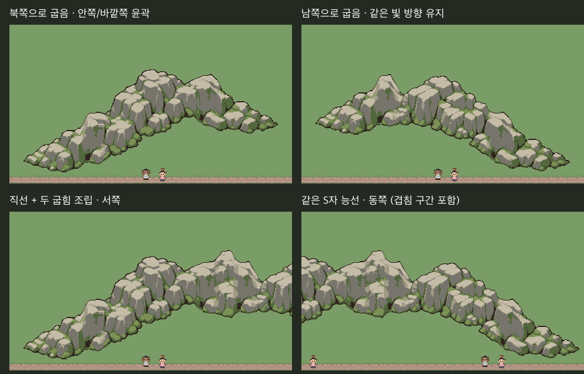

# 산맥 2a — 완만한 북쪽·남쪽 굽힘

**그림 승인 대기 / 검토 전용 / 본편 미적용**.

사용자 “계속 진행해.”를 S1 직선 능선을 기준으로 다음 단계 진행하는 것으로 기록했다. `Approved/MountainRange-S1`에 S1 조각4개·공통 단면·검토판·픽셀 지문을 동결했다. 본편 적용 승인은 별도다.

이번 단계는 **동서로 이어지는 능선 전체가 화면 북쪽/남쪽으로 완만하게 굽는 두 조각**이다. 그림의 안쪽 오목한 윤곽·바깥쪽 볼록한 산자락을 함께 연결한다. **독립적인 안팎 모서리 타일이나 직각 방향 전환은 아직 구현하지 않았다.** 2단계 전체를 완료한 것으로 처리하지 않는다.



위 두 장은 각각 북쪽·남쪽 굽힘이다. 아래 두 장은 **같은 S자 조립물**을 카메라 x0/240px에서 촬영한 것으로 240px가 겹친다. [S1 직선과 북쪽 굽힘 비교](comparison.png)도 함께 만들었다.

## 제작과 연결

내장 imagegen을 사용해 방향별 새 조립 마스터 원화를 만들었다. `AI/bend-*-prompt.txt`와 `AI/bend-*.png`. S1을 회전/반전하거나 승인된 산의 일부를 떼어 쓰지 않았다. 북쪽·남쪽 모두 왼쪽 위 빛을 유지했다.

`Tools/ArtTrials/mountain_range_s2.lua`가 전체 원화를448×256 native 캔버스·기존 이끼바위7색으로 정리하고 제작 단계에서 연결 단면을 맞춘다. 남쪽 원화는 좁은 돌출 봉우리가 생기지 않도록 세로 배치 기준을24px 위로 조정한 뒤 연결부를 정리했다. `*-before-ports.*`는 정리 전, `*-master.*`는 정리 후 원본이다.

새 원본은 처음부터 서쪽 참조끝128px·중앙 굽힘192px·동쪽 참조끝128px로 기획했다. 중앙 역할 영역만 `Native/`로 내보내고, 실제 조립에는 동결된 S1 끝 조각을 사용한다. 기존 승인 원본을 자른 것이 아니다. Unity/맵에서 크기·색·회전·뒤집기를 바꾸지 않는다.

| 새 조각 | 캔버스 | 왼쪽 연결 y | 오른쪽 연결 y |
|---|---|---|---|
| bend-north | 192×256 | 64 | 0 |
| bend-south | 192×256 | 0 | 64 |

연결 y는 S1의192px 높이 단면이 조각 안에서 시작하는 위치다. 북쪽 조각을 지나면 다음 S1 조각이 화면 위로64px, 남쪽 조각을 지나면 아래로64px 이동한다. 이는 **평면상의 산줄기 위치 변화**이며 실제 고도·계단 시스템이 아니다.

`Tools/ArtTrials/mountain_range_s2.py`가 해당 앵커로 배치 목록과 전체 조립 이미지를 만든다. 중앙과 끝의 경계는16px 공통 단면을 공유하고, 겹쳐 경계를 감추지 않는다. 배치 생성물은 손으로 고치지 않는다.

## 검사

- 파일/정적: 신규2개192×256·기존 팔레트·이진알파, Aseprite2개 재출력 디코딩RGBA 일치.
- 연결: S1↔굽힘, 굽힘↔굽힘16조합이 동결된 S1 공통 연결 단면과RGBA 일치. 동결 S1 그림4개와 작업 원본 픽셀 불변 확인.
- Unity: **Edit 임시 씬480×270** 기준/신규5장 전체프레임 참조합성RGBA차이0·콘솔오류0. 촬영 후 원래씬 복귀·dirty상태 유지·본편쓰기0. 실제 본편 플레이 화면은 아니다.
- 기록: `checks.json`, `Docs/Validation/MountainRange-S2a-2026-10-29.md`.

실제 플레이·이동·충돌·가림동작·전체회귀·빌드 미실행. 그림 자연스러움은 사용자 검토가 필요하다. 모서리 자유조립, 남북 진행방향, 갈림·고개·계곡·수원폭포·실제고도는 아직 없다.

## 다음

현재 완만한 굽힘을 검토받은 뒤, 직각으로 방향이 바뀌는 산줄기와 독립적인 안팎 모서리 조각(2b)을 제작·검토한다. 그다음 갈림·고개·계곡으로 진행한다. 본편 적용은 아직 하지 않는다.

```sh
aseprite -b --script-param root="$PWD" --script Tools/ArtTrials/mountain_range_s2.lua
python Tools/ArtTrials/mountain_range_s2.py
```

`unity-review.cs.txt`를 Unity execute_code에서 실행해5장을 촬영하고 Python 검사를 다시 실행한다. PNG 동일성은 파일 바이트가 아니라 크기와 디코딩RGBA로 확인한다.
