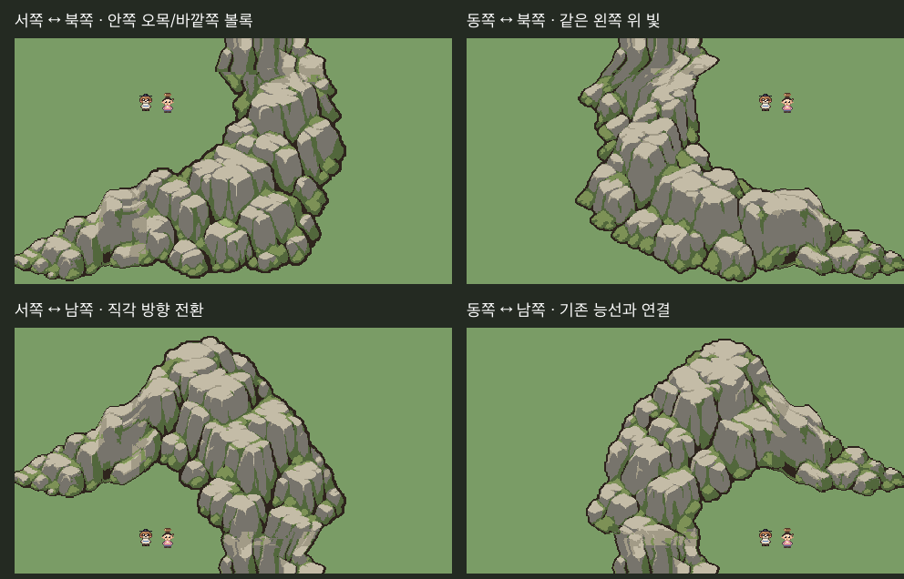

# 산맥 2b — 직각 방향 전환과 모서리

**그림 승인 대기 / 검토 전용 / 본편 미적용**.

사용자 “좋아. 더 진행할 작업 있어?”로 S2a 완만한 굽힘2종과 제출 배치를 승인받아 `Approved/MountainRange-S2a`에 PNG/Aseprite·검토판·RGBA지문을 동결했다. 후속 “계속 진행해줘.”에 따라 남북 능선과 직각 방향 전환을 제작했다.



각 모서리는 **안쪽 오목한 빈 공간과 바깥쪽 볼록한 암반 윤곽을 함께 갖는 독립 조립 조각**이다. 서↔북, 서↔남, 동↔북, 동↔남으로 이어진다. 이 조각을 이용하면 같은 빛 방향을 유지하면서 능선의 진행 방향을90도 바꿀 수 있다. 모서리 두 팔은 별도 암반을 겹쳐 가린 것이 아니라 새로 만든 하나의 암반 형태다.

[직선·완만한 굽힘·직각 모서리 혼합 조립 전체](unity-mixed-784x784.png)

위 네 장은 **Unity Edit 임시 씬의480×270 근접 화면**으로 연결된 남북 능선은 카메라 밖으로 계속된다. 전체 링크는 같은16px/PPU16을 유지해 더 넓은 영역을784×784로 촬영한 새 화면이다. 에셋을 축소해 한 장에 끼워 넣은 것이 아니다. 실제 플레이 검사는 아니다.

## 새 원본7종

| 조각 | 크기 | 역할 |
|---|---|---|
| north-cap | 192×128 | 남북 능선의 북쪽 끝 |
| north-south-body | 192×192 | 남북 반복 중앙 |
| south-cap | 192×128 | 남쪽 끝 |
| turn-w-n | 256×256 | 서쪽과 북쪽 연결 |
| turn-w-s | 256×256 | 서쪽과 남쪽 연결 |
| turn-e-n | 256×256 | 동쪽과 북쪽 연결 |
| turn-e-s | 256×256 | 동쪽과 남쪽 연결 |

기존 동서 능선이나 굽힘을 회전/반전하지 않았다. 내장 imagegen으로 남북 마스터1개·방향별 모서리4개를 새로 제작했고 `AI/`에 원화와 프롬프트5쌍을 보관했다. 참조는 승인한 S1 능선과 독립 돌산의 재질·큰 면·왼쪽 위 빛이다.

## 제작과 연결 규격

`Tools/ArtTrials/mountain_range_s2b.lua`에서 native 격자·기존 이끼바위7색·이진알파로 정리한다.

- 남북 원본192×448은 처음부터 북쪽 끝128px·중앙192px·남쪽 끝128px로 나누는 조립 마스터다. 공통 가로 단면은 밝은 봉우리 대신 y296의 낮은 암반 면에서 선택했다. 조각의 양 끝을 Aseprite 제작 단계에서 정리해 `north-south-port.*`와 일치시켰다.
- 새 모서리는 동서 원본과 암벽 두께가 맞도록 원화 프롬프트의 임시256px 목표보다 큰384×384 조립 마스터로 정리했다. 이 마스터에서 계속 이어지는 두 팔의 역할 영역256×256을 내보내고, 동서/남북 접속부를 native 원본에서 정리했다. `*-source-master.*`·`*-before-ports.*`로 과정을 보존한다. **기존 승인 산을 잘라 쓰는 작업이 아니다.**
- 동서 접속은 동결된 S1의16×192 단면을 그대로 쓴다. 남북은 새192×16 단면이다. 각 조각의 포트 방향·로컬 좌표는 `catalogue.json`에 있다.
- 맵/Unity에서는 완성PNG를 제자리 배치한다. 확대/축소·회전·반전·색 바꾸기·잘라 쓰기·겹쳐서 접속 숨기기를 하지 않는다.
- 남북 마스터의 끝3개를 재조립하면 정리 후 마스터와 RGBA가 같다. 독립 개체인 옛 승인 암반은 바꾸지 않았다.

## 검사 결과

`Tools/ArtTrials/mountain_range_s2b.py` 실행:

- 새7종 크기·기존 팔레트·이진알파 통과, Aseprite7개 재출력 디코딩RGBA 일치.
- S1/S2a/S2b 전체 라이브러리에서 서로 맞는 방향·같은 규격의 **접속65쌍**이 공통 단면과RGBA 일치. 이는 접속 단면 검사이며65가지 전체 산맥 배치를 승인했다는 뜻이 아니다.
- 새 조각의 두 접속 중심이 같은 연결된 암반 덩어리에 속함. 네 모서리의 안쪽 샘플 영역에 오목한 빈 공간이 유지됨.
- S1/S2a 승인본 픽셀 지문 불변, 남북 원본 재조립 일치.
- Unity Edit:480×270 네 장+784×784 한 장 생성 성공. 배치 목록의 참조 합성과 전체프레임RGBA차이0, 콘솔오류0. 원래씬 복귀·dirty상태 유지·본편쓰기0.

PNG 동일성은 파일 바이트 대신 크기와 디코딩RGBA로 비교한다. 검사 요약은 `checks.json`과 `Docs/Validation/MountainRange-S2b-2026-10-29.md`다.

## 현재 범위

현재 것은 **능선의 진행 방향을 바꾸는 모서리 세트**다. 안쪽/바깥쪽 윤곽은 각 모서리에 함께 들어 있다. 임의의 넓은 산악 영역을 중앙·내/외곽 타일로 채우는 범용 오토타일 세트는 아니다. 네 방향 그림을 각각 확인받는다.

갈림·고개·계곡·수원/폭포·실제 고도와 통행 기능은 아직 없다. 실제 플레이·이동·충돌·가림동작·전체회귀·빌드 미실행. 기존 본편 맵/씬/공용 파일 미변경. 모서리 표현 승인 후 다음 갈림·고개·계곡 단계로 진행한다.

## 재생성

```sh
aseprite -b --script-param root="$PWD" --script Tools/ArtTrials/mountain_range_s2b.lua
python Tools/ArtTrials/mountain_range_s2b.py
```

Python이 배치JSON/TSV·카메라목록·참조합성·검토판·보고서를 만든다. `unity-review.cs.txt`를 Unity execute_code에서 실행한 뒤 Python 검사를 다시 실행한다. 생성물만 손으로 고치지 않는다.
