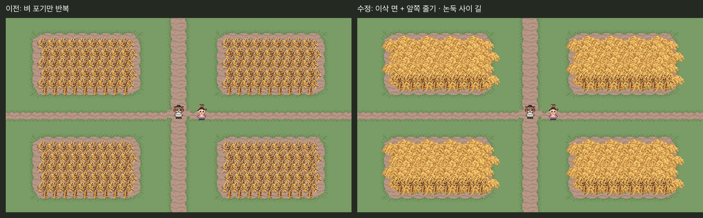

# 논 v5 — 이삭 면과 앞쪽 줄기

상태: **초원 위 완성 논 구획 그림 승인 (2026-10-29) / 본편 미적용**.

사용자 “훨씬 낫네.”를 제출한 초원 배치의 그림 승인으로 기록했다. `ArtReview/Approved/RiceField-v5`에 완성 구획·이삭 군집·앞줄 벼의 PNG/Aseprite와 Unity 검토 그림·RGBA 지문을 동결했다. 다른 크기·모듈 조합의 실제 배치는 별도 검토한다.

사용자 “흙보다는 초원에 두는게 낫겠는데.” 반영: 벼 아래 흙 구획만 제거했다. 벼 그림·밀도·위치·구획 사이 길·캐릭터는 그대로다. 최신 검토는 [흙/초원 Unity 비교](grass-comparison.png)와 [초원 Unity480×270](unity-grass-480x270.png). `unity-grass-review.cs.txt`로 재촬영한다. 이전 흙 배치와 비교 그림은 기록으로 보존했다.

사용자 “이게 논으로 보이는 것 같아? 검토해봐.” → “수정해봐.”에 따른 검토본이다.
v4의 포기 반복은 어두운 줄기가 논 전체에 드러나 황금 풀밭처럼 읽혔다.
새 내부용 이삭 군집을 전체 형태로 겹쳐 황금색 면을 만들고, 앞쪽 한 줄에만 기존 v3 벼 포기를 온전히 배치했다.
초가 지붕의 금색 3개를 포함한 6색 / 64×48 native 이삭 군집과 32×32 기존 벼를 쓴다.
논 안쪽의 이삭 곡선 반복을 포함해 제출한 완성 구획 표현을 승인받았다.



- [수정본 Unity 480×270](unity-after-480x270.png): 네 구획과 기존 흙길·풀 경계, 플레이어·사람 NPC. 기존 승인 지형 타일만 사용했다. 경작지 사이 풀 공간을 논둑으로 읽히게 한 배치 시험이며 새 논둑 에셋/수로는 만들지 않았다.
- 비교 왼쪽은 **같은 작은 구획에 기존 벼 v3를 v4의 14px 간격으로 배치한 대조군**이다. 이전 v4 캡처를 그대로 재사용한 것은 아니다.
- Unity **Edit 모드 임시 씬 렌더**다. 본편 맵의 실제 플레이 캡처가 아니다. 촬영 뒤 원래 씬을 복구했고 씬 dirty 상태는 유지했다. 본편 쓰기 0, 콘솔 오류 0.
- `canopy-ai.png` / `prompt.txt`: imagegen 원화와 참조 지시. `canopy.aseprite` / PNG: nearest native 격자·6색 정리본.
- `small-plot.*`: 논리 8×4칸인 완성 구획. 외부 여유까지 192×128px. 검토 화면에서 네 번 배치했다.
- `Native/`: 논리 4×4칸 반복 중앙·외곽 가장자리·모서리 9종. 외곽 여유 좌우32/위48/아래16px. **최소 2×2블록 직사각형 전용**이며 비정형/안쪽 모서리/좁은 끝 연결은 미구현이다.

재생성:

```sh
aseprite -b --script-param root="$PWD" --script Tools/ArtTrials/rice_field_canopy.lua
python Tools/ArtTrials/rice_field_canopy.py
```

Unity 촬영은 `unity-review.cs.txt`를 execute_code로 실행한다. 실행 중인 원본 씬과 본편 에셋을 저장하거나 고치지 않는다.
배치 목록 TSV/JSON은 위 Python에서 생성하며 생성물을 손으로 고치지 않는다.

검사: 5가지 크기에서 모듈 조립과 전체 군집 직접 배치의 디코딩 RGBA 일치, 이진 알파·6색, Aseprite18개 재출력 RGBA 일치. Unity 전후480×270 전체 프레임이 같은 배치 목록의 참조 합성과 RGBA 일치.
이동·충돌·가림·바람 애니메이션·빌드·본편 통합 검사는 하지 않았다. PNG 파일 바이트는 비교하지 않는다.
