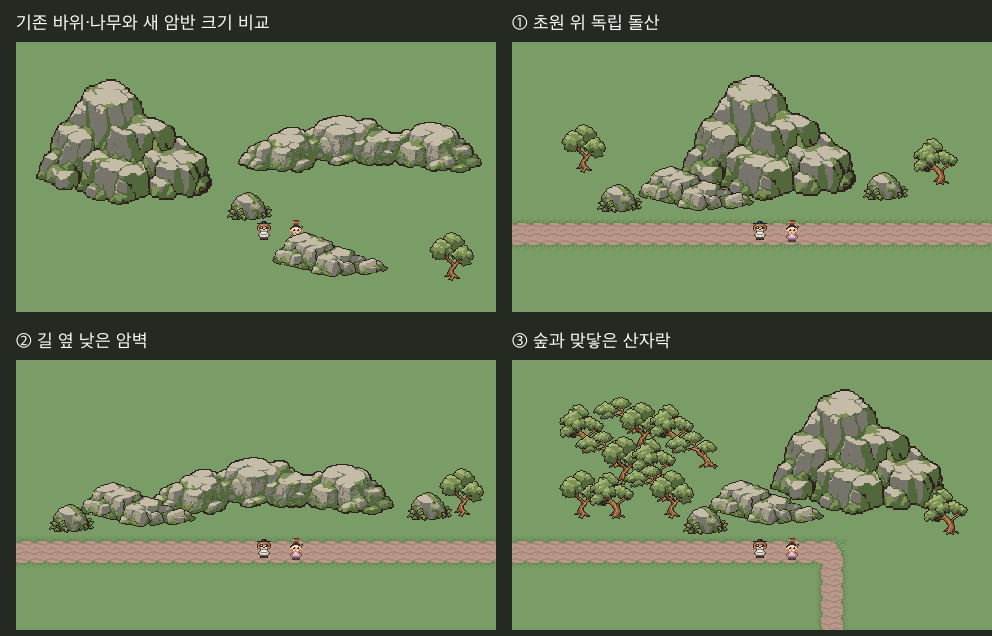

# 돌산·암벽·산자락 v1

**그림 승인 대기 / 본편 미적용**. 사용자 “한번 만들어봐.”에 따른 첫 형태·크기 시험이다.



왼쪽 위는 기존 이끼바위·나무·캐릭터와 새 암반의 크기 비교다. 나머지는 독립 돌산, 길 옆 낮은 암벽, 숲과 맞닿은 산자락이다. 각 장면은 Unity **Edit 모드 임시 씬 480×270** 렌더이며 실제 플레이 장면이나 기존 본편의 전후 비교는 아니다.

## 원본과 정리

내장 imagegen 사용. `AI/*-prompt.txt`에 프롬프트3개, `AI/*.png`에 원화3개를 저장했다. 참조는 기존 `Approved/C7-LowNature-v1/moss_rock.png`의 재질과 `Docs/Images/team-style-reference.png` 윗부분 베네치아·아라비아의 큰 면·단순 명암이다.

Aseprite에서 원화의 불투명 전체 실루엣을 유지하며 nearest native 격자·공용색으로 정리했다. 투명 여백만 제외하고 비례를 보존했다. 캐릭터와 나란히 놓았을 때 큰 돌산으로 읽히게 native 크기를 원화 프롬프트의 임시 목표보다 크게 정했다. 맵 배치/Unity에서는 크기·색·회전을 바꾸지 않는다.

| 원본 | Native 캔버스 | 실제 불투명 영역 | 용도 |
|---|---|---|---|
| mountain | 192×160 | 176×126 | 여러 층의 큰 암반·독립 돌산 |
| ridge | 256×112 | 244×58 | 길 옆으로 길게 놓는 낮은 암벽 |
| foothill | 128×80 | 116×45 | 풀밭·숲으로 낮아지는 산자락 |

기존 이끼바위에 실제 쓰인 7색만 사용했다. 회색3단계·짙은 갈색 외곽·녹색3개, 이진 알파. 각 `Native/*.png`와 `.aseprite`는 온전한 개체이며 잘라 쓰지 않는다. 산자락은 이 목적의 완성 암반으로 큰 돌산 앞에 일부 겹쳐 배치했다.

## 범위와 제한

- 바닥은 기존 단색 초원과 흙길 조립 타일이다. 새 회색 지면·흙 테두리를 만들지 않았다.
- 숲은 기존 승인 나무를 전체 형태로 겹쳤다. 실제 생성기·본편 맵·기존 산악/충돌/강 흐름은 바꾸지 않았다.
- **연결용 타일 세트가 아니다.** 자유로운 산맥 연결, 반복 중앙, 안팎 모서리, 끝, 고도 전환, 통로, 수원·폭포 연결부는 아직 없다. 이 원화에서 일부를 잘라 연결 조각으로 쓰지 않는다. 형태 승인 후 별도 제작·검토가 필요하다.
- 돌산이 실제 산악지대로 충분히 읽히는지와 기존 나무·캐릭터 대비 크기는 사용자 검토 대상이다. 기술 검사로 그림 승인을 대신하지 않는다.

## 재생성과 검사

```sh
aseprite -b --script-param root="$PWD" --script Tools/ArtTrials/rock_mountain.lua
python Tools/ArtTrials/rock_mountain.py
```

`Tools/ArtTrials/rock_mountain.py`가 배치 JSON/TSV·참조 이미지·검토판·`checks.json`을 만든다. 생성물을 손으로 고치지 않는다. `unity-review.cs.txt`를 Unity execute_code에서 실행해 네 장을 촬영하고 Python 검사를 다시 실행한다.

실행 결과: 크기·기존 바위 팔레트·이진알파 통과, Aseprite3개 재출력 디코딩 RGBA 일치, Unity4장 전체 프레임이 동일 배치의 참조 합성과 RGBA 일치. Unity 실행 성공·콘솔 오류0, 촬영 후 원래 씬 복귀·dirty 상태 유지·본편 쓰기0.

실제 플레이·이동·충돌·가림 동작·본편 통합·빌드 검사는 하지 않았다. PNG 동일성은 파일 바이트 대신 크기와 디코딩 RGBA로 검사했다.
