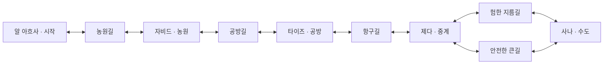

# 2단계 — 아라비아 지역 설계와 첫 구현 명세

2026-10-20 · 로컬 기반 설계 v0.1

최신 사용자 지시: 외부 연결을 더 진행하지 않고 제공된 로컬 프로젝트를 기반으로 진행한다. GitHub 최신 상태를 이번 작업의 선행 조건으로 삼지 않는다. 이 문서는 구현할 명세이며 Unity에 적용된 결과가 아니다. 세부 수치는 실험값으로 구분한다.

## 1. 지역 전체 범위

수도1+마을4+길5 = 설계상10개 씬. 첫 구현은3개 씬만 만든다. 최종 거점 수를 축소한 것이 아니다.

실제 지명은 시나리오의 후보를 유지한다. 현실의 도시 규모·정치적 위계·지리적 인접성을 재현한 지도가 아니다. 역할과 상품은 게임상 각색이며 근거는01 문서에 있다. 수도 접근 자체를 신용으로 잠그지 않는다.

## 2. 맵·거점 목록

좌표는 지역 내부 설계용 상대 좌표다. 기존 지역과 중복되므로 공용 등록부에 그대로 넣지 않는다. 첫 구현용 복사본에서 기존 등록 좌표를 검사한 뒤 전체에 동일한 정수 오프셋을 더해 비어 있는 영역에 배치한다. 이는 로컬 시험 배치이며 팀 좌표 합의가 아니다. 배치 후 TownData와 등록 좌표를 일치시킨다. 타지역 상품 가격 영향도 확인한다.

| mapId = 씬 파일명 | 표시명 | 상대좌표 | 종류/등급 제안 | 제작 차수 |
|---|---|---|---|---|
| arabia_ahsa | 알 아흐사 | 0,0 | 시작마을/1 | 1 |
| arabia_farmroad | 농원길 | 1,0 | 길 | 1 |
| arabia_zabid | 자비드 | 2,0 | 농원마을/1 | 1 |
| arabia_workshoproad | 공방길 | 3,0 | 길 | 2 |
| arabia_taiz | 타이즈 | 4,0 | 공방마을/2 | 2 |
| arabia_portroad | 항구길 | 5,0 | 길 | 2 |
| arabia_jeddah | 제다 | 6,0 | 중계마을/2 | 2 |
| arabia_shortcut | 험한 지름길 | 7,0 | 짧은 길/감속·도적 | 3 |
| arabia_sanaa | 사나 | 8,0 | 수도/3 | 2 |
| arabia_highroad | 안전한 큰길 | 7,1 | 긴 길/안정적 노면 | 3 |

큰길과 지름길이 각각 씬1개여도 실제 걷는 거리·노면·위험을 다르게 설계한다. 씬 수가 같다는 이유로 같은 길이라고 판단하지 않는다. 현재 경제 거리는 좌표의 맨해튼 거리이며 실제 이동 시간과 같지 않다.

### 시설과 시장

| 거점 | 시작부터 사용 가능 | 신용 해금 후보 | 교역 역할 |
|---|---|---|---|
| 알 아흐사 | 기본시장·게시판·Rest | 없음 | 대추야자 공급, 곡물 소비 |
| 자비드 | 기본시장·게시판·Rest | 없음 | 곡물 공급, 대추야자 소비 |
| 타이즈 | 기본시장·게시판 | RouteInformation 신용C1 | 직물 공급, 생활식량 소비 |
| 제다 | 기본시장·게시판·공통손수레 판매 | Warehouse 신용C2 | 중간 판매·수송 거점 |
| 사나 | 기본시장·게시판 | Warehouse 신용C3 | 여러 산지 상품의 소비처 |

C1≤C2≤C3는 변수이며 숫자는 플레이 평가 후 결정한다. minTier는 실제 settlementTier 이하로 배정한다. 기본시장/퀘스트/이동은 잠그지 않는다. 기존 FacilityKind는 Rest/RouteInformation/Warehouse뿐이다. ‘상인회·고급 거래소’가 이미 있는 시설이라고 가정하지 않는다.

## 3. 출구·스폰 계약

- 시작 스폰은 `S0`를 유지한다. 경계 도착 스폰은 `arabia_<맵약칭>_spawn_w_01` 형태를 사용한다.
- 출구 target은 목적 씬 이름, spawn은 목적 씬의 도착 스폰 ID다.
- 출구 논리 이름과 런타임 id 지원을 혼동하지 않는다. 현재 연결표는 제작 원본으로 유지한다.
- 타일 경계 범위·통로 폭은 실제 맵 크기를 정한 뒤 채우고, 채우기 전 빌드 가능 명세라고 보고하지 않는다.

| 출발 | 출발 경계 | 목적 씬 | 목적 스폰 | 역방향 |
|---|---|---|---|---|
| arabia_ahsa | 동 | arabia_farmroad | arabia_farmroad_spawn_w_01 | 농원길 서→알 아흐사 동 스폰 |
| arabia_farmroad | 서 | arabia_ahsa | arabia_ahsa_spawn_e_01 | 위 행과 한 쌍 |
| arabia_farmroad | 동 | arabia_zabid | arabia_zabid_spawn_w_01 | 자비드 서→농원길 동 스폰 |
| arabia_zabid | 서 | arabia_farmroad | arabia_farmroad_spawn_e_01 | 위 행과 한 쌍 |

확장 연결은 자비드↔공방길↔타이즈↔항구길↔제다↔지름길↔사나를 동/서 경계로 연결한다. 큰길은 제다·사나의 북쪽 출구에서 각각 연결하며, 큰길 씬의 서쪽·동쪽 도착 위치를 실제로 검수한다. 큰길 위치는 상대좌표7,1이지만 JSON 타일y와 Unity 셀y의 방향은 반대임을 주의한다.

첫 구현에는 아직 없는 공방길·외부 지역으로 연결되는 출구를 만들지 않는다. 안내 문구로 준비중이라고 표시해도 보이지 않는 출구 트리거는 두지 않는다.

## 4. NPC·상품·퀘스트 ID 계약

### NPC

| ID | 인물/기능 | 맵 |
|---|---|---|
| arabia_hasan | 길잡이 하산 | arabia_ahsa |
| arabia_maryam | 여관 주인 마리암/Q2 | arabia_ahsa |
| arabia_hindbad | 짐꾼 힌드바드/Q1 | arabia_ahsa |
| arabia_kitchen_keeper | 공동 부엌 담당/Q1 수령 | arabia_zabid |
| arabia_salma | 창고 관리인/Q3 | arabia_taiz |
| arabia_nadia | 먼 마을 의뢰인/Q4·Q5 수령 | arabia_sanaa |
| arabia_rashid | 라이벌/Q6 | arabia_taiz |
| arabia_yusuf | 수레 장인/Q7 | arabia_jeddah |
| arabia_dispatcher | 물류 담당/Q4·Q5 제안 | arabia_jeddah |
| arabia_redcord_leader | 도적 두목 | arabia_shortcut |

Q4의 의뢰인은 나디아지만 수락은 제다의 물류 담당이 대행하도록 구체화한다. 목적지에 먼저 가야 의뢰를 받을 수 있는 불필요한 왕복을 줄인다. 시장 상인은 공용 market 구조를 사용하고 QuestNpc를 무조건 복제하지 않는다.

### 상품

| ID 제안 | 표시명 | 구분 | 공급 거점 | 쓰임 |
|---|---|---|---|---|
| arabia_dates | 대추야자 | 거래품 | 알 아흐사 | 자유 교역 |
| arabia_grain | 곡물 꾸러미 | 거래품 | 자비드 | Q2·생활 수요 |
| arabia_cloth | 직물 꾸러미 | 거래품 | 타이즈 | Q6·자유 교역 |
| arabia_delivery_dates | 맡긴 대추야자 | questItem=true | 없음 | Q1 전용, 판매 불가 |
| arabia_delivery_cloth | 맡긴 천 꾸러미 | questItem=true | 없음 | Q4·Q5 기본 후보 |
| arabia_extra_bundle | 확인이 필요한 꾸러미 | 의뢰 전용 후보 | 없음 | Q3, 소유/회수 처리 추가 후 |

기존 상품과 의미·산지·가격이 완전히 같다면 공통품 재사용을 우선한다. 위 표의 지역품은 별도 산지/거래 역할을 전제로 한 제안이다. Q3·Q4·Q5가 같은 품목을 쓸 경우 한 의뢰의 짐으로 다른 의뢰를 충족하는 문제가 없는지 검사한다. 해결 전에는 의뢰별 전용품 분리를 검토한다.

## 5. 첫 구현 — Q1·Q2 데이터 명세

금액·무게·수량은 실험값이다. 공용 수치 변경 없이 아라비아 데이터 안에서 검증한다.

### Q1 `arabia_q01_first_delivery`

- giverNpc: arabia_hindbad
- requires: 없음
- giveItem: arabia_delivery_dates, giveCount: 2
- 의뢰품 무게 후보: 개당2. 빈 등짐의 실제 capacity가4 이상인지 검사.
- objectives: Deliver(item=arabia_delivery_dates, count=2, targetId=arabia_kitchen_keeper)
- rewardMoney 후보: 20, rewardCredit 후보: 1
- 납품 대사: “기다리던 짐이구나. 네 이름도 장부에 적어 둘게.”
- 미수락/수락/완료에서 표식과 짐 수량이 맞아야 한다. 재대화로 보상을 반복 수령하면 실패.

### Q2 `arabia_q02_supper`

- giverNpc: arabia_maryam
- requires: arabia_q01_first_delivery
- objectives1: Buy(item=arabia_grain, count=2, targetId=arabia_zabid)
- objectives2: Deliver(item=arabia_grain, count=2, targetId=arabia_maryam)
- rewardMoney 후보: 30, rewardCredit 후보: 1
- 곡물 무게 후보: 개당1. basePrice 후보: 5. originTown=자비드.
- 초기 자금은 현재 공통 시작값을 확인하고, Q1보수와 합쳐 실제2개 구매비를 낼 수 있는지 검사한다.
- basePrice5가 상점 실제구매가5라는 뜻은 아니다. 재고·매매 보정 적용 후 구매비가30 미만인지 확인한다. 그렇지 않으면 지역 재고/보상을 조정하고 다시 측정한다.
- 반드시 수락 이후 구매 이벤트를 검증한다. 미리 산 재고가 있으면 구매단계가 자동 통과하지 않는 현행 규칙을 안내하거나 별도 개선으로 남긴다.
- 납품에서 실제2개가 제거되고 보수는 한 번만 지급되어야 한다.

### 첫 씬 배치

알 아흐사: 입구S0→우물과 안내소→여관/게시판→힌드바드→동쪽 길이 보이게 배치. 시장·NPC가 출구를 막지 않도록 한다.

농원길: 첫 버전은 안전한 노면. 빈 짐·의뢰품 적재 상태의 속도를 비교할 수 있는 충분한 길이. 미구현 낙하/날씨 이벤트를 추가하지 않는다.

자비드: 서쪽 입구→Q1 수령NPC→곡물 시장을 가까이 배치한다. 초보자가 목표물을 찾으려고 마을 전체를 헤매지 않도록 한다.

## 6. 아트 제작 목록

| 우선순위 | 필요한 것 | 첫 구현 방식 | 후속 |
|---|---|---|---|
| P0 | 플레이어·NPC·땅·길·상점·퀘스트 표식 | 기존 공용 에셋을 임시 사용 | 최종 스타일 확정 후 교체 |
| P1 | 모래고양이 플레이어1종 | 기준 이미지→실제 해상도 비교 | 지원 방향·걷기 프레임 |
| P1 | 안내NPC·여관주인·짐꾼 | 사람NPC1안 대표 화면 | 역할별 변형 |
| P1 | 우물·천막·야자수·짐가방·바구니 | 작은 모듈 세트 | 마을별 팔레트 |
| P2 | 곡물·대추야자·직물 아이콘 | 공용 아이콘 대체 가능 여부 확인 | 전용 아이콘 |
| P2 | 수도/항구/공방 건물·장식 | 임시 프리팹 | 검증된 기준으로 확대 |
| 보류 | 낙타 탑승·대형초상화·새날씨 | 제작하지 않음 | 별도 후속 |

타일16px/PPU16·캐릭터16×24는 로컬 문서 기준이다. 임포터의 실제 설정을 확인하고 사용한다. AI 콘셉트 이미지를 그대로 스프라이트시트로 취급하지 않는다.

## 7. 구현 파일과 원본 관리

제안 경로(아직 생성되지 않음):

- `Assets/PocketCaravan/Data/Arabia/`: Region/Town/Item/Quest 에셋.
- `Assets/PocketCaravan/Maps/arabia_*.json`: 맵 JSON.
- `Assets/PocketCaravan/Scenes/Arabia/arabia_*.unity`: 생성 씬.
- `Assets/PocketCaravan/World/Regions/arabia.json`: 실제로 생성된 맵만 등록.
- `Tools/MapGen/arabia.py`: 생성기를 선택할 경우의 기준 원본.
- `Docs/Arabia/`: 이번 문서와 구현 기록을 개발 복사본에 보존.

공용 GameDatabase에는 기존 참조를 유지하며 추가한다. 자기 맵만 생성한다. ‘시작 세트 만들기’나 전체 재생성은 일반 실행 단계로 사용하지 않는다. 새 .meta를 함께 관리한다.

## 8. 첫 구현 완료 기준

1. Unity6000.3.26f1로 컴파일 성공, 시작맵에서 직접 이동 가능.
2. 알 아흐사↔농원길↔자비드 양방향 이동·도착 위치 정상.
3. Q1수락→2개 수령→납품→짐 제거→보수20/신용1 각1회.
4. Q1완료 전Q2 미노출, 완료 후 제안 가능.
5. Q2구매처·품목·수량 판정, 납품 보수와 실제구매비 차이가 양수.
6. 짐 부족·과적·돈 부족에서 오류 없이 이유 안내. 무료 배달 등 재기 통로 확인.
7. 비시작 씬Play의 저장 비활성화를 숙지. 복사본의 시작 정책을 명시적으로 정해 저장/로드 시험. 저장 파일은 시험용으로 분리해 기존 플레이 기록을 덮어쓰지 않음.
8. 기존 고려 등록·DB·시작 흐름 회귀 확인.
9. 실제검사와 미실행검사를 분리해 결과 기록.

다음은3단계 첫 플레이 구현이다. 이 단계에는 Q3분기·Q4특화·Q6순손익의 공용 기능 확대나 최종아트 제작을 끼워 넣지 않는다.
