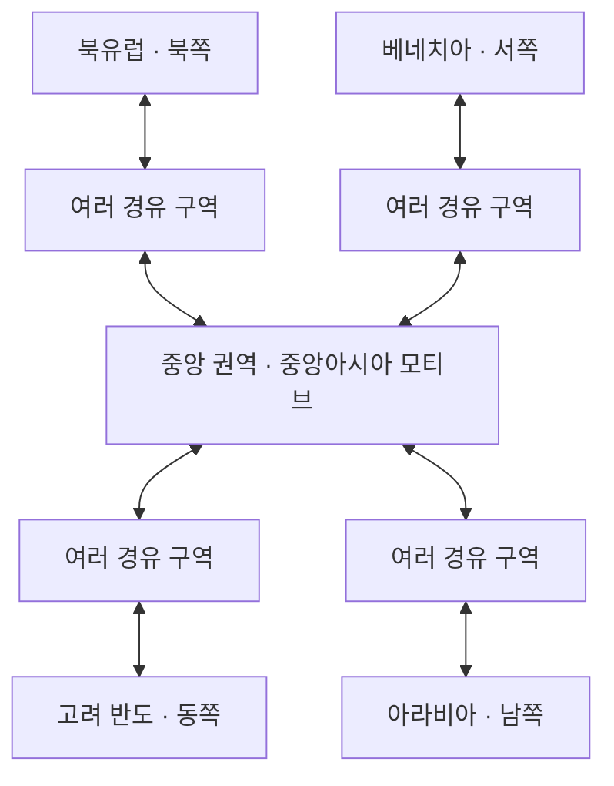

# 실크로드 세계 지리·교역망 기준

기준: 2026-10-22 사용자 보충 설명. **실제 지리의 형태와 환경을 알아볼 수 있게 각색하고, 거리·비율을 조정한 실크로드 교역 세계**를 만든다. 현재 실제 지형/19맵은 이 방향을 시험하는 초기 원본이며 최종 지형 확정본이 아니다.

## 프로토타입의 배치와 연결

| 방위 | 문명 권역 | 중앙까지의 이동 |
|---|---|---|
| 동쪽 | 고려: 한반도 모티브 | 북서쪽 육로로 반도에서 대륙으로 나와 여러 경유 구역을 지난다 |
| 북쪽 | 북유럽 | 북방 지형과 경유 마을을 지나 중앙으로 이어진다 |
| 서쪽 | 베네치아 | 서방 지형과 경유 마을을 지나 중앙으로 이어진다 |
| 남쪽 | 아라비아 | 남방 지형과 경유 마을을 지나 중앙으로 이어진다 |

프로토타입에서 **다른 문명으로 가는 여정은 중앙 권역을 경유**한다. 각 팔은 여러 개의 맵/마을/길로 구성한다. 팔 안에서는 지형·짐·수단·교역 목적에 따라 오솔길/큰길·경유지를 선택할 수 있다. 수도와 중앙을 한 출구로 직결하지 않는다.

중앙은 여러 길이 합류하는 **권역**이다. 중앙 맵 한 장을 완벽한 십자 도로로 만들거나 각 경계에 출구를 하나씩 두어야 하는 규칙이 아니다. 구역 안의 실제 길은 산·강·마을에 맞춰 굽고 갈라진다. 지역 내부의 북서쪽 출구와 세계 전체에서 동쪽에 위치한 문명이라는 구분을 유지한다.

## 지리와 축척

- 한반도의 남북으로 뻗은 반도와 대륙 연결, 해안·산지·강변·초원·건조 내륙 등 상대적 형태와 환경 변화가 여정에서 읽혀야 한다.
- 모든 지역에 같은 축척을 강제하지 않는다. 넓은 대륙 이동은 압축하고 중요한 고개/교역 거점/길 선택은 확대할 수 있다. 각 구역의 모양·면적·거리는 반복 이동 피로와 경유 선택을 보며 조절한다.
- 사각 맵 배열만으로 지리를 정하지 않는다. 실제 출구, 지형 지도, 이정표, 환경 전환이 같은 방향과 연결을 설명해야 한다. 지도는 실제 플레이 타일만 축약하며 미제작 범위는 빈 종이로 표시한다.
- 현실과 비슷한 지리 인상을 지향하지만 실제 해안선/국경/실측 거리/단일 역사 노선의 완전한 재현을 뜻하지 않는다. 별개의 시대 해석과 건축·복식 등의 고증 기준은 기존 문서를 유지한다.
- 경제용 worldCoord는 현재 가격 계산용 논리 좌표다. 지리 재배치 때문에 임의로 뒤집지 않는다. 향후 실제 경유 거리 기반 경제로 변경할 때는 별도 밸런스 작업으로 다룬다.

## 구현 상태와 확장

현재는 고려13구역과 내륙 경유6구역이 구현되어 있다. 북·서·남 방향은 위 배치를 따르는 **계획**이며 다른 팀의 지역을 중앙에 통합했다고 표시하지 않는다. 구체적 접속 위치·중간 구역 수·거리와 환경 원본은 각 담당의 실제 제작물과 대조해 정한다.

장기적으로 여러 도시·마을과 대안 루트가 얽힌 거미줄 교역망을 확장할 수 있다. 다만 프로토타입의 중앙 경유 원칙을 다른 문명끼리 우회 직결하는 것으로 임의 변경하지 않는다. 중앙을 우회하는 문명 간 노선은 이후 단계에서 별도 판단한다.

실행/편집 원본과 현재 검토 화면은 [고려 반도~내륙 연결](CentralConnection.md), 협업 기준은 [통합 계약](../Reference/TeamIntegrationContract.md), 방향별 명세는 `Assets/PocketCaravan/World/Connections/central_ports.json`을 따른다.
