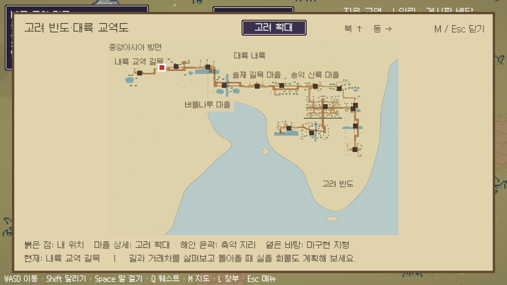
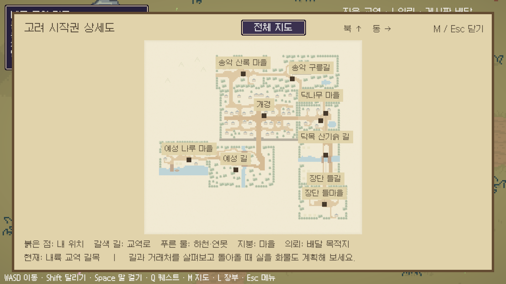
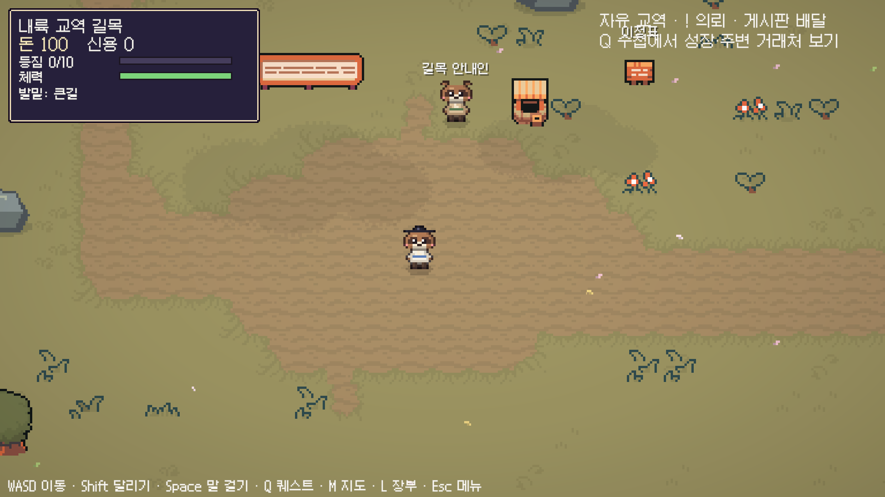

# 고려 반도→대륙 내륙·중앙아시아 방면

최신 방향: 2026-10-22. **한반도에서 북서쪽 육로로 대륙에 진입해 중앙아시아 방면으로 이동하는 형태**로 수정한다. 고려는 동쪽의 반도 권역이다. 이전의 장단 남서쪽 연결과 문자 그대로 중앙 십자 도로를 만든 배치는 대체한다.

십자형은 동·서·남·북 문명과 중앙 권역 사이의 전체 교역망 구조다. 한 맵에 반드시 네 출구/십자 도로를 만드는 규칙이 아니다. 각 방향은 여러 경유 구역으로 연결하며 장기적으로 거미줄 교역망으로 확장한다.

## 실제 이동과 지도

`고려 나루 → 예성 길 → 개경 → 북쪽 송악 산록 → 서쪽 솔바람 고개 → 솔재 길목 → 버들 물가 길 → 버들나루 → 초원 진입로 → 내륙 교역 길목`

- 대륙 출구를 장단에서 **고려 북서부 송악 산록의 서쪽**으로 옮긴다. 남쪽 장단은 농업 교역 생활권으로 남는다. 고려의 수도1+마을4·산록 순환과 시장ID는 유지한다.
- 본편은 고려9맵+중간권6맵=15맵, 왕복 방향을 각각 센 등록 출구30개다. 송악에서 내륙 길목까지6개 맵 경계를 넘는다. 중앙아시아까지의 실제 거리를 그대로 걸리는 시간으로 구현한 것은 아니다.
- 지형 지도에 바다·남북으로 뻗은 반도·북서쪽 대륙 연결을 표시한다. 고려9맵은 반도 전체를 채운 것이 아니라 현재의 수도 주변 시작권이다. 남부 반도 윤곽과 주변 대륙의 옅은 바탕은 미래 확장 배경이며 플레이 구역으로 세지 않는다. 길·건물·현재 위치는 실제 생성 맵과 출구를 따른다.
- 전체 지도에서도 고려는 내륙 길목의 동남쪽에 있다. 북·서·남 문명과 추가 경유 맵은 아직 미연결이다. 다른 지역 담당의 작업을 덮어쓰지 않는다.
- 숲 고개→마을·강변→건조 초원/바위 길목으로 변화를 준다. 기존 환경 라이브러리의 steppe 스킨을 새2맵에 재사용한다. 선인장 사막으로 중앙아시아 전체를 표현하지 않는다. 현재의 건물·동물NPC는 임시 자산이며 해당 문화의 최종 아트가 아니다.
- 오솔길/수레 큰길의 노면 등급과 이동 수단 수치를 유지한다. 신규 시장·상품·전투·날씨·국경 관문 퀘스트를 추가하지 않는다. 쉼터는 별도의 유료 시설/시장으로 간주하지 않는다.

## 수정·확장·협업 원본

| 변경 대상 | 원본 |
|---|---|
| 고려 북서쪽 대륙 출구/마을 내부 길 | `Tools/MapGen/goryeo_villages.py` |
| 여러 경유 구역/초원 길목 | `Tools/MapGen/frontier.py` |
| 해안 윤곽·지명 주석·세계 범위 | `Assets/PocketCaravan/World/Cartography/peninsula.json` |
| 지도 렌더링/출구 정렬 | `Tools/MapGen/cartography.py` |
| 외형 스킨 | `Tools/MapGen/Modules/skins.py`, `Map.apply_visual_skin` |
| 방향별 미래 교역망 | `World/Connections/central_ports.json` |
| 맵/씬 등록 | `World/Regions/*.json` |

생성 순서는 MapGen export→맵/지도/연결 검사→변경 씬만 BuildSelected→Play 이동/화면 확인이다. 해안 프로필은 개경 맵을 기준으로 붙는다. 다른 담당 지역을 이 지도에 추가할 때 해당 지역의 지형/방위와 프로필 범위를 다시 대조한다. 중앙 길목의 기존 내부ID `transit_crossroads`는 보존하지만 이름을 도로 모양 규칙으로 해석하지 않는다.

**경제용 worldCoord는 지리적 방위가 아니다.** 기존 마을 좌표와 재고/가격/상품ID를 보존한다. 맵을 지도상 서쪽으로 옮겼다는 이유로 가격 계산용 좌표를 뒤집지 않는다. 새 길의(9,0)/(9,1)은 임시 논리 좌표다.

현재 해안선·지명 간 거리·경유지는 게임용 축약이다. 고려를 한 연도의 국경 복원으로 바꾸거나 실제 실크로드의 단일 노선을 재현했다고 주장하지 않는다. 시대 해석은 [고려 설계 검토](GoryeoDesignReview.md)를 유지한다.

## 확인 방법

Unity `Pocket Caravan → 중앙 연결 → 내륙 교역 길목 열기` 후 Play하면 저장과 분리해 직접 비교한다. 동쪽 길을 거슬러 송악으로 돌아온 뒤 개경/나루에 갈 수 있다. 전체 플레이는 Naru에서 시작하며 M 지도와 이정표를 이용한다. 전체 지도는 반도·대륙과 주요 경유지를, `고려 확대`는 수도/4마을/길의 상세 이름을 표시한다.

`Pocket Caravan → Tests → 고려~중앙 출구 왕복 검사`는 활성 퀘스트가 없는 비시작 Play에서 사용한다. 여섯 경계의 실제 출구를 세 칸 폭으로 왕복하며 재산/화물/배달 보존을 확인하고 메모리를 복구한다. 사람이 전체 여정을 걸은 시험이나 온라인 부하 시험은 아니다.

지도 맵 겹침·출구 정렬·전체 구역 육지 배치·북서쪽 대륙 진입·미개방 문명으로 가짜 출구 없음·외형 스킨 분리를 검사한다. 최종 수치/빌드/제한은 [검증 기록](Validation/CentralConnection-2026-10-22.json)과 [빌드 현황](BuildStatus.md)을 따른다. 이전 SaveGuard ZIP이나 중간 배치의 원시 빌드는 이 반도 버전을 포함하지 않는다.

## 검토 화면

