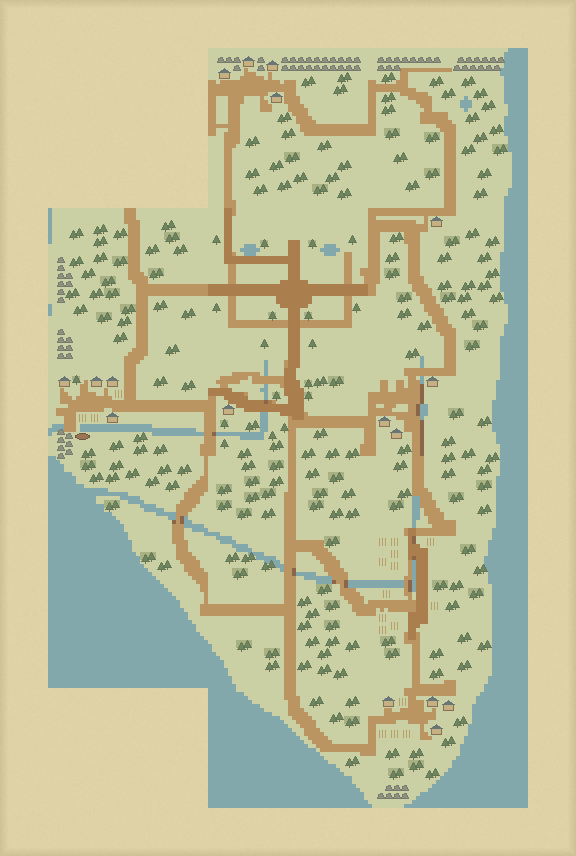
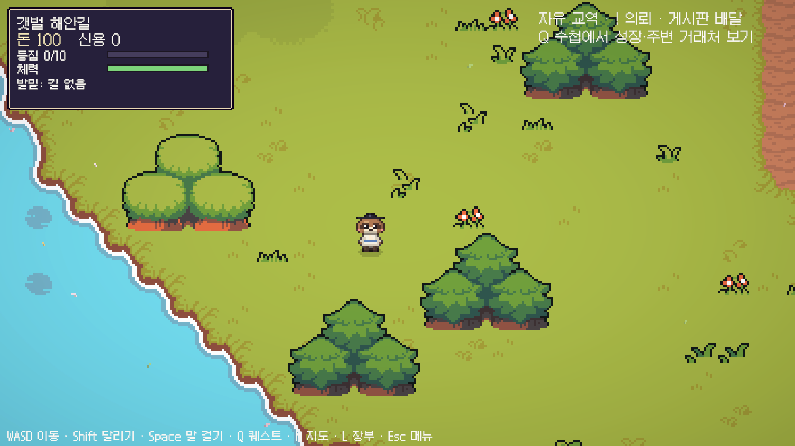
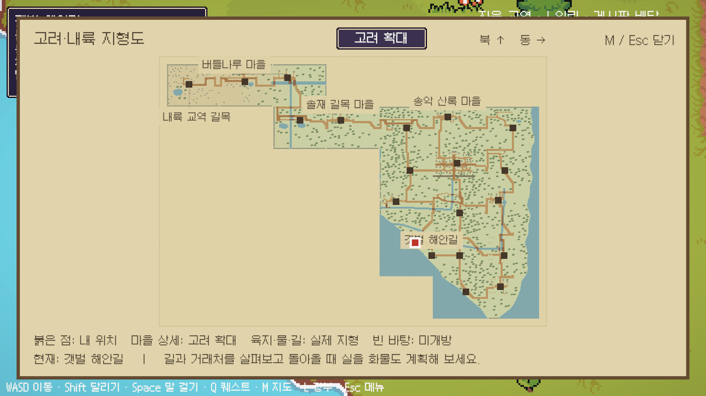
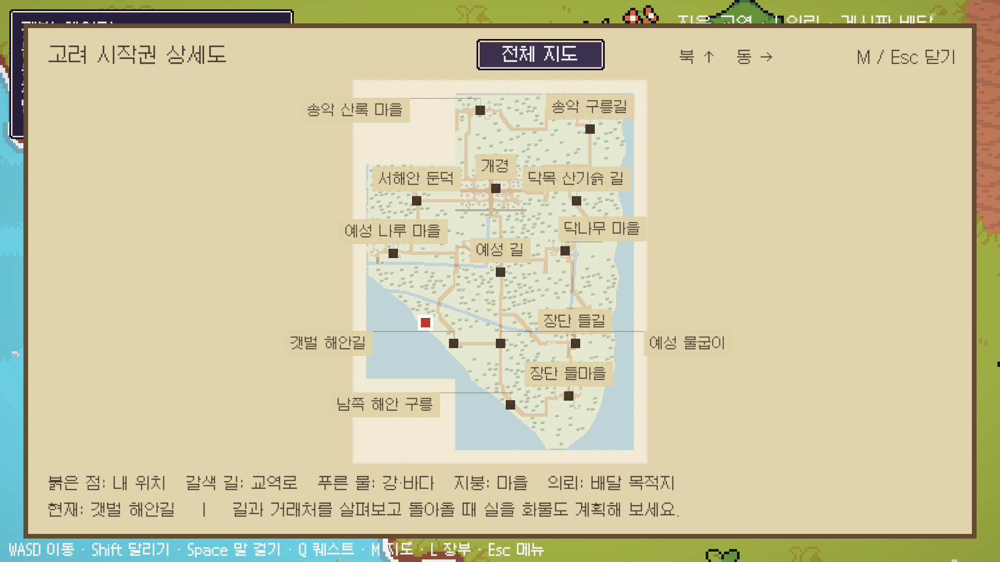

# 실제 지형과 일치하는 연속 세계

2026-10-22. 지도에 반도 배경만 덧그리던 이전 방식을 대체한다. **실제 플레이 타일을 공통 월드 좌표장에 만들고, 그 타일을 구역별 씬과 지형도로 함께 내보낸다.**

## 10/23 면적 계약 적용

아래80×64는10/22의 중간 제작 좌표다. 최신 결과는 `area_budget.json`과 `compact.py`를 거쳐 고려20,000+중앙 동쪽25,000칸으로 변환하며, 서로 맞닿은 열/행의 크기를 공유한다. 최종 실제 타일과 지도를 함께 생성한다. [현재 원본·범위·검증](GoryeoArtRenewal.md)을 우선한다.

## 현재 구조

고려13구역+내륙 경유6구역=19구역, 각80×64칸. 수도1+마을4는 유지하고 서해안 둔덕·갯벌 해안길·예성 물굽이·남쪽 해안 구릉 4개 지형 구역을 추가했다. 새 마을/시장/상품을 늘린 것은 아니다. 남북으로 길게 내려오는 반도, 서남쪽 하구·해안, 동쪽 해안과 북서쪽 대륙 진입이 실제 바다/강/육지 타일이다.

구역의 길 출구만 맞추던 구조 대신, 강과 숲 분포도 월드 좌표를 기준으로 만든다. 걸을 수 있는 인접 경계는 큰길뿐 아니라 풀밭에서도 왕복할 수 있고, 넘어간 위치를 유지한다. 출구는 진행 방향을 확인해 경계 모서리에서 연속 전환되는 것을 방지한다. 다리는 월드 단위로 연결된 강 횡단부를 묶어 그린다. 바다에 도로 연결용 다리를 임의로 놓지 않는다.

씬은 여전히 나누어 로드하며 짧은 전환이 있다. 스트리밍 심리스 월드 구현이 아니다. 지도에서 빈 종이 부분은 미제작 범위다. 실제 셀이 없는 곳을 가짜 육지/바다/산맥으로 채우지 않는다. 열린 외곽의 임시 바위 경계는 후속 구역 추가 시 재생성한다.

## 수정 원본과 순서

| 대상 | 원본 |
|---|---|
| 구역 위치·크기·해안·수계·길 연결/경계 위치 | `Assets/PocketCaravan/World/Terrain/continuous.json` |
| 연속 지형 생성·도로 연장·강/다리·숲·연결 스폰 | `Tools/MapGen/continuous.py` |
| 기존 마을/시설/NPC/의뢰 위치 | 기존 `maps.py`, `gaegyeong.py`, `goryeo_villages.py`, `frontier.py` 템플릿 |
| 새 지형 구역 기본 정보 | `Tools/MapGen/landscape.py` |
| 실제 타일 축약 지도/검사 마스크 | `Tools/MapGen/cartography.py` |
| 구역/씬 등록 | `World/Regions/goryeo.json`, `transit.json` |

1. 설정/템플릿 수정 후 `python Tools/MapGen/export.py`.
2. `python Tools/MapGen/validate.py`, `python Tools/Integration/validate_world.py`, `python -m unittest discover -s Tools/Integration -p 'test_*.py'`.
3. Unity에서 변경된 등록 구역만 `MapJsonBuilder.BuildSelected`로 재생성. 공유 강/해안 변경은 영향을 받는 이웃도 포함한다. 다른 팀 지역을 자동 재생성하지 않는다.
4. `SceneTerrainChecks.CheckGeneratedScenes()`로 실제 씬과 JSON을 대조한다. 새 저장을 쓰지 않는 중앙 비교 Play에서 `CentralConnectionChecks.Begin()`으로 실제 이동 모터·충돌·출구·자산 보존을 검사한다.
5. 지도 M, 실제 해안/강/다리와 경계 화면을 확인한다.

`terrainOrigin`은 실제 지형 좌표, `worldCoord`는 기존 시세용 논리 좌표다. 서로 혼용하지 않는다. 지도만 위치를 바꾸는 대신 설정의 지형과 인접 관계를 함께 바꾼다. 다른 팀 구역을 편입하려면 담당자와 위치/수계/경계 원본을 맞추고 등록 범위를 확장해야 한다.

## 보존과 검토 한계

기존 시장7곳(고려5+중간2), 상품/시설/퀘스트ID, 시세 좌표와 운반 수치는 유지했다. 맵 높이 확장 때문에 Unity 저장 y가 바뀌는 부분은 이전 높이를 고정 기록해 보정한다. 새 저장은 `mapHeight`를 기록한다. 재산/화물을 초기화하지 않는다.

실제 지형 비용 계산상 송악→닥목에서 도보는 개경·동쪽 내리막, 손수레는 개경·예성 큰길을 선택한다. 예전 ‘도보는 반드시 산등성이’라는 고정 경유 조건은 현 지형에 맞게 대체했다. 별개의 경로 선택은 유지하지만, 시간 계산은 가속/대화/매매/로딩/사람 판단을 제외한 정적 비교다. 재미와 분량의 사람 검증을 뜻하지 않는다.

기존 고증·시대 각색, 동서남북 배치·중앙 경유, 장기 MMORPG 목표는 그대로다. 북/서/남 문명 통합·온라인·바다 항해는 미구현이다. [유지할 규칙](ProjectRules.md), [세계 교역망](WorldTradeNetwork.md), [검증 기록](Validation/ContinuousTerrain-2026-10-22.json)을 함께 확인한다.

## 실제 게임 화면

현재 검토 빌드: `Builds/Packages/deliverables/PocketCaravan-{Windows-x64,macOS-Universal}-Continuous-2026-10-22.zip`. 소스0bb0175이며 배포/실행 범위는 [빌드 현황](BuildStatus.md)을 따른다.
