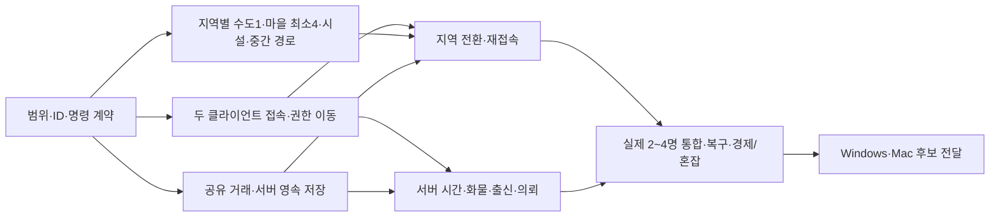

# Pocket Caravan 개발·검증 계획

> **현재 구현 추적:** [개발 진행표](DevelopmentStatus.md)를 먼저 확인한다. 아래 검토 당시의 ‘4맵·마을2·시설/낙하 제거 미구현’은 이전 기준선이다. 이번 구현은 6맵·수도1+마을4·로컬 시설3종이며, 사용자 후속 확인에 따라 감속을 나타내는 시각적 흔들림은 유지한다. 기획/검증/미완료는 진행표에서 구분한다.

기준일: 2026-10-16. **사용자 확인 마감은 11월 초**, 정확한 날짜·공통 기능 담당·개인 가용시간은 결정 대기다. 지역 실명 담당은 회의에서 확인됐다. 기존 전체 4주 구상과 지금부터 남은 기간을 구분한다. 이 문서는 10월16일 기준 약 2~3주의 남은 작업을 역산한 배정안이며 완료 보장이 아니다.

읽는 순서: **[해야 할 일](ImplementationBacklog.md) → 이 문서의 4절 일정·6절 담당 → 5절 검증·7절 결정 목록**. 작업 범위/상태/완료 기준은 작업 목록을 단일 원본으로, 달력·역할·마일스톤은 이 문서를 단일 원본으로 관리한다.

## 1. 이번 목표와 완료 선언

**사용자 확인:** 초기 4주 MVP는 기본 시스템 선행 후 2~4명 실제 멀티플레이를 검증한다. 최종 제품 목표는 MMORPG 규모의 다중 접속 교역 세계이며, 2~4명이 최종 정원은 아니다. 장기 인원 수치는 아직 미정이다.

- 기본 시스템 → 두 클라이언트 연동 → 2~4명 통합 시연의 순서로 간다.
- 네 출발 지역과 여러 연결 구역은 기존 사용자 목표로 유지한다. 인원 목표를 맞추기 위해 지역 수를 자동으로 줄이지 않는다.
- 2~4명에서 검증된 실제 인원을 보고한다. 두 명 시험만 하고 네 명 지원 검증을 통과했다고 쓰지 않는다.
- MVP 기간에 그 이상의 인원을 검증하는 것은 추가 목표다. 최종 MMORPG 확장은 제품 목표로 유지하며, 2~4명 단계의 거래·지역 전환·재접속·출신 적용 안정성을 바탕으로 진행한다.
- 2D를 우선 실행 기준으로 계획한다. 3D 전환 작업을 이번 일정에 병행하지 않는 안을 권장한다.

최신 요구: [개발 기준안](GameDesign.md), 온라인 설계: [멀티플레이 설계안](MultiplayerPlan.md).

아래 일정은 팀 분담/계획 제안이다. [전체 완성도 검토](HolisticDesignReview.md)의 G1~G5에서 게임성·제작 과정·온라인 일관성·경제/성능 근거를 확보해 작업 순서를 조정한다. 전체 MMORPG 목표는 유지하되 초기 MVP와 구현 시기를 구분한다. 이번 요청에서는 작업 목록과 일정만 정리하며 게임 기능을 자동으로 일괄 변경하지 않는다.

## 2. 현재 구현과 검증 상태

| 항목 | 상태 | 다음 작업 |
|---|---|---|
| 2D 이동·지형 속도·적재·체력·흔들림 | 로컬 구현 | 재미/피로 평가, 서버 계산 경계 분리 |
| 독립 이동 시험장 | 구현. 19개 런타임 검사 기록 | 같은 무게 기준 플레이 기록·핵심 수치 선정 |
| 시세·매매·NPC 거래·마을 성장 | 로컬 구현 | 명령별 검증/원자성, 행위자와 시간 명시 |
| 본편 고려 맵 | 내부 네 맵. 개경 남문/시전/물류 마당 프로토타입 반영 | 사람의 첫/반복 교역·미술/동선 피드백, 지역 품질 보완 |
| 다른 세 스타팅 지역·문명 간 중간 구역 | 이 검토에서 플레이 가능한 연결 구현 미확인 | 팀 산출물 확인·공통 계약으로 통합 |
| 긴 대사 분할·시각 HUD 제거 | 구현. 대사 검사 102개 기록 | 화면 비율·혼잡 상태 UI 확인 |
| 맵 생성·출구/스폰·접근성 | 최근 맵78·경로4·수도 실행10, 수도 데이터2,944칸 일치 검사 | 네 지역 통합 검사로 확대 |
| 팀 전달 | Windows x64·Mac Universal 프리릴리스 업로드, 소스 작업 브랜치 공유 | 실제 팀원 컴퓨터 실행 확인. Mac은 미공증 |
| 멀티 이동·공유 재고·서버 저장·재접속 | 미구현 | 별도 온라인 단계의 필수 과제 |
| 대규모 동시 접속·운영 | 미검증 | 2~4명 통과 후 별도 목표/환경/부하 설정 |

검사 개수는 기존 기록의 범위만 가리킨다. 이번 문서 검토에서 온라인 기능이나 인원 성능을 구현·검증한 것은 아니다.

## 3. 단계별 통과 조건

### A. 기본 시스템 확정

- 독립 시험장에서 등짐/손수레·화물·출신·노면 감속을 즉시 비교하고 원인을 구분한다.
- 구입 → 적재 → 경로 선택 → 감속 운반 → 도착·판매 → 귀환 구간을 로컬에서 한 번 끝낸다.
- 가격 계산과 명령의 입력·결과를 UI에서 분리한다. 로컬 어댑터를 온라인 어댑터로 바꿀 경계를 정한다.
- 튜토리얼을 완료해야만 매매·수레·적재량을 시험할 수 있는 상태로 만들지 않는다.
- 문명별 장터/출구/스폰/상품 ID와 맵 소유자를 정하고 임시 지역도 연결할 수 있게 한다.

기본 기능이 동작하는 최소선이 온라인 단계 진입 조건이다. 모든 아트·대사·밸런스를 끝내고서 네트워크를 시작하는 순서로 잡지 않는다.

### B. 두 클라이언트의 공유 세계

- 독립된 두 클라이언트가 같은 서버에 입장하고 이동·수단을 일관되게 본다.
- 같은 시장 재고·가격에 거래하고 마지막 재고 동시 구매/중복 요청을 처리한다.
- 다른 한 명의 메뉴·대화·지역 이동이 세계 시계를 멈추거나 건너뛰게 하지 않는다.
- 서버 재산 상태와 로컬 개발 저장을 분리한다.
- 한 번의 지역 전환과 연결 해제 후 재접속을 구현한다.

### C. 초기 MVP의 2~4명 통합 시연

- 실제 검증 인원 모두가 이동·거래·재접속을 수행한다. 복제된 창에서 움직임만 확인한 상태와 구분한다.
- 네 출발 지역과 중간 구역을 왕복하고 돈·화물·의뢰·시장 상태가 일관된다.
- 장터·다리 혼잡에서 통행·이름표·상호작용이 가능하다.
- 선택한 기준 장비/네트워크에서 합의한 품질 예산을 만족한다.
- 서버 재시작 후 확정 거래와 재산이 복구된다. 시연에서 지원하는 복구 범위·안 되는 범위를 명시한다.

### D. 추가 인원

C의 버그가 남아 있으면 추가 정원 검증보다 수정이 우선이다. 그 이상을 시도할 때 `N_total`, `N_zone`, 장비, 네트워크 조건, 유지 시간, 실패 기준을 먼저 정한다. 지원 인원은 조건과 측정 결과를 함께 표기한다.

## 4. 11월 초 마감 역산 일정

**계획상 MVP 후보 전달 목표는 11월1일**이다. 이는 ‘11월 초’ 중 이른 시점에 맞춰 잡은 제안이며 사용자가 확정한 마감일이 아니다. 11월2일 이후는 실제 마감일이 확인되면 수정/재검증 여유로 배정하고 필수 기능 개발 시간으로 선반영하지 않는다. 날짜 구간은 검토/납품 창이며 주말 근무·전일제 작업을 뜻하지 않는다.

| 구간 | 공통 납품 목표 | 반드시 확인할 것 |
|---|---|---|
| 10/16~10/18 · 기준/기술 확인 | 담당·가용시간·현재 산출물 표, 공통 ID/명령/출구 초안, 두 클라이언트 접속 실험, 고려 첫 왕복 관찰 | PL-01~03, ARC-01 초안, NET-01 실험 결과, GY-01. 미술 완성 대기 없이 통신 위험 확인 |
| 10/19~10/23 · 기능 연결 | 두 클라이언트 이동·공유 매매·서버 재산 저장의 첫 세로 연결. 네 지역 각각 수도1+마을 최소4의 기능 초안·등급/시설표·연결 구역 | NET-02, EC-02/SAVE-02의 첫 거래. 각 MAP-02~04 납품과 MAP-05 초안. 멀티는 위치만 보이는 상태로 완료하지 않음 |
| 10/24~10/28 · 통합/실제 인원 | 네 지역/여러 중간 구역 왕복, 서버 시간·적재/출신·의뢰 상태, 지역 전환/재접속을 2~4명으로 검증 | SIM-01, NET-03, CARGO-01, QA-02/03. 10/28까지 실제 검증 인원과 실패 항목 기록 |
| 10/29~11/01 · 마감 후보 | 새 시스템 추가를 멈추고 재산/진행 오류·혼잡 UI·지역 가림/통행·두 OS 실행 수정. 버전 고정해 공유 | QA-01~03 회귀, REL-01. 서버 재시작·재접속·기존 저장·실제 Windows/Mac 확인, 알려진 제약과 기록 전달 |
| 11/02~정확한 마감일 · 조건부 | 실제 마감이 이 기간이면 피드백 수정/재시험·발표 자료 보완 | 앞 단계의 지연을 자동 흡수한다고 가정하지 않음. 새 필수 기능·추가 정원은 안정성 확인 뒤 판단 |

### 파트별 달력

**2026-10-17 발표 피드백 반영:** 10월19일 발표 자료에서는 10/16~18 구간을 ‘사전 준비’로 구분한다. 기획 초안 정리는 완료, 고려 로컬 교역은 구현 상태이며, 팀 범위 승인과 온라인 연결 시험의 완료 근거는 아직 없다. 온라인 시험은 ‘검증 대기’로 표시하고 발표 직전 실제 결과가 있으면 해당 항목만 갱신한다. 전체 일정이 완료되었다고 표시하지 않는다.

팀 통합의 우선 합의 항목은 [좌표 구역·ID·출구/스폰 계약](TeamIntegrationContract.md)이다. 고려 0~9, 베네치아 10~19, 아라비아 20~29, 북유럽 30~39의 x 구역 배정은 합의안이며, y·중간 구역·경제 거리 영향과 함께 승인한다. 10월16일 회의에 기록된 지역 담당 실명은 문서 6절의 공통 기능 A~D 배정안과 별개다.

담당 A~D의 의미는 6절을 따른다. 각 칸은 그 구간의 **주된 산출물**이며 기능 담당은 자기 기능의 테스트와 수정까지 맡는다. D에게 모든 버그를 넘기지 않는다.

| 파트/담당안 | 10/16~18 | 10/19~23 | 10/24~28 | 10/29~11/01 |
|---|---|---|---|---|
| **A 사용자: 고려·지역 계약/연결 조율** | GY-04/05 다섯 거점·등급/시설표·GY-01, MAP-01 원본 확인 | GY-04 신규 최소2마을·FAC-01 실제 이용·GY-06 연결/지도·MV-01/02 공통 협업 | SCN-01·ORG-01 고려 정보·시설/다섯 거점 온라인 왕복·GY-02 미술/고증 | QA-REG/FAC·실패/재기·시설 문턱·반복 교역 회귀·지역 안내/빌드 |
| **B: 네트워크·공유 세계 + 비고려 지역1** | ARC-01, NET-01 스택/호스팅/세션/부팅 실험, 자기 지역 기존 산출물 확인 | NET-02 이동·클라이언트 경계, SIM-01 시간 단일화, MAP-02 최소 납품/자기 접속부 | NET-03 지역 전환/재접속, SIM-01 활성 사건·도적 정합성, CARGO-01 전송 보조 | 접속/전환/중복 시뮬레이션 결함, 서버 재시작 회귀. 필수 결함 없을 때 SCALE-01 설계 |
| **C: 경제·화물·저장 + 비고려 지역2** | SAVE-01 저장 보호, EC-01 수량/재기/공유 시장 분석, 명령/저장 계약 합의 | EC-02+SAVE-02 한 거래를 저장/응답까지 연결, MAP-03 최소 납품/자기 접속부 | CARGO-01 적재/의뢰·출신, 거래/재접속·재시작 복구, 공유 경쟁 수치 비교 | 돈/재고/화물/보수·손상 저장 회귀와 경제 막힘 수정 |
| **D: 조작·UI·빌드/검증 진행 + 비고려 지역3** | PL-03 기기 실행, MV-01/UX-01 문제 재현, QA-01 실행표, 자기 지역 초안 | UX-01과 NET-02 클라이언트 표현 보조, MAP-04 최소 납품/자기 접속부, 테스트 빌드 | QA-02/03 실제 인원/혼잡 진행, 화면/조작·빌드/버전 문제 수정 | 전원 기능 회귀 일정 조율, REL-01 두 플랫폼 패키지·릴리스·실행 안내 |

### 의존 관계와 확인 시점

10/18에 NET-01이 불명확하면 네트워크 담당 보조와 기술 선택을 즉시 재조정한다. 10/23에 두 클라이언트의 공유 매매/저장이 연결되지 않으면 11월1일 목표는 위험 상태로 표시한다. 10/28에 재산·지역 전환의 필수 실패가 남아 있으면 추가 인원·새 미술 세트·새 시스템보다 해당 결함을 고친다. 미달 항목을 문구만 바꾸어 MVP 완료로 처리하지 않는다.

정확한 날짜/가용시간 확인 전 이 일정의 성공을 약속할 수 없다. 특히 B/C가 각자 지역 제작과 신규 온라인 핵심을 겸하는 안은 부담이 크다. 이 두 담당의 지역은 처음에는 최소 기능/대표 표식으로 연결하고, A/D가 공통 표본·배치 검토로 돕는다. 기존 다른 지역 산출물이 없다면 제작량과 온라인 범위를 팀이 즉시 재산정해야 한다.

기능 개발 외 통합·리뷰·오류 수정 시간을 가용시간의 **20~30% 정도 확보하는 안**을 권장한다. 실제 시간은 PL-01에서 확인한다. 이미 요구한 네 지역·멀티·여정 구조를 줄여야 한다면 팀/사용자와 재합의한다. 줄일 후보는 새 날씨/보급 종류, 출신별 특수 행동, 긴 스토리, 전 지역의 과도한 장식, 이번 기간의 추가 정원 실험이다. 최종 MMORPG 확장은 제품 목표로 보존한다.

## 5. 검증 표

| ID | 시험 | 통과 조건/기록 | 선행 |
|---|---|---|---|
| QA-MV-01 | 같은 무게의 두 수단 × 세 경로 | 경로·이유·물량·감속·정지 원인·피로 기록. 항상 한 길만 선택하면 다른 길 가치 재검토 | A |
| QA-MV-02 | 빈짐/짧은 풀밭 이탈/장시간 이탈 | 감속 원인·길 선택 이해, 화물 수량 불변, 초보/숙련의 우회 피로 기록 | A |
| QA-REG-01 | 수도1+마을 최소4·전 거점 자유 왕복 | 독립 townId·공급/소비·출구/수레 접근·지형 지도 일치. 길/씬을 마을로 중복 집계하지 않음 | GY-04/06 |
| QA-FAC-01 | 등급/개인 신용별 실제 시설 이용 | 저신용/문턱직전/충족·자금부족·잘못된 거점·재접속·다른 유저 신용 분리, 비용/효과 한 번 | FAC-01 |
| QA-AR-01 | 나루/길/수도/생산 마을 구분 | 지명 없이 역할을 묻고 기억한 랜드마크·혼동 지점을 기록 | 대표 장면 |
| QA-UX-01 | 대사/거래/지도/혼잡 이름표 | 글자 잘림·오선택·화물/가격 오인 0. 개인 메뉴로 세계 정지 없음 | B |
| QA-EC-01 | 동일 상품 구입·판매·반복·NPC 거래 | 실제 차익 설명, 정수 처리·재고 회복·성장 규칙의 일관성 | A/B |
| QA-NET-01 | 마지막 재고 하나를 동시 구매 | 재고 한 번·지급 한 번·성공한 잔고 차감 한 번 | B |
| QA-NET-02 | 거래 재시도/응답 유실/확정 직후 이탈 | 같은 요청은 같은 확정 결과. 돈/화물 중복·부분 반영 0 | B |
| QA-NET-03 | 출신 적재 한도·과적 요청·기존 저장 이주 | 승인한 수량/원가·의뢰·출신 일치, 중복 복구/초과 구매 거절 | B |
| QA-NET-04 | 전환 전/확정 후 연결 해제·재접속 | 캐릭터 활성 지역 한 곳, 재산 일치, 승인 위치 복구 | B |
| QA-NET-05 | 서버 재시작·저장 복구 | 확정된 거래·재산·시장·출신·이주 상태 일치 | C |
| QA-SCALE-01 | 2~4명 장터·다리·분산 지역 | 실제 인원/장비/서버/지연 조건과 품질 지표 기록 | C |
| QA-SCALE-02 | 추가 인원 부하 | 목표·조건·예산·실패 지점을 함께 보고 | C 통과 |

### 품질 예산 입력표

정확한 수치는 기준 장비를 정한 뒤 온라인 단계 시작 전에 합의한다. 아래 값이 빈 상태에서 ‘충분히 빠름/대규모 가능’이라고 판정하지 않는다.

| 항목 | 정할 값 |
|---|---|
| 클라이언트 | 화면 크기·그래픽 설정·목표 FPS·허용 프레임 지연 |
| 서버 | 목표 갱신 간격·허용 처리시간·CPU/메모리 예산 |
| 거래 | 지연 조건별 응답 지연 목표와 오류 처리 한도 |
| 동기화 | 이동 보정 허용 폭·지역 전환 지연 목표 |
| 인원 | 초기 MVP 2~4명 중 검증 인원, 이후 MMORPG 검증의 `N_total`/`N_zone` |
| 환경 | 서버 위치·장비, 클라이언트 장비, 정상/지연/손실 환경과 유지 시간 |

테스트가 짧게 끝났다는 이유로 수치 예산을 영구 생략하지 않는다. 날짜·시각을 UI에서 숨겨도 내부 QA에서는 이동 시간과 처리 지연을 측정할 수 있다.

## 6. 책임 영역과 협업 계약

**배정안이며 실제 담당자 확정 전이다.** 기존 팀 분담/숙련도가 있으면 B/C/D의 실명을 그에 맞게 배치하고, 기존 지역 담당까지 임의로 바꾸지 않는다. A만 사용자로 확정되어 있다.

| 담당 | 지역 책임 | 공통 주책임 | 보조/리뷰 계약 |
|---|---|---|---|
| A · 사용자 | 고려 | 지역 납품 계약·전체 연결표 조율·공간/교역 경험 | D와 이동/가독성, B와 출구/전환. 다른 세 지역/중간 구역 전부 제작하지 않음 |
| B · 팀원 미정 | 기존 배정의 비고려 지역1 + 자기 접속부 | 세션·서버 부팅·권한 이동·세계 시간·지역 전환 | D가 클라이언트 표현, C가 재산/저장. 네트워크와 경제 전체를 혼자 맡지 않음 |
| C · 팀원 미정 | 기존 배정의 비고려 지역2 + 자기 접속부 | 가격/매매·화물/의뢰·로컬/서버 저장·재기 | B가 권한/전송, D가 UI·재현. 자기 지역은 공통 시장/ID 계약 사용 |
| D · 팀원 미정 | 기존 배정의 비고려 지역3 + 자기 접속부 | 조작/UI·빌드/버전·검증 진행 | B의 클라이언트 작업과 A의 지역 시험 보조. 기능 버그 수정은 원 담당이 수행 |

지역 담당은 고려 은샘·베네치아 윤채·아라비아 은인·북유럽 기우다. 네 명이 지역을 하나씩 맡는 구조와 공통 기능 분업을 함께 유지하되, B/C에게 두 개의 전일제 업무를 겹쳐 배정한 것으로 계산하지 않는다. 지역 초안이 납품되면 공통 병목을 먼저 해결하고 대표 미술을 순차 보강한다.

- 맵마다 Python/JSON/직접 편집 씬 중 기준 원본과 소유자를 지정한다. 공용 빌더 재생성으로 수동 작업을 지우지 않는다.
- 변경 계약: 안정적 ID, 출구/도착 스폰, 맵 데이터 버전/해시, 상품/차량/출신 데이터 버전, 네트워크 요청/응답 버전.
- 공용 경제 수치와 생성기는 지역 브랜치에서 각자 복제해 확정하지 않는다. 통합 전에 실제 연결 빌드를 공유한다.
- 서버·클라이언트가 다른 맵/밸런스 버전이면 입장을 거절하거나 호환 버전으로 처리한다. 같은 지형에서 서로 다른 통행/속도를 계산하지 않는다.

작업자는 한 번에 큰 구현 하나를 진행하고 다른 하나는 리뷰/확인 수준으로 제한하는 안을 권장한다. 매 작업에 보조/리뷰어와 완료 기준을 붙이고, 공통 계약 변경은 관련 담당과 함께 검토한다. 시연 빌드는 버전/소스 커밋을 고정한다. 하루 작업 종료 때 변경·막힘·다음 납품을 짧게 남기고, 주2회 이상 연결 빌드를 확인하는 안을 권장한다. 정확한 팀 회의/작업 시간은 PL-01에서 합의한다.

## 7. 결정 목록

| ID | 결정 | 상태 / 권장 시점 |
|---|---|---|
| D-01 | 초기 4주 MVP: 기본 시스템→2~4명 멀티 검증. 최종 제품: MMORPG 규모의 다중 접속 교역 세계. 장기 정원 미정 | 2026-10-15 사용자 재확인. 2~4명으로 최종 정원 축소 금지 |
| D-02 | 2D 우선 제작 기준안과 팀 최종 승인 | 사용자 의향 반영 / 지역 아트 확대 전 |
| D-03 | MVP 마감과 실제 가용시간·주담당/보조 배정 | 2026-10-16 사용자 ‘11월 초’ 확인. 정확한 마감일·실명·시간 미정. 11월1일 후보 전달은 역산 제안 |
| D-04 | 네 스타팅 지역 각각 수도1+수도 외 최소4마을·등급별 거점·시설/신용 이용 | 10/16 회의·10/17 사용자 재확인. 개별 지명/등급/시설표·실제 시작 스폰은 구체화 대기, 범위 자체는 미정 아님 |
| D-05 | 서버/네트워크/저장 기술·호스팅 환경·예산 | 결정 대기 / A 단계 중 확인 실험 |
| D-06 | 주행 중 물품 낙하 제외, 노면·적재 감속 중심 | 2026-10-17 사용자 확정. 코드 수정·HUD/대사·저장 이주는 MV-01/02 미완료 |
| D-07 | 유저 통과·도적·직접 거래/PvP 범위 | 낙하 소유권은 새 MVP 필수에서 제외. 나머지는 별도 합의 |
| D-08 | 일반/기한 의뢰 구분, 서버 정지·접속 해제 중 시간 정책 | 결정 대기 / B 시간·의뢰 연결 전 |
| D-09 | 시연 인원별 품질 예산·기준 장비·추가 접속 목표 | 결정 대기 / PL-02·NET-01의 10/18 확인 목표, 온라인 성능 측정 전에 수치 기록 |
| D-10 | 공식 수송 거리/비용과 시세·의뢰·NPC 거리 통일 범위 | 결정 대기 / 문명 간 교역 연결 전 |
| D-11 | 텍스트 채팅 우선·음성 후속, 채널/범위·이번 통합 수준과 직접 유저 거래 | 채팅 방향은10/16 회의. CHAT-01로 구체화, 직접 거래·음성을 자동 MVP 필수로 추가하지 않음 |
| D-12 | 시대는 원본의 대항해시대 이전(대략 8~15세기) 가상 교역 세계. 단일 연도 복원으로 변경하지 않음 | 2026-10-15 원본 1·12·13쪽 재확인. 역사·각색 검토는 GoryeoDesignReview.md |
| D-13 | 길 개척 제외, 정해진 교역로의 선택과 사건을 개발 | 2026-10-16 회의 방향. 동적 개척을 현재 미결정 필수/후속 약속으로 복구하지 않음 |
| D-14 | NPC를 실제 자금·운반 제한 상인으로 만들지, 단순 시장 수요 모형으로 유지할지 | 현재 가격/재고 공유만 구현. 인원 연동·정보 출처·성장 기여 포함해 결정 |
| D-15 | 지형 편집 원본과 생성/수작업 보존 방식 | 현 Python 원본 유지. 등록부/공용 목록 소비는 구현, Generated/Overlay·지도·경제 거리 분리는 미완료. RegionAuthoringPlan/TeamDevelopment 참조 |
| D-16 | 고려 환경의 고정 계절·건축 모티브와 고증/각색 표기 | 계절 미확정. 자료 시대·위치 신뢰도와 현대 지형 참고를 구분. 단일 역사 연도로 변경하지 않음 |
| D-17 | 공유 시장의 경쟁 강도·후발 기회·NPC 활동·재기 통로 | 전체 완성도 검토의 수식 민감도와 G1/G4 실험으로 비교. 수치 미변경 |
| D-18 | 기능 확대/구조 변경의 착수 기준과 MMORPG 단계별 용량 목표 | 전체 완성도 검토 G1~G5. 즉시 일괄 시행보다 경험·협업·권한/복구·경제/성능 근거 우선 |
| D-19 | 고려 정보·아라비아 적재·베네치아 판매/중개·바이킹 이동 | 2026-10-17 사용자 확정한 역할. 배율·조건은 미확정, 기존 에셋 변경은 ORG-01 |

새 결정은 날짜·결정자·이유·영향 문서를 함께 기록한다. 모델이나 구현자가 편의상 정한 값은 팀 확정으로 승격하지 않는다.

## 8. 우선 위험

1. 기본 기능과 모든 아트를 끝낸 뒤 멀티를 시작하면 시간/재고/저장 구조를 늦게 다시 만들 수 있다. 10/18 기술 확인, 10/23 두 클라이언트 공유 매매/저장 연결을 위험 확인 시점으로 둔다.
2. 기획에서 낙하를 제외했어도 코드·대사·저장·시험장에 이전 규칙이 남을 수 있다. MV-01/02와 ORG-01을 함께 반영하고 감속·우회 피로와 실제 거래 효율을 검증한다.
3. 네 지역 모두를 수도 수준으로 만들거나 이벤트·날씨·상단까지 확장하면 필수 연결·거래 일관성 검증이 밀린다. 공통 표본과 범위표를 사용한다.
4. 2D의 렌더링이 가벼워 보인다는 이유로 동시 접속 가능 인원을 추측할 수 있다. CPU·저장·시장 경합·동기화·혼잡을 따로 측정한다.
5. 시험장 치트·무료 재화·리셋을 온라인 명령으로 열 수 있다. 개발 세션은 온라인 저장·빌드·서버 권한과 분리한다.

## 9. 바로 시작할 순서와 기록

1. 전원이 최신 릴리스/같은 소스를 실행하고 PL-01/03의 담당·가용시간·산출물·실기기 결과를 채운다.
2. 전원이 PL-02의 MVP 활성 기능·ID/시간/소유 정책을 짧게 정한다. 미결정으로 막히는 작업을 공개한다.
3. A/D는 고려 첫 교역/반복 이동 관찰과 수정 병목을 기록하고, B/C는 통신·명령·공유 거래/저장 실험을 시작한다.
4. MAP-01 계약으로 각 지역 수도1+마을 최소4·등급/시설표와 자기 접속부를 납품하고, A가 MAP-05 전체 연결표를 맞춘다.
5. 10/23·10/28의 실제 결과로 남은 작업과 날짜를 다시 계산한다. 11월1일 후보에 미달하면 이미 되는 프로토타입과 미완성 온라인을 구분해 공유하고 남은 목표를 재합의한다.

할 일 카드의 필수 필드: `작업ID / 실명 담당·리뷰어 / 상태 / 예정 시작·끝 / 선행 / 완료 기준 / PR·커밋 / 검사·플레이 결과 / 남은 문제`. 이 문서와 작업 목록은 GitHub 소스로 공유하며, 별도 Issues/Project 보드나 팀원 메시지는 이번 정리 작업에서 자동 생성하지 않았다.

### 10월17일 범위 교정의 일정 영향

기존 일정은 수도1+마을 최소4와 실제 시설 구현을 누락해 작업량을 과소 계산했다. A의 고려 작업에 GY-04/05/06·FAC-01·SCN-01을 명시하고 공통 담당 협업을 포함한다. 기존 날짜는 납품 목표 창이며 이번 교정만으로 실현 가능성이 검증된 것은 아니다. 거점/시설 기능을 먼저 연결하고 장식·새 날씨·후속 운송을 조절한다. 필수 거점 수를 임의로 줄여 맞추지 않는다. PL-01에서 실제 가용시간/기존 팀 산출물을 대조하고 지연 시 명시적으로 재합의한다.
