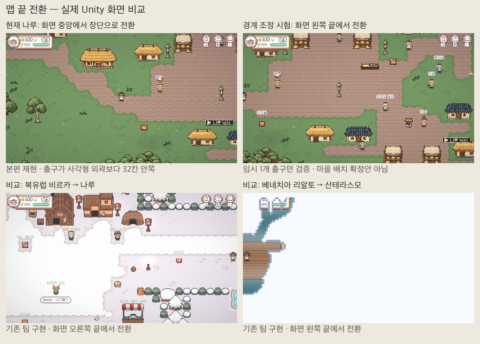

# 맵 끝 전환 조사·임시 시범

2026-11-07 Codex. T3 진행 중. **본편 해결 완료 아님.** 사용자 지시대로 페이드·지역명·전환 시간을 바꾸지 않았다. 최신 main을 fetch/merge했고 이미 포함되어 있다. 타 지역은 읽기·실행 비교만 했다.

## 원인

고려는 terrain_v3의 불규칙한 구역을 사각형으로 잘라 맵을 만들지만, 출구는 그 사각형 외곽이 아니라 원래 구역 접촉선마다 생성한다. 사각형 안에는 이웃 구역 그림도 보이고, 실제 이동은 구역 마스크로 막힌다. CameraFollow는 CameraBackdrop까지 포함해 추적한다. 따라서 내부 출구에서 캐릭터가 화면 중앙에 있어도 정상적인 출구 접촉 판정이 발생한다.

MapExit의 담당 지역 발 중심/바깥 면 판정은 이미 타 지역의 출구 칸 접촉보다 늦다. 이를 더 늦추거나 페이드를 조정해도 내부 분할선을 실제 맵 외곽으로 만들 수 없다. 카메라 배경 범위만 제거한 실제 실험에서도 나루는 중앙에서 전환됐다.

## 크기 비교

등록된 실제 JSON의 각 문명 시작 마을 5개씩을 비교했다. 가로·세로는 사각형 맵 크기, 면적은 그 중앙값이다. 통행 가능 칸은 정적 blocked만 세었으며 NPC·동적 장애물·날씨는 제외한다.

| 문명 | 가로 범위 | 세로 범위 | 사각형 면적 중앙값 | 통행 가능 칸 중앙값 | 출구 객체 / 방향상 외곽보다 2칸 이상 안쪽 |
|---|---:|---:|---:|---:|---:|
| 고려 | 61–93 | 76–98 | 6216 | 2267 | 367 / 335 |
| 베네치아 | 57–75 | 56–84 | 3477 | 1118 | 17 / 0 |
| 북유럽 | 56–70 | 78–95 | 5440 | 2211 | 30 / 4 |
| 아라비아 | 64 | 44 | 2816 | 2136 | 40 / 0 |

고려가 전반적으로 작은 맵은 아니다. 먼저 **맵을 합치지 않고 구역 경계·통행 범위·출구·카메라 외곽을 일치시키는 재조정**을 권한다. 일부 모서리의 입구→다른 출구 최단 거리가 1칸인 경우는 경계 배치 문제로 함께 검토한다. 다른 문명에도 짧은 연결 예외가 있어 모든 차이를 고려만의 오류로 단정하지 않는다.

기본 나루 S0→장단 출구는 정적 4방향 최단 16칸, 비르카 표본은 28칸, 리알토 표본은 40칸이다. 같은 퀘스트나 사람의 실제 플레이 시간 비교가 아니다.

## Unity 재현·시범

960×540, 30×16.875칸 카메라. 실제 렌더 뒤 플레이어 발 위치를 측정했다.

- 현재 나루→장단·송악→닥목: 플레이어가 화면 가로/세로 약 50%에서 출구에 접촉하고 실제 씬 이동.
- 팀 표본 비르카: 오른쪽 약 98.3%, 리알토: 왼쪽 약 1.7%에서 실제 씬 이동.
- 나루 임시 사각형 경계: 왼쪽 약 0.1%까지 이동한 뒤 기존 MapExit/TravelTo로 장단 이동. 외곽 2칸 전 미전환, 바깥 통행 제한 확인. 페이드 정책 유지.

**시범의 제한:** 실행 중인 나루에만 렌더러 없는 임시 경계/충돌층과 서쪽 출구 하나를 만들었다. 원래 지형 그림은 그대로이며 본편 에셋은 저장하지 않았다. 경계는 세계 좌표 x224..290/y25..111(66×86)이며 기존 장단 도착 spawn을 재사용했다. 마을 내부를 잘라 보이는 이 화면은 전환 방식의 기술 검증이지 승인받을 최종 배치안이 아니다. 장단 반대편 경계·왕복 배치·전체 출구·기존 저장 이주는 아직 구현하지 않았다. 씬 이동 후 임시 구성은 소멸한다.

## 본편 적용에 필요한 후속 작업

1. 원본 구역 분할에서 마을 중심·주요 지형·도로·외부 연결을 보존하는 13맵 경계안을 만든다. 길목이 실제 외곽에 놓이게 하되 마을 한가운데를 잘라내지 않는다. 불가능한 구간만 합치기/길 조정을 별도로 제시한다.
2. 그림으로 경계안을 검토받은 뒤 생성 원본에서 지형 범위·충돌·출구·도착을 함께 재생성한다. 생성 JSON/씬만 손으로 고치지 않는다.
3. 고려/담당 동쪽만 카메라 외곽을 같은 범위에 맞춘다. 출구 방향에 따라 카메라를 옮기거나 이웃 그림을 가리는 이전 방법은 쓰지 않는다.
4. ID 유지. 원점/크기가 달라지면 기존 저장의 로컬 위치를 세계 위치로 변환하는 이주와 안전 도착 검사를 먼저 구현한다. 이전 출구 바로 앞/직후 저장도 왕복 검사한다.
5. 13맵 길 연결·네 방향/모서리·기본/확대 화면·왕복 이동을 검사하고 실제 화면을 승인받는다. 페이드 변경은 이 작업에서 제외한다.

경계 재조정은 사용자가 먼저 설명을 요청한 구조 변경이며 아직 본편에 임의 적용하지 않았다.

## 검사와 한계

- 데이터 조사: 등록 맵54개 읽기, 담당13맵 출구1189개 중 방향상 외곽보다 2칸 이상 안쪽1100개. 객체 수이며 출구 칸 길이 합계가 아니다.
- 정적: 기존 경계 회귀4개 통과, 세계 연결1437개/오류0. 전체403개 회귀는 이번 조사에서 재실행하지 않았다.
- Unity: 자동 배치·모터/출구 호출40항목, 실제 씬 전환5회, GameView 캡처9장, 최종 콘솔error0. 네이티브 WASD 사람 플레이·온라인·장시간 성능·빌드 미검사.
- QA는 Autosave OFF·랜덤 격리 슬롯을 사용했고 해당 슬롯 파일 미생성을 확인했다. 다만 긴 중단 전17:14 개인 저장9파일 지문과 비교하면 본체/bak2개가18:27 변경되어 개인 저장 전체 불변은 확인할 수 없다. 원인 미확인으로 기록하고 사용자 저장을 덮어 복원하지 않았다.
- 기존 B1 배분 합계45000과 이전 M4 report의 cells 합계44993은 기준이 다르다. 재생성하지 않은 이전 보고서 차이7칸을 실제 지형 유실로 단정하지 않는다. 본편 재분할 때 정확한 소유 마스크로 재검증한다.
- 근거: [수치/검사](../Validation/Map-Boundary-Audit-2026-11-07/summary.json), [원시 수치](../Validation/Map-Boundary-Audit-2026-11-07/metrics.json), [Unity](../Validation/Map-Boundary-Audit-2026-11-07/unity.json). 본편 Maps/Scenes/MapExit/CameraFollow/전환 코드 변경0.
