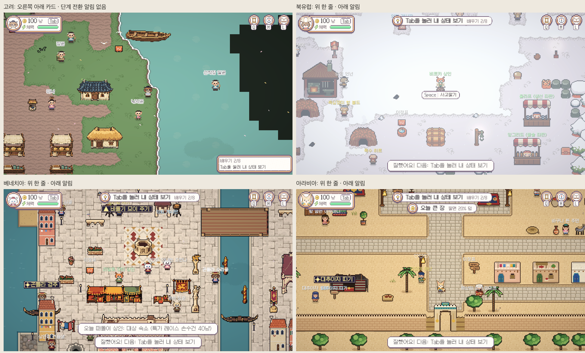
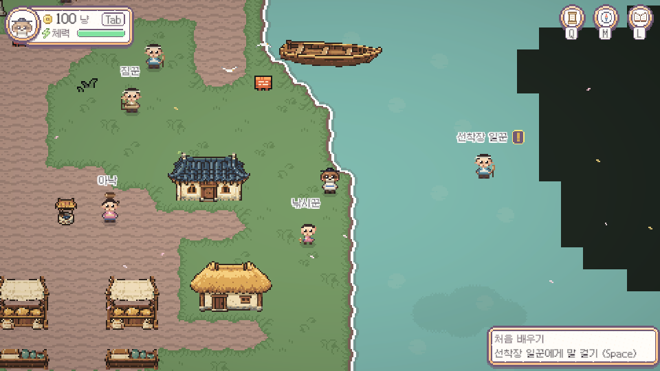

# 고려·다른 지역 일관성 조사

2026-11-08 Codex. 사용자 요청: 고려의 첫 튜토리얼·오른쪽 아래 안내·선착장 일꾼 위치 차이를 조사하고, 퀘스트 표시/이름표는 고려식을 다른 지역에도 쓸 수 있는지 검토한다.

비교 기준은 최신 integration `ff9a9ccf6`(팀 UI 겹침 정리·생김새·서버12단계). 로컬에 `e0ccae77b`로 병합했다. 앞서 적용한 상인/낚시꾼 별칭을 보존했다. **이번에는 조사만 했으며 아래 위치·튜토리얼·공용 표시를 수정하지 않았다.**

## 먼저 고쳐야 하는 문제

| 항목 | 고려 | 다른 세 지역 | 판단 |
|---|---|---|---|
| 첫 안내 NPC | 선착장 일꾼이 물 위에 생성됨 | 각 지역 안내 인물/대사는 지역별 이야기 | 진행을 막는 실제 위치 버그 |
| 조작 학습 순서 | 달리기 → Tab → **Q → I → M** → 사기 → 팔기 → L | 달리기 → Tab → **I → M → Q** → 사기 → 팔기 → L | 공통 조작 교육 순서 통일 권장 |
| 현재 할 일 | 오른쪽 아래의 2줄 카드 | 위 가운데 한 줄 `TopPill` | 고려만 별도 UI가 남음 |
| 학습 단계 전환 메시지 | Done()에서 소리/단계만 바뀜, 하단 다음 단계 메시지 없음 | Done()에서 “잘했어요! 다음…” 하단 알림 | 현재 할 일은 위, 일시 알림은 아래로 팀 기준 재사용 권장 |
| Tab 펼친 상태 | GoryeoIntro.Showing에 HUD.Expanded 제외 조건 없음 | 세 지역 모두 Tab 펼치면 튜토리얼 줄 숨김 | 표시 조건도 함께 맞춰야 함. 실제 겹침 면적은 이번에 별도 측정하지 않음 |
| 인물 호칭 일치 | 월드 이름은 “촌장/아낙”처럼 짧지만 StoryGuide/일반 Navigator는 원본 긴 이름 사용 | 공용 원본 이름을 그대로 표시 | 추적 안내와 실제 찾는 사람의 짧은 이름도 맞추는 편이 좋음 |

사진은 모두 배우기2/8(Tab 보기), 단계 값3이다. 격리 세션 메모를 단계2로 두고 각 지역 Done(0)을 호출한 직후의 실제 렌더다. 사용자가 네 지역을 직접 처음부터 플레이한 기록은 아니다. 다른 지역 하단의 추가 시장 안내 등은 그 지역 본편 시스템에서 나온 메시지다.

## 선착장 일꾼의 정확한 원인

[GoryeoIntro.cs](../../Assets/PocketCaravan/Scripts/World/GoryeoIntro.cs)의 `MapH=84`, `GuideCell=(40,33)`이 옛 나루 배치 그대로다. 도입 인물은 맵 JSON의 NPC가 아니라 OnMap에서 실행 중에 만든다. 따라서 앞선 T3 맵/리소스 좌표 이주에서 이 상수로 생성되는 인물을 빠뜨렸다. **Codex가 맵 경계를 옮길 때 놓친 부분이다.**

- 실제 나루: 가로69·세로89, 원점(224,22). 시작 발밑은 위 기준(15,37).
- 현재 일꾼: 위 기준(40,38), Unity (40.5,50.5). 해당 타일은 water=1, blocked=1.
- Unity에서 주 통행 영역의 모든 실제 통행 칸을 조사했을 때, 가장 가까운 플레이어 몸 위치와 일꾼 사이 거리는 약7.03칸이다. 대화 범위는1.8칸이므로 걸어서 말을 걸 수 없다.
- 옛 세계 위치를 그대로 새 구획으로 환산하면 위 기준(18,38)이다. 이 칸은 정적 맵에서 육지/통행 가능이며 시작점 근처다. 실제 수정 시 NPC/소품과의 충돌·말 걸기·왕복까지 확인해야 한다. 아직 옮기지 않았다.

수정은 원래 시작점 옆의 안전한 육지로 복구하고, 고정 맵 높이/로컬 상수 대신 배치 원본/좌표 데이터에 포함해야 한다. 이후 재분할에도 살아 있도록 “시작점에서 안내 NPC에게 대화 거리까지 도달 가능”을 별도 회귀로 검사할 필요가 있다. 기존635출구/저장 이주 검사가 이 런타임 도입 NPC의 접근성까지 보장한 것은 아니다.

## 지역별로 달라도 되는 첫 이야기

네 지역 모두 “도입 인물과 대화 → 같은8가지 기본 조작 → 안내 인물에게 돌아가기 → 본편 첫 배달” 구조다. 완료 노잣돈도20냥으로 같다. 도입 인물이 고려는 일꾼, 북유럽은 어머니, 베네치아는 안내원 조반나, 아라비아는 아미르인 것은 지역별 이야기 차이다.

본편 첫 퀘스트도 모두 배달 계열이다. 고려 `q1_naru`는 촌장이 맡긴 소금을 장단에 전하고, 북유럽은 버터, 베네치아는 꾸러미, 아라비아는 대추야자 짐을 전한다. 이 인물·물건·대사·보상을 전부 같은 것으로 바꿀 근거는 없다. 공통화할 것은 조작 학습 순서와 안내 방식이다.

순서를 바꿀 때는 저장된 goryeo:intro 단계 값4~6이 현재 Q/I/M을 뜻한다는 점도 다뤄야 한다. 배열과 인덱스만 바꾸면 중간 저장의 다음 목표가 바뀐다. 완료한 학습을 잃거나 반복하지 않는 전환도 확인 대상이다.

## 고려식을 공통화하기 좋은 부분

현재 다른 세 지역은 공용 WorldLabels를 사용하고, 고려만 GoryeoPlaceLabels가 대체한다. 실제4지역 세션에서도 그 활성 상태를 확인했다.

- 이름은 사람/물체 바로 위 고정, Space는 바로 아래에 글자만 표시.
- 짧은 표시 호칭, 밝은 외곽선과 작은 차지 면적.
- 이름 오른쪽 작은 네모 !/? 표시. 기존 퀘스트 NPC의 떠 있는 표시는 고려에서는 숨긴다.
- 움직여도 가림 회피를 위해 이름을 다른 자리로 보내지 않고, 겹치는 부수 이름은 생략.
- 가까이 있을 때 필요한 시설/상호작용 안내만 표시.

다른 지역의 WorldLabels는 원본 긴 이름·범주별 색·Space+“말 걸기/사고팔기/게시판 보기” 알약을 사용하고, 별도의 퀘스트 표식도 남는다. 이것은 실제 구현 차이다. 고려의 표시 렌더러를 공용화하는 방향이 사용자 의견과 맞는다.

다만 고려의 지역 접두어 제거 목록을 그대로 전체에 적용하지 말고, 각 지역 인물의 짧은 표시 이름을 별도로 공급해야 한다. 원본 DisplayName·NPC/시장/퀘스트 ID는 유지해 호감도/대화/저장 키를 건드리지 않는다. 전 지역 인물 이름을 이번에 하나씩 전수 결정한 것은 아니다.

## 권장 작업 순서

1. 선착장 일꾼 위치와 실제 말 걸기를 먼저 복구한다.
2. 고려의 조작 순서를 공통 순서로 맞추고 중간 저장을 호환한다.
3. 고려 튜토리얼은 기존 팀 TopPill·하단 Notify·Tab 숨김을 재사용한다. 오른쪽 아래 전용 카드와 관련 예약 영역/중복 회피 연결도 함께 정리한다.
4. 고려식 이름표/Space/퀘스트 표시를 공용 렌더러로 옮기고, 다른 지역 짧은 이름을 연결한다. 지역별 이야기·퀘스트 데이터는 유지한다.
5. 각 지역 첫 실행→학습→첫 배달 수락까지 같은 조건으로 플레이하고 화면 비교를 받는다.

## 검사의 범위와 진행 중 업데이트 사고

- 최신 팀 UI/서버12단계 병합 후 기존 Python424개, 실패0·skip23. 세계883출구 오류0. 이 성공은 위의 도입 NPC 버그가 없다는 뜻이 아니다.
- 별도 SaveOFF/랜덤 슬롯·Offline 상태에서4지역 실제 렌더5장, 고려 안내 NPC 대화 접근 거리 조사. 실제 키 입력으로8단계 전체를 끝내거나 온라인/서버 저장을 검사하지 않았다.
- 격리 검사 전후 개인 저장9파일 SHA256 동일. 비교용 메모/출신 변경은 메모리에만 있었고 디스크에 쓰지 않았다.
- 조사 도중 기존 Play 세션에 최신 C#이 반영되며 GameManager.I/MapRoot.Current가 끊긴 hot reload 오류가 났다. 코드 갱신 전 실행 상태를 확인하지 않은 Codex의 절차상 실수다. 실제 객체의 자동 저장을 끄고 세션을 종료했다. 새로 시작한 격리 검사에서는 최종 console error0이었다. 상세는 [reload-note](../Validation/Region-Consistency-Audit-2026-11-08/reload-note.txt). 같은 세션 오류를 새 시작 자체의 제품 버그로 보고하지 않는다.

[기계 판독 조사값](../Validation/Region-Consistency-Audit-2026-11-08/findings.json), [회귀](../Validation/Region-Consistency-Audit-2026-11-08/static.txt), [세계](../Validation/Region-Consistency-Audit-2026-11-08/world.txt), [저장 보존](../Validation/Region-Consistency-Audit-2026-11-08/preservation.json).

최신 main/integration 포함·로컬 기록만. 이번 조사에서 새 제품 코드를 고치거나 push/PR/integration 병합을 하지는 않았다. 후속 사용자 지시로 진행한 구현·이름 길이 결정은 [후속 기록](Region-Consistency-Fix-2026-11-08.md)을 따른다. 받은 팀 코드의 로컬 병합만 수행했다. Unity는 본편 나루 씬에서 정지해 뒀다.
