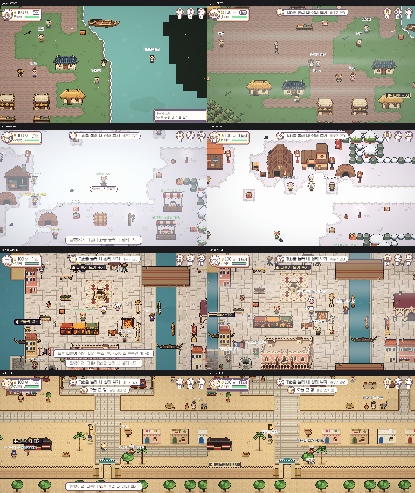

# 지역 튜토리얼·공용 이름표 수정

2026-11-08 Codex. 기준 integration `ff9a9ccf6`, 브랜치 `codex/team-system-audit-20261107`. [직전 조사](Region-Consistency-Audit-2026-11-08.md) 후 사용자 수정 지시에 따른 로컬 구현이다. 원격 반영/새 화면 사용자 승인은 아직 아니다.

## 이름 길이 결정

등록 NPC/주민, 맵의 이름 있는 사람 talker/worker, 첫 튜토리얼 안내원을 조사했다. 공백 포함·지역별 중복 문자열을 제거했다. 동적으로 만드는 모든 인물/상인을 포함한 런타임 전수조사는 아니다.

| 지역(담당 중앙 구역 포함) | 고유 이름 | 중앙값 | 최장 | 8자 초과 |
|---|---:|---:|---:|---:|
| 북유럽 | 68 | 7 | 14 | 18 |
| 베네치아 | 86 | 7.5 | 13 | 28 |
| 아라비아 | 70 | 8 | 13 | 25 |
| 고려·동쪽 | 37 | 5 | 9 | 3 |

원본 예: `포도밭에서 온 행상 마르코`14자, `포도 바구니 나르는 아낙`13자, `나즈드의 대상 숙소 주인`13자. [원본 목록/범위](../Validation/Region-Consistency-Fix-2026-11-08/npc-name-source-lengths.json).

사용자 최종 지시: **이름은 화면을 확인한 뒤 그때마다 변경/수정한다.** 자동 8자 제한이나 밀집도 기반 자동 축약을 넣지 않았다. 타 지역의 긴 이름은 보존한다. 이미 승인된 고려 접두어 제거·상인·낚시꾼 별칭만 유지하고, 원본 DisplayName과 사회/의뢰/시장/저장 ID를 바꾸지 않았다. 겹침은 배치 조정 또는 개별 표시 호칭을 검토한다.

## 구현

- 선착장 일꾼: 옛 맵 상수 좌표를 제거했다. `Tools/WorldLayout/goryeo_intro.json`에 기존 물리 세계 칸(242,60)을 원본으로 두고 T3 생성기가 현재 나루(69×89)의 (18,38)로 내보낸다. 원본에서 main 도달 가능/막힘을 검사하고 런타임에서 현재 맵 크기 일치를 확인한다. 물 위 (40,38)에서 육지의 원래 의도 자리로 복원했다. 기존 맵/씬 생성물 변화는 없다.
- 조작 순서: 달리기→Tab→I→M→Q→매입→판매→L로 팀과 통일했다. 옛 저장 단계5/6은 이미 완료한 Q를 별도 메모로 보존하여 I/M 이후 반복하지 않는다. 단계4의 미완료 Q는 I/M 후 배우며, 기존 보상/완료 상태는 유지한다. 새 `goryeo:intro_order`·`goryeo:intro_q_done` 메모를 쓰며 기존 키를 삭제하지 않는다.
- 안내: 팀의 TopPill 상단 목표·하단 Notify·Tab 확장 시 숨김을 재사용한다. 오른쪽 아래 카드/예약 공간은 제거했다. 옛 검토 도구를 위해 GuideText/GuideRect/ReservedGuideRect API는 남겼고 사라진 카드 영역은 예약하지 않는다.
- 공용 이름표: 기존 고려 렌더러를 본편 다른 지역에서도 연결한다. 이름은 위, Space만 아래, 이름 오른쪽 작은 네모 퀘스트 배지, 원래 WorldLabels/QuestNpc 마커 복원 규칙을 유지한다. 클래스명/GUID는 기존 검토 도구 호환을 위해 유지했다. 타 지역 전용 씬·맵·이야기·NPC 데이터는 변경하지 않는다. 고려 추가 장소 좌표만 기존 승인 리소스에서 공급한다.
- `WorldDisplayNames`에 기존 표시 별칭을 모아 Navigator와 StoryGuide도 실제 표시 호칭을 쓴다. 타 지역 TownMarket의 긴 고유 표시는 보존한다.

왼쪽은 이전 조사 캡처, 오른쪽은 이번 렌더다. 같은 단계3(Tab 보기)이며, 위치/애니메이션 프레임까지 고정한 픽셀 동일성 검사는 아니다. [퀘스트 배지](../../ArtReview/Region-Consistency-Fix-20261108/goryeo-badge.png)도 별도 촬영했다.

## 검증과 한계

- Python 기존424개 통과,23skip. 첫 제한 환경에서는 Aseprite27건 SIGABRT 오류가 났다. 제한 밖 같은 검사로 재실행하여 통과했다. 원본 위치/맵 크기/도달 가능한 육지와 인접 접근을 검사하는 신규2개도 통과했다.
- 세계883출구/오류0, 서버 TypeScript 검사 통과. 서버 로컬 통째 저장/순위·선물/백업 결과는 [검증 기록](../Validation/Region-Consistency-Fix-2026-11-08/README.md)을 따른다.
- Unity 컴파일/최종 콘솔 오류0. SaveOFF·Offline 격리에서 옛 단계0~11 이주/반복 적용/이미 완료한 Q/새 시작, 실제 대화 열기 등30확인. S0에서 실제 PlayerMotor 28tick 이동으로 일꾼1.29354칸 접근/Nearest 확인.
- 실제 InventoryUI.Open 이벤트, M/Q/L 가상 키로 창 열림·단계 변화, 실제 TownMarket Buy/Sell 동작(각1회, 소금), 귀환 대화 선택·완료11/20냥 확인. Shift 달리기·Tab 실키·모든 지역8단계의 사람 수동 완주는 실행하지 않았다. Tab 확장 조건 숨김은 실제 HUD 상태로 확인했다. 별도 API가 없는 검사에서 존재하지 않는 SupplyWeight를 조회한 도구 조각은 컴파일 실패했으며 제품 컴파일 실패로 세지 않았다. 실제 API를 읽고 stock/Buy/Sell로 다시 확인했다.
- 네 시작 씬에서 공용 렌더러 활성/기존 표시 대체, 화면에 그려진 이름/배지 상호 겹침0을 확인했다. 나루6개(배지 포함), 비르카3개, 리알토5개, 아흐사3개. 전체 맵/모든 화면 위치에서 겹침0을 보장한 것은 아니다.
- 아흐사 `대추야자 따기` 활동은 기존 이름표 겹침 생략 정책에 걸렸다. NPC 이름을 임의로 바꾸거나 타 담당 배치를 옮기지 않았다. 타 지역 전역 밀집 배치/전용 활동 UI는 별도 화면 검토 대상으로 남긴다.
- 개인 저장9개 SHA256 동일. 기존 개인 설정/패키지 변경·3D실험은 보존·커밋 제외. 최신 main/integration 포함 확인. 실서버 계정·실시간 원격 캐릭터 렌더·실제 매일 백업·사람 장시간 플레이·성능/빌드는 미검사.

공용 변경: `Scripts/UI/WorldDisplayNames.cs`, `UI/Navigator.cs`, `Quests/StoryGuide.cs`, 기존 고려 이름표 Director의 전 지역 연결. Core/Economy/DB/WorldIndex/Connections/빌드 목록/타 지역 전용 파일/서버 제품 코드는 추가 수정하지 않았다.
