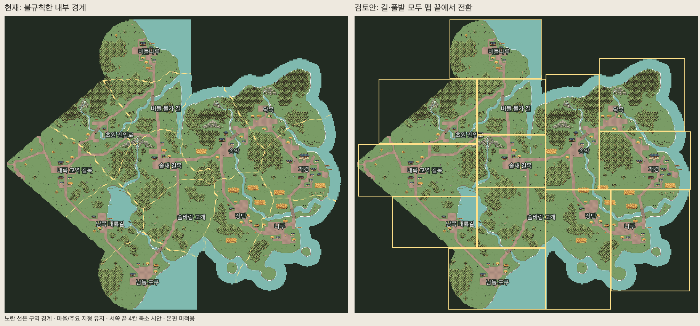
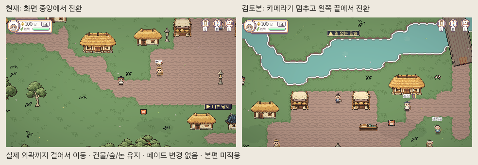
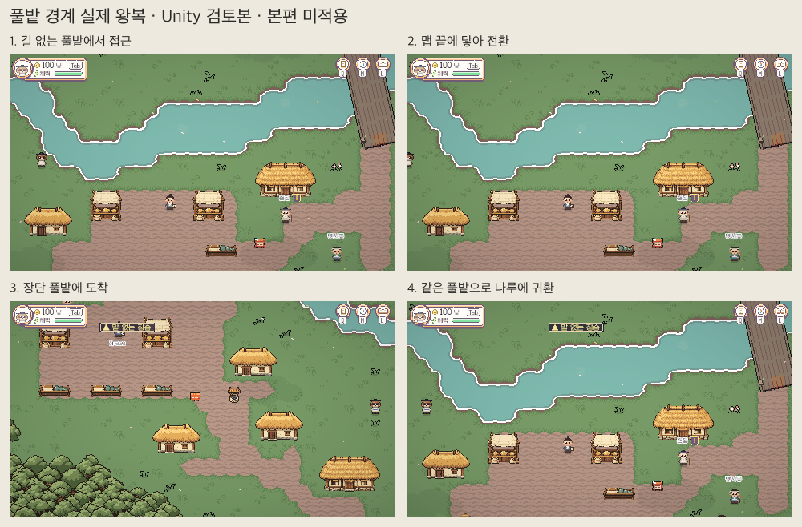

# T3 경계·길목 재조정 검토본

2026-11-07 Codex 검토본. 사용자 2026-11-08 “이대로 확정”으로 길·풀밭 경계안을 승인했다. **승인안을 로컬 본편에 연결했고 저장·좌표 이주를 완료했다.** 아래 검토 당시 기록과 [본편 적용 결과](../Validation/T3-Production-2026-11-08/README.md)를 구분한다. GitHub integration에는 아직 올리지 않았다.

## 달라진 점

- 13개 맵 ID와 모든 기능 객체의 ID·세계 위치를 유지했다. 마을·건물·주요 숲·논의 그림과 위치도 유지한다. 움직이는 장식·표지판은 새 구획에 배정했다.
- 불규칙한 내부 구역선 대신 사각형 맵의 실제 외곽에 출구를 둔다. 길 전용 제한을 없애고 마을에서 걸어서 닿을 수 있는 흙길·풀밭의 안전한 공유 경계를 모두 열며, 카메라는 해당 사각형 안에서 기존 CameraFollow로 제한한다. CameraBackdrop은 검토본에 만들지 않는다.
- 출구 635개(타 담당 중앙 구역 출구 3개 포함)에서 연속 모터 접근·바깥 면/마지막 출구 칸 접촉을 확인했다. 기존 MapExit의 담당 지역/타 지역별 접촉 차이는 유지한다. 북쪽 출구에서는 캐릭터 상체가 먼저 화면 밖으로 나갈 수 있으므로 끝 접촉 캡처만 보고 사람이 느끼는 자연스러움까지 승인한 것으로 보지 않는다.
- 초안의 도로 주변 전용 제한을 사용자 요청으로 철회했다. 풀밭을 열어 개경↔송악·장단↔솔바람 고개의 직접 연결도 복원했다. 새 사각형 구획상 안전한 공유 경계가 없는 개경↔장단, 초원 진입로↔남쪽 내륙길, 남쪽 내륙길↔솔바람 고개, 남쪽 내륙길↔솔재 길목 4쌍은 다른 맵을 거쳐 이동한다. 지형이나 길 그림을 지운 것은 아니다. 모든 13맵은 왕복 가능한 길 연결을 유지한다. 본편 적용 때 WorldIndex/길찾기/의뢰 이동거리를 이 연결표와 함께 갱신·검사해야 한다.
- 실제 플레이 영역 면적은 재분배된다. 기존 통행 가능 칸 총26,939칸 중 서쪽 끝4칸을 줄인26,935칸을 유지한다. 합치기·새 맵 추가·새 땅 생성은 없다. 맵마다 가로·세로는 달라지므로 이전과 치수가 모두 같다는 의미의 ‘크기 유지’는 아니다.

풀밭 검토는 나루↔장단의 길 등급0 구간을 사용했다. 2칸 전 미전환→끝 접촉(화면 가로0.18%)→장단 풀밭 도착→같은 풀밭으로 나루 귀환을 실제 모터/검토 씬 로더로 확인했다. 사람의 WASD 체감 검사는 아니다.

[13맵 실제 화면 모자이크](../../ArtReview/T3-Boundaries-20261107/13maps-game-mosaic.png). 이 검토기는 지형·경계 확인용이다. 새 치수로 아직 이주하지 않은 본편 생활 활동·장소 이름표·전체 UI/퀘스트 동선을 검증한 게임 데모가 아니다.

## 기존 타 담당 중앙 구역 연결 3곳

사용자 확인을 계기로 JSON 개수뿐 아니라 실제 연결 여부를 별도로 검사했다. 현재 본편에서 세 출구 모두 활성화·실제 충돌 기준 장터에서 도달 가능·기존 GameManager.TravelTo로 상대 씬 도착을 확인했다. 해당 맵·씬·Connections는 fetch한 integration과 같다. 북유럽 담당 중앙 맵1곳, 아라비아 담당 중앙 맵2곳이며 고려 본토에서 타 문명 본토로 직통 출구3개라는 뜻이 아니다. central_ports.json의 planned 설명만으로 비활성이라고 판단할 수 없다.

| 기존 상대 맵 | 검토본 우리 쪽 외곽 | 상대 쪽 보존 |
|---|---|---|
| north_c_road_se | 북쪽4칸, 세계(24,-18) | 씬·출구·도착 spawn·폭4 유지 |
| arabia_central_steppe | 서쪽 위3칸, 세계(3,-2) | 씬·출구·도착 spawn·폭3 유지 |
| arabia_central_eastvale | 서쪽 아래2칸, 세계(3,1) | 씬·출구·도착 spawn·폭2 유지 |

서쪽의 별도 출구 두 개를 같은 실제 외곽에 겹치지 않게 두기 위해 끝의 한 열4칸(세계x2, y-2..1)을 줄인 시안이다. 기존 원본 타일을 바꾸거나 새 땅을 늘리지 않았다. 북쪽 표지판을 새 출구 쪽으로 옮기고 기존 이정표 그림으로 서쪽 위·아래 안내2개를 배치했다. 내부 출구와 타 지역 출구가 같은 셀·같은 방향을 공유하지 않게 했다. 우리 쪽 귀환 spawn ID와 폭은 보존하고 안전한 안쪽에 옮겼다.

현재 본편의 정상 TravelTo 시험과 별도로, 새 검토본→기존 상대 씬→새 검토본의 세 경로도 각각 왕복했다. 이는 편집기 전용 로더를 사용하는 SaveOFF 검토이며, 아직 본편 등록/이주를 적용한 결과는 아니다. 상대 지역 파일은 수정하지 않았다.

## Unity에서 확인

1. `Pocket Caravan > Tests > T3 경계 검토 직접 걷기` 메뉴를 실행한다. 현재 나루 검토 씬을 열어 두었다. 해당 씬에서 직접 Play해도 격리 검토기를 시작한다.
2. WASD로 이동한다. 카메라가 가장자리에서 멈춘 뒤 캐릭터가 외곽 출구까지 가면 이동한다. 페이드는 기존 TravelTransition 정책을 재사용한다.
3. 이 모드는 이동·경계 검토용이며 NPC 상호작용·경제/저장 시험을 대신하지 않는다. 개인 저장 적용/자동 저장을 끄고 랜덤 격리 슬롯을 사용한다. Play를 멈추면 본편 상태로 남는 변경은 없다.

재생성: NumPy·SciPy·Pillow가 있는 Python으로 `Tools/WorldLayout/t3_boundaries.py`, 필요하면 `t3_render.py` 실행 후 위 Tests의 `T3 경계 검토 씬 생성` 메뉴를 실행한다. 원본은 t3_boundaries.json의 구획·출구 설정과 t3_baseline.json.gz의 동결 맵 입력이다. sourceLocks가 달라지면 먼저 최신 변경을 검토하고 재기준화해야 하며, 변경된 본편을 조용히 다시 입력으로 사용하지 않는다. 생성물을 손으로 수정하지 않는다.

## 검사

- Python 경계 검토11개 + 기존 경계 회귀4개 = 15개 통과(작성 도구 의존성이 있는 로컬 환경). 팀 CI는 Pillow만 설치하므로 NumPy/SciPy 없는 환경에서는 신규11개를 명시적으로 skip하며, 이 경우 통과로 세지 않는다. 13맵 연결·왕복/실제 외곽·같은 방향 출구 중복0·기능 ID/세계 위치·안전 도착·명시한4칸 이외 전체 네이티브 타일 참조 유지 확인.
- Unity 최종2642항목 통과: 13맵/635출구, 연속 모터 접근·2칸 전 미전환·실제 외곽·13개 렌더 표본, 타 담당3곳 왕복과 안전 귀환 포함. 풀밭 나루↔장단 왕복4장 포함 실제 게임 화면30장. 타 담당 본편 출구의 정상 GameManager 이동은 전단계의 별도19항목 기록으로 확인했다.
- 길 등급을 조건으로 사용하지 않는 비도로 출구면806개를 포함한다. 독립된 공유 경계 전수 검사에서 안전한 경계 누락0, 이전 유효한 길 출구면164개 누락0을 확인했다. 분리된 막다른 풀밭 조각은 열지 않으며, 한 방향이 막힌 모서리 때문에 다른 열린 방향까지 닫히지 않게 면별로 검사한다. 기존 타 담당 출구3곳은 해당 바깥 면에서 우선하며 내부 출구와 겹치지 않는다. 북쪽 외부 출구 맞은편의 일반 내부 경계4칸도 예약 구간으로 제외한다. 그곳에 내부 통로를 겹치면 되돌아갈 때 다른 지역으로 가므로, 예약 구간 외의 모든 내부 풀밭 출구는 동일한 이웃으로 왕복하는지 셀 단위로 검사했다.
- 첫 연속 접근 검사에서 나무 뒤 출구를 발견해 거부 조건을 추가했다. 타 지역 출구와 내부 출구의 겹침도 실제 모터 검사로 발견해 위치를 분리하고 중복 회귀를 추가했다. 직접 Play 자동 시작과 검사 시작의 중복 실행도 단일 검토기로 고친 뒤 자동/직접 Play를 별도로 재검사했다. 풀밭 촬영 표본의 2칸 뒤가 막혀 있던 초기 검사는 실패로 보존하고, 3칸 모두 풀밭·통행 가능한 표본으로 바꿔 재확인했다. 실패 기록도 Validation에 보존했다.
- 직접 Play 검사에서 previewOnly=true·검토기 활성·Autosave OFF·격리 슬롯·본편 PC 대신 검토 이동기 활성 확인. 최종 콘솔 error0.
- 본편 세계 검사1437출구/오류0. 기존 타일 에셋·PocketCaravan Settings 15,888파일 지문 변화0. 본편/타지역 씬·맵·공용 데이터 및 빌드 목록 변경0.
- 이번 풀밭 확장 직전/직후 개인 저장9파일 지문은 모두 동일하다. 앞선 긴 조사 세션에서는 본체/bak2개 변경이 있어 원인을 단정하지 않았으며 임의 복원하지 않았다. QA는 격리 슬롯/SaveOFF와 해당 슬롯 미생성을 확인했다. 네이티브 지형 PNG13장의 디코딩 RGBA도 풀밭 확장 전후 모두 동일하다.
- 전체 회귀·온라인·사람 WASD 체감·긴 플레이/FPS·빌드는 실행하지 않았다.

근거: [길 출구 보존](../Validation/T3-Boundaries-2026-11-07/grass-road-regression.json), [그림·저장 보존](../Validation/T3-Boundaries-2026-11-07/grass-preservation.json), [Unity](../Validation/T3-Boundaries-2026-11-07/unity.json), [정상 본편 외부 연결 확인](../Validation/T3-Boundaries-2026-11-07/foreign-audit.json), [정적 검사](../Validation/T3-Boundaries-2026-11-07/static.txt), [구획·면적·연결 변경표](../Validation/T3-Boundaries-2026-11-07/geometry.json).

## 승인 후 본편 연결 (2026-11-08)

사용자 확정 후 `t3_install.py`에서 본편 13 JSON·생활 기능/장터/나룻배 좌표·지도·고려 쪽 연결표를 재생성했다. `T3Production.Build()`는 등록된 우리 13씬과 WorldIndex의 우리 항목만 갱신한다. 빌드 목록과 다른 지역 파일은 유지했다.

`layoutVersion=3` 이주는 동결된 v2 원점·높이에서 세계 위치를 구한 뒤 새 소유 맵으로 옮긴다. v0·v1/옛 ID는 기존 M4 도착 정책을 유지한 뒤 변환한다. 유효한 위치는 그대로, 잘린4칸·막힘·고립 조각·출구 위는 같은 대상 구역의 주 통행 영역 안전 칸으로 복구한다. 떨어진 짐도 위치만 옮기고 미등록 상품/계약 정보는 보존한다. 돈·짐·퀘스트 등의 필드는 바꾸지 않으며 이주는 메모리에서만 수행한다. 개인 저장에 대한 디스크 쓰기는 하지 않았다.

본편 재생성은 NumPy·SciPy·Pillow 환경에서 `python Tools/WorldLayout/t3_install.py --write --worldmaps`, Unity에서 `PocketCaravan.EditorTools.T3Production.Build()` 순서다. 원본 `t3_baseline.json.gz`에는 승인 직전 9536d0d29 입력이 들어 있고 맵 sourceLocks를 유지한다. 새 팀 변경이 출력에 들어오면 검사 없이 덮어쓰지 않도록 기존/설치 지문이 다를 때 중단한다. 옛 M4 본편 생성은 차단하며 과거 그림 검토 재현은 `t3_history.py`의 명시적 동결 입력으로 검사한다. 새 본편의 실제 좌표·전수 재생성·물리 위치 보존 검사는 `test_t3_production.py`가 맡는다.

검사 수치·실제 화면·재현 명령·확인하지 못한 범위는 [검증 기록](../Validation/T3-Production-2026-11-08/README.md)을 따른다.
