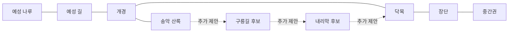

# 고려 지역 플레이 경험·성장·동선 검토

기준: 2026-10-18, 소스 기준 `b489f48`. 사용자 요청에 따른 설계 검토다. **새 퀘스트·마을·도로·경제 배율을 구현하거나 확정한 문서가 아니다.** 현재 상태는 DevelopmentStatus, 기존 필수 범위는 GoryeoRegionSpec을 따른다. 아래 시간·수치·콘텐츠 배정은 플레이 테스트용 제안이다.

## 1. 판단

고려는 **수도1+마을4를 유지하고, 각 거점을 이용할 이유와 이동 중 선택을 먼저 완성**하는 편이 낫다. 지금 여섯 번째 마을을 더해도 비슷한 장터와 왕복이 늘어날 가능성이 크다. 반대로 현재 다섯 거점만으로 충분한 플레이타임이 확보됐다고 판단할 근거도 없다.

부족한 것은 마을의 개수보다 ① 생산·소비 역할에 맞는 실제 차익 ② 지역 전체의 대안 경로 ③ 수레를 산 다음의 새 목표 ④ 변화가 읽히는 이동·생활 공간이다. 우선 기존5거점+현재 길을 다듬고, 필요성이 검증되면 **마을 대신 이동 구역2~3개**를 후보로 둔다. 새 구역은 기존 환경 라이브러리를 재사용하되 자동 완료로 보지 않는다.

## 2. 현재 코드·데이터에서 확인한 것

| 항목 | 현재 상태와 경험상의 영향 | 근거 |
|---|---|---|
| 고려 연결 | 6맵·양방향 연결5개, 지역 차원의 독립 순환0개. 송악은 개경에서 되돌아오는 가지, 장단은 외부 진입 방향 | Maps JSON 출구, 이동 분석 JSON |
| 길 선택 | 예성 길 안에 샛길/큰길이 있으나 다른 마을을 경유해 돌아오는 지역 순환로와는 다름 | Route01, validate_route_choice |
| 초반 퀘스트 | T1~T5가 나루·개경·닥목을 반복. 송악·장단은 기본 주선에 포함되지 않음 | Data/Goryeo/Quests |
| 구매 목표 판정 | T2의 문구는 닥목에서 종이 구매지만 Buy 목표 targetId는 비어 있어 다른 장터의 구매도 인정 가능 | T2_BuyPaper.asset, QuestManager.Advance |
| 운반 성장 | 등짐10 → 손수레30, 가격150. 같은 짐이면 적재 감속이 줄지만 풀밭·산길에서는 불리할 수 있음 | Vehicle_Walk/Handcart, PlayerController.CurrentSpeed |
| 초기 자금·보상 | 시작100, 기존 주선 T1~T4 보수30/45/20/50. 손수레 시점이 퀘스트 보수·특별 할인 거래에 크게 좌우됨 | GameDatabase, 기존 퀘스트 |
| 조기 수레 구입 | 퀘스트 순서와 별개로 자금이 되면 구입 가능. 이미 수레가 있으면 BuyVehicle 단계가 상태 검사로 통과하므로 재구매를 요구할 필요 없음 | TownMarket, QuestManager.CheckPassive |
| 신용 | 시작0, 안내소1·개경 창고3. 방문과 기본 매매는 자유. 초기 신용 보상으로 시설이 비교적 일찍 열릴 수 있음 | TownData 시설, 퀘스트 보상 |
| 장단 곡식·땔감 | 둘 다 originTown 없음. 초기 정상 재고에서는 모든 마을 기준가가 각각8/4로 같아, 장단의 공급·수도 판매 역할을 초기 차익으로 보장하지 못함 | Item_Grain/Firewood, ItemData.BasePriceAt, MarketMath |
| 송악 약재 | 거래하는 인삼의 가격 기준 공급지는 개경. 송악에서 인삼을 사서 개경에 파는 공급지 역할이 성립한다고 가정하면 안 됨 | Item_Ginseng.originTown, 송악 stock |
| 쉼터 | 달리기 체력을 회복한다. 걷는 중에도 체력은 회복되므로 이것만으로 마을 방문을 강하게 유도하기 어려움 | PlayerController.UpdateCarry, TownFacilitiesUI |
| 미구현 | 공통 Q1~Q7 통합, 고려 정보 특화의 실제 효과, 날씨에 따른 본편 통행 변화, 온라인 | 진행표·기존 작업 목록 |

장단 stock의 optimal을30으로 늘린 것만으로 산지 할인은 생기지 않는다. MarketState는 초기 재고를 해당 optimal에서 시작하므로 초기 가격 비율 optimal/stock이 동일하다. 시장 재고 변화로 차익이 생길 수 있다는 점과 거점 역할을 설계했다는 것은 구분한다.

### 현재 지역 연결과 순환 후보

실선은 현재 연결, 점선은 미구현 후보다. 닥목~장단의 들길 후보는 기존 직결을 대체하는 접속 구역이며 위 그림에 독립 마을로 추가하지 않는다. 지도에서 이 사각 구역들이 실제로 겹치지 않는지는 별도 배치 검사가 필요하다.

### 실제 거리와 시간의 계산 기준

`python3 Tools/Integration/analyze_journey.py`로 현재 JSON의 통행 지형과 출구, 차량의 노면 속도, 기본3.8칸/초, 화물 무게5를 사용했다. 장터에 인접한 상호작용 칸 사이의 직교 최단 경로이며 전환당0.30초 페이드만 더한다.

| 장터 사이 편도 | 등짐 계산값 | 손수레 계산값 | 전환 |
|---|---:|---:|---:|
| 나루 → 개경 | 27.1초 | 25.8초 | 2회 |
| 개경 → 닥목 | 13.3초 | 11.3초 | 1회 |
| 개경 → 송악 | 19.0초 | 18.4초 | 1회 |
| 닥목 → 장단 | 6.8초 | 6.0초 | 1회 |
| 나루 → 장단 | 46.6초 | 42.7초 | 4회 |
| 장단 → 중간권 버들나루 | 64.5초 | 55.7초 | 4회 |

**실제 사람의 플레이타임이나 Unity 주행 실측이 아니다.** 대각선 조작·달리기·가감속·NPC·출신 효과·장터 조작·대화·길 찾기·장비별 로딩은 제외했다. 둘 사이 정방향 계산이며 반대 방향 시간은 별도로 기록해야 한다. 현재 지형을 읽고 방향을 판단하는 시간까지 위 숫자로 주장하지 않는다. 근거 스냅샷은 Validation/GoryeoExperience-2026-10-18.json이다.

이 수치가 시사하는 것은 ‘속도를 낮추자’가 아니다. 특히 닥목~장단은 별도 생활권으로 느끼기 전에 도착할 수 있고, 중간권도 맵 전환 횟수만으로 먼 여정을 보장하지 못한다. 길을 늘리기 전 로딩 중단과 실제 판단의 비율부터 관찰한다.

## 3. 레벨 디자인: 경험으로 느끼는 성장

별도의 캐릭터 경험치·전투 레벨은 이번 고려 개선의 필수로 추가하지 않는다. 기존 돈·신용·수단·장부를 연결해 **스스로 판단할 수 있는 거래와 이동 범위가 커지는 것**을 성장으로 만든다. 아래 단계는 권장 경험 순서이며 지역 출입 잠금이나 숙제 목록이 아니다.

| 경험 단계 | 배우는 판단 | 얻는 변화 | 다음에 해볼 일 |
|---|---|---|---|
| 첫 운반 | 목적지·무게·길 읽기 | 첫 보수와 거래처 인지 | 자기 돈으로 소량 구매 |
| 첫 자율 거래 | 원가와 판매가·귀환 화물 | 장부에 둘 이상의 거래처 기록, 자신의 손익 확인 | 다른 상품·거점 비교 |
| 첫 전문 선택 | 가벼운 고가 화물 / 무거운 생활재 / 안정적 배달 | 송악과 장단 중 다음 방문을 스스로 선택 | 같은 길을 다른 적재로 비교 |
| 손수레 | 가격뿐 아니라 남길 운전자금·노면·물량 | 적재10→30, 수레 시각 변화·대량 거래 가능성 | 첫 수레 왕복과 다른 귀환품 |
| 신용과 물류 | 제공 시설·개인 조건·화물 분할 | 안내소·창고를 실제 의사결정에 이용 | 여러 거래처를 잇는 상업 활동 |
| 외부 여정 | 예상 거리·쉬는 곳·팔 곳·귀환 계획 | 장단을 출발 거점으로 중간권을 시도 | 타 문명 교역으로 확장 |

수레 구매와 시설 해금이 같은 순간에 몰리지 않도록 실제 획득 시점을 기록한다. 기존 신용1/3을 임의로 올려 시간을 늘리지 않는다. ‘새 신용 도달 → 무엇을 할 수 있게 됐는지 한 줄 → 지금 이용할 곳’이 연결돼야 한다.

수레를 살 수 있는 돈과 장사를 계속할 돈은 다르다. 권장 구매 안내는 `수레값 + 선택한 다음 거래의 매입비 + 이번 여정에서 명시한 서비스 비용`을 보여 주는 방식이다. 남은 돈이0이라고 이동/재기용 배달을 막지 않는다. 수레를 일찍 산 숙련자는 순서를 건너뛰고 다음 목표로 넘어가게 한다.

## 4. 다섯 거점의 역할·왕복 이유

| 거점 | 꼭 구분할 경험 | 출발 화물과 돌아올 이유의 제안 | 공간·성장 요소 |
|---|---|---|---|
| 예성 나루 | 작은 장사와 강변 출발 | 소금 등 유통품 출발, 생산 마을의 생활재 수요 대응. 바깥 물건을 가져와 판매 | 선착장→적치장→장터→동쪽 길을 읽기 쉽게. 보수 없이 길 찾기·매매 연습도 가능 |
| 개경 | 수도 집산·거래 비교·화물 재편 | 여러 품목의 판매처와 분배 중심. 각 생산 마을에 보낼 귀환품 선택 | 남문 도착과 시전의 밀도 차이, 짐을 맡기고 거래선을 바꾸는 창고 사용 |
| 닥목 | 생산 현장과 첫 매입 | 종이 매입→소비지 판매, 귀환 시 소금·생활재 납품 | 물가 작업장→건조대→적치→장터 순서. 안내소는 가까운 거래처 비교 |
| 송악 | 가벼운 화물·산록 탐색 | 약재 집산 또는 선별 거래 중 하나를 채택. 개경 기준 인삼을 비싸게 재매입하는 현 상태와 역할을 맞춤 | 산록 길·조망·작은 작업장. 값비싼 가벼운 짐만 항상 최고 수익이 되지 않게 재고·자금·수요 제한 |
| 장단 | 수레·농업 물류·원정 준비 | 곡식·땔감의 실제 공급 이득 또는 대량 납품 의뢰를 마련, 종이·생활재를 귀환품으로 | 넓은 적재 마당·밭·외부 이정표. 장단을 거치면 재정비/거래할 이유 |

한 거점당 새로운 전용 시스템을 만들 필요는 없다. 기존 매매·의뢰·시설을 다른 조합으로 배치하되, 실제 순이익/시간·적재·운전자금이 달라야 한다. 쉼터나 긴 NPC 대사 하나만으로 방문 목적이 충족됐다고 평가하지 않는다.

### 경제 역할을 먼저 성립시키는 방법

공용 상품의 originTown을 지역 담당자가 임의로 바꾸면 타 지역 가격까지 바뀐다. 우선 공통 경제 담당과 **거점별 품목 공급·소비 가격 계수 또는 지속적인 공급·소비 규칙** 중 작은 방식 하나를 합의한다. 후보는 TownData 품목 항목의 기본값1인 로컬 가격 계수다. 기존 거리 기준가에 적용한 뒤 재고·매입/판매 수수료는 그대로 계산해 같은 마을 되팔기 악용을 막는다. 이는 새 제안이며 이번에 공용 코드를 수정하지 않는다.

초기 재고만 조정하면 회복 뒤 역할이 사라질 수 있고, optimal만 바꾸면 초기 할인 자체가 생기지 않는다. 장단의 대량 배달은 임시로 수레의 쓰임을 검증할 수 있지만, 퀘스트 보수로만 장단 수익을 보장한 상태를 자유 교역 밸런스 완료로 보지 않는다.

비교식: `왕복 순이익 = 판매 대금 - 매입 원가 + 의뢰 보수 - 실제 서비스/통행 지출`. 이를 전체 왕복 시간으로 나누고, 매입 가능한 자금·용량·상품 수요를 함께 비교한다. 첫 한 개의 마진에 수레 용량을 곱해 대량 수익을 보장하지 않는다. 창고 출고·중간 판매·귀환품 변경도 전체 여정으로 기록한다.

## 5. 이동 동선과 구역 확장

기본 안내 동선은 나루→예성 길→개경→닥목이다. 모든 목적지를 한꺼번에 퀘스트 마커로 채우지 않는다. 첫 거래를 마치면 **송악의 경량 교역 / 장단의 수레 교역**을 동시에 제시하고 선택하게 한다. 필수 도입은 두 번의 짧은 거래 경험 수준으로 줄이되 기존 T/S 진행 이주를 먼저 정리한다. 공통 Q1~Q7의 낙하/촌락 승급 전제는 복구하지 않는다.

| 구간 | 현재 문제 | 다음 후보 | 넣기 전에 확인 |
|---|---|---|---|
| 예성 길 | 두 길 비교는 있으나 몇 초 차이를 잘 못 느낄 수 있음 | 같은 상품·무게로 양쪽 경로 비교, 큰 다리/주막/성문을 미리 보이는 이정표로 연결 | 지름길이 잔디 직선보다 실제로 나은지, 큰길 수레 이득이 조작에서도 읽히는지 |
| 닥목~장단 | 장터 사이 약7초, 구역 차이가 약함 | 들길·둑길 등 **이동 구역1개 후보**. 작업장 밖→농경지→적재 마당 전환, 물가/큰길 선택 하나 | 단순 통행 시간 늘리기인지. 도착할 마을과 적재 이유를 미리 알 수 있는지 |
| 송악~닥목 | 현재 개경 왕복을 반복해야 함 | 구릉길·내리막을 이용한 **이동 구역2개 안팎 후보**로 지역 첫 순환로 | 경량 산길과 개경 경유 큰길의 왕복 가치, 실제 접속 위치·지도 겹침·수레 통행 |
| 나루~장단 강변 우회 | 별도 수계·여러 연결 구역 작업이 커짐 | 보류. 첫 순환로가 효과 있을 때 후속 비교 | 이번 마감과 생산량, 강 경계의 연속성 |
| 장단~중간권 | 전환4회지만 계산 이동은 약1분 | 새 마을보다 풍경·길 선택·휴식 위치를 묶은 여정. 짐과 귀환 계획을 미리 세우게 함 | 매 전환의 로딩, 경관/판단 없이 빈 구간만 늘지 않는지 |

새 순환로를 이미지에만 그려서는 안 된다. 현재 cartography는 사각 맵과 출구 정렬, 순환 시 위치 일치를 검사한다. 송악~닥목 한 장을 임의로 붙이면 수도와 지도 영역이 겹칠 수 있으므로 **2개 이상 구간으로 꺾어 연결하거나 실제 배치부터 재설계**해야 한다. 정확한 씬 수·좌표는 설계/검사 후 확정한다. 가격용 좌표를 지도 좌표에 맞춰 자동 변경하지 않는다.

기존 마을 방문은 자유다. 확장은 **알게 된 길 → 활용 가능한 거래 → 적재와 시설을 이용한 더 먼 여정**으로 느끼게 한다. 개인 신용 때문에 같은 세계의 도로를 유저별로 다르게 막지 않는다. 외부 진입에 강제 자금·수레·Q7 완료 조건을 새로 달지 않고, 준비가 부족한 플레이어에게 추천 조건과 귀환 경로를 안내한다. 본편에서 아직 연결되지 않은 다른 문명은 완료된 목적지로 표시하지 않는다.

## 6. 몰입감·발견·이동 사건

- **보이기→선택하기→이동하기→잠깐 쉬기→도착하기:** 내리막에서 지붕이 보이거나, 강 소리를 들은 뒤 나루를 발견하는 식으로 목적지를 예고한다. 매 화면마다 장애물을 넣거나 계속 뛰게 하지 않는다.
- **거점마다 대표 장면1개:** 나루의 하역, 개경의 남문·시전, 닥목의 종이 작업, 송악의 산록 작업/조망, 장단의 곡물 적재. 장식은 일의 동선 주변에 모은다. 노동자 연출을 실제 경제 시뮬레이션이라고 설명하지 않는다.
- **지역 전체 발견3~5곳 후보:** 물가 샛길, 고갯마루 조망, 작업장 뒷편, 다리 전망, 길손 쉼터. 한 번은 돌아볼 이유가 있고 이후에는 원하면 통과한다. 경치·다음 거래 힌트·자기가 확인한 경로 정보가 보상이며 반복 현금 줍기는 넣지 않는다.
- **본편 장애는 우선2종 이하로 비교:** 쓰러진 통나무의 우회/명시적 처리 비용, 진흙 구간의 큰길 우회처럼 이미 있는 도구로 판단 한 가지를 시험한다. 산적·수적·전투·날씨·48종 동시 배치는 필수로 올리지 않는다. 모든 선택에 명확한 무상 우회 또는 돌아갈 길이 있어야 한다.
- **가벼운 생활 반응:** 수레의 적재 모습, 상품·장부·시설 이용 결과, 첫 거래 이후 짧은 NPC 반응. 모든 방문마다 대사를 강제로 재생하지 않는다. 사람 NPC1안과 최종 아트 채택은 별도다.

기존 도적 약탈은 주행 낙하 제거와 별개로 남아 있다. 초기 안전 구간에서는 손실 없이 이동·매매를 배우게 하고, 위험 구간은 사전 표시·우회가 있는 선택으로 재검토한다. 도적이 있는 현재 상태를 ‘화물 유실이 전혀 없는 게임’이라고 안내하지 않는다. 초기 구간 배치/약탈 정책 변경은 미구현이다.

설계 참고: Valve의 [Replayable Cooperative Game Design: Left 4 Dead, GDC2009](https://cdn.fastly.steamstatic.com/apps/valve/2009/GDC2009_ReplayableCooperativeGameDesign_Left4Dead.pdf), 특히 예고·변주·강약 조절 논의(p.28~38). 교역 게임의 시간·사건 수가 이 자료로 검증된 것은 아니다. AI Director나 전투를 도입하자는 제안도 아니다.

## 7. 플레이타임: 목표와 검증을 분리

회의 초안은 필수 약5분+선택10~20분과 총12~25분이 혼재한다. **첫 손수레는12~25분, 고려 입문 세션은30~45분을 우선 검증할 가설**로 둔다. 지역을 반복 이용하는 수명과 1회 입문 분량은 다르다. 아래는 재조정할 목표이며 현재 확보된 분량이 아니다.

| 처음 온 플레이어의 누적 시간 | 확인할 경험 | 목표 판정 |
|---|---|---|
| 0~5분 | 첫 운반/매매, 목적지와 적재 확인 | 긴 설명 없이 상품·목적지·보수를 구별 |
| 5~12분 | 두 거래처 비교, 첫 자기 돈 교역과 귀환품 | 목표 지시 없이 다음 매입/판매를 설명 |
| 12~25분 | 선택 의뢰·거점 분기·첫 손수레 | 자금·적재·노면 차이를 느끼며 구매 후에도 재기 가능 |
| 25~45분 | 새로운 거점 역할·반복 교역·순환로 또는 외부 출발 준비 | 이전과 다른 이유로 길/물량/목적지를 선택 |
| 선택 연장45~60분 | 다섯 거점 탐색·추가 거래선·중간권 시험 | 강제 전체 방문이 아닌 탐색 성향의 추가 체험 |

숙련자가 빨리 수레를 사는 것은 실패가 아니다. 반대로 25분을 넘겼다는 이유만으로 보상을 일괄 늘리거나 낮추지 않는다. 어디에 시간이 쓰였는지 나눠서 본다. 이해하기 어려운 UI·잘못된 길·과도한 대사·같은 심부름 때문에 늘어난 시간을 콘텐츠 분량으로 세지 않는다.

**이동 목표 후보:** 가까운 생산/소비 거점35~60초, 준비가 필요한 지역 내 구간60~90초를 우선 비교하되 현재 약7초 구간에 곧바로 일괄 적용하지 않는다. 지도·거리·표현이 만든 변화가 있는지 본 뒤 결정한다. 변화 없는 직선 걷기가30초 이상 반복되면 이정표/시야/분기·지형을 수정할 후보로 기록한다. 이는 인간 주의력의 보편 법칙이 아니라 이 프로토타입의 검토 기준이다. 시간을 채우기 위한 속도 하향·필수 대기·돌아가기 퀘스트는 쓰지 않는다.

## 8. 마을을 추가할 판단 기준

지금은 여섯 번째 정착지보다 기존 역할을 완성한다. 아래 질문에 답할 때만 신규 마을을 제안한다.

1. 기존 다섯 곳에 배정하면 정체성이 흐려지는 별도 생산·소비/물류 기능이 있는가?
2. 다른 경로로 왕복할 이유·귀환 화물이 있고, 다른 마을의 거래를 복제하지 않는가?
3. 실제 유저가 해당 여정에서 쉬고 정리할 거점을 필요로 하는가? 현재 초 단위 동선에 장터를 추가하는 것이 맞는가?
4. 담당·미술·NPC·등급/시설·가격·출구·저장·멀티 납품까지 감당할 수 있는가?

임시 쉼터·길목 노점·나루 시설·관측 지점이면 해결되는 필요는 독립 townId를 늘리지 않고 POI로 만든다. 미래의 도예/철물 등 전문 거점은 신규 상품·수레 사용처와 함께 판단할 후보이며, 역사적 전문 생산지로 임의 확정하지 않는다. 중간권의 솔재·버들나루를 고려 마을 수로 더하지 않는다.

## 9. 실제 플레이·멀티·재방문 검증

첫 시험은 팀원3명이 같은 새 저장·시작 자금으로 **30~45분, 설명 없이** 진행한다. 효율 위주·탐색 위주·게임에 익숙하지 않은 플레이를 나눠 보되 작은 표본을 전체 유저 선호로 일반화하지 않는다. 두 번째 시험은 같은 사람의 수레/화물 변경 왕복을 짧게 비교한다.

기록할 것: 첫 매매/첫 순이익/첫 수레/신용1·3의 시각, 방문 순서, 길·품목 선택 이유, 제자리·매매·대화·이동·로딩 시간, 세 번째 왕복의 선택 변화, 실패 후 재기. 수익에는 매입 원가·전량 가격 하락·비용과 귀환을 모두 포함한다. 수레는 같은 무게 비교와 같은 적재율 비교를 별도로 한다.

수정 신호: 송악/장단을 설명 없이 갈 이유가 없음, 수도에 팔기만 하면 항상 정답, 빈손 귀환만 반복, 같은 노선만 돌 때 수익/시간이 압도적, 도착 즉시 재출발해 마을 역할을 기억하지 못함, 수레 구매 후 할 일이 없음. 이런 경우 새 마을보다 거래 역할·노선·목표를 먼저 바꾼다.

온라인2~4명에서는 공유 재고 고갈·같은 의뢰 동시 수락·창고 개인 귀속·사건 우회·지역 전환을 따로 시험한다. 상점 품절로 모든 초보자가 막히지 않도록 개인별1회 도입 의뢰나 안정적 재기 작업을 설계하되 반복 발급으로 무한 재화를 만들지 않는다. 한 사람의 수리/막힘 상태가 다른 사람에게 다르게 보이지 않도록 서버가 사건 상태와 버전을 결정해야 한다. 개인 대화·장부·거래 메뉴를 열어도 공유 세계나 다른 이용자의 시간이 멈추지 않아야 한다. 현재 온라인 검증 완료가 아니다.

최종 MMORPG에서는 매 프레임 모든 지역의 장식 NPC를 동기화하지 않고 근처 이용자에게 필요한 거래/사건 상태만 공유하는 방향을 검토한다. 수익성·정보·개인 신용·발견 기록과 공유 시장 상태를 구분한다. 순간이동이나 원격 구매를 이번 편의 기능으로 추가하면 운송 거리의 가치가 달라지므로 별도 경제 검토 없이 넣지 않는다.

## 10. 실행 순서·확인 단위

세부 상태는 ImplementationBacklog의 **GY-LD-01~06**을 단일 원본으로 관리한다.

1. **교역 역할·돈 흐름:** 장단/송악의 실제 공급·소비와 수레 이후 거래를 정리한다. 공용 경제 담당과 변경 경계를 합의한다.
2. **초반 경험·개인 성장:** 필수 두 경험 뒤 선택을 제시하고, 기존 T/S와 공통 Q1~Q7·구 저장을 매핑한다. 수레·신용 해금 전후를 읽히게 한다.
3. **현재 길로 먼저 시험:** 다섯 거점의 자율 왕복·동선·교역/시간을 관찰한다. 계측 전에 새 맵으로 분량을 보장하지 않는다.
4. **필요한 이동 구역만 추가:** 닥목~장단 구역과 송악~닥목 순환을 단계적으로 비교한다. 마감에 따라 첫 순환과 근거리 지형 중 경험 효과가 큰 것을 먼저 납품한다.
5. **대표 장면·발견·작은 사건:** 실제 거래와 길 판단을 보강하는 지점부터 배치하고, 혼잡/가림/수레 폭/대사를 확인한다.
6. **반복·재기·온라인 인원:** 세 번째 왕복과 수레 이후 목표를 확인하고, 공통 담당의2~4명 통합 시험에 동일 콘텐츠를 넘긴다. 사용자 고려 담당을 전체 서버 개발 담당으로 바꾸지 않는다.

11월 초 MVP의 남은 기간에 새 마을·새 성장 스탯·생존 시스템·해상 이동까지 한꺼번에 올리지 않는다. 이 검토는 범위 확대 약속보다 기존 고려의 실제 플레이 경험을 완성하기 위한 우선순위다.
