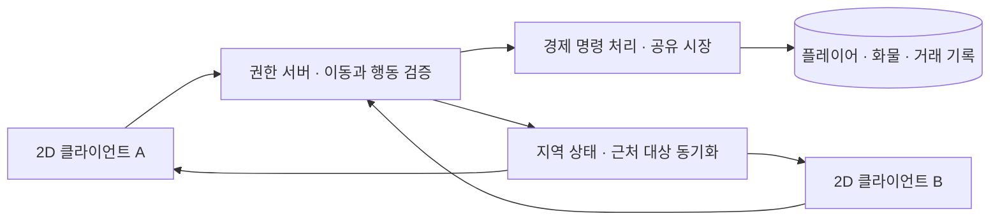

# Pocket Caravan 멀티플레이 설계안

> **현재 구현 추적:** [개발 진행표](DevelopmentStatus.md)를 먼저 확인한다. 아래 검토 당시의 ‘4맵·마을2·시설/낙하 제거 미구현’은 이전 기준선이다. 이번 구현은 6맵·수도1+마을4·로컬 시설3종이며, 사용자 후속 확인에 따라 감속을 나타내는 시각적 흔들림은 유지한다. 기획/검증/미완료는 진행표에서 구분한다.

기준일: 2026-10-15. **설계 제안이며 미구현**. 상위 요구는 [개발 기준안](GameDesign.md), 작업·검증 순서는 [개발·검증 계획](DeliveryPlan.md)을 따른다.

## 1. MMO 목표와 이번 검증을 구분 — MP-01

목표는 여러 상인이 같은 세계의 길과 시장을 이용하고, 다른 상인의 거래가 내 거래 기회에 영향을 주는 교역 세계다. 같은 화면에 여러 캐릭터를 표시하는 기능만으로 완료하지 않는다.

| 단계 | 입증할 내용 | 현재 |
|---|---|---|
| 로컬 시험 | 이동·운반·교역 규칙 | 일부 구현·기술 검사 완료 |
| 최소 온라인 | 최소 두 독립 클라이언트가 한 권한 서버에 접속, 이동·시장·화물 상태 공유 | 미구현 |
| 초기 MVP 시연 | 2~4명 실제 동시 이동·교역. 네 팀원 검증 권장 | 사용자 MVP 목표 확정. 미구현 |
| 용량 검증 | 목표 지역 인원·전체 동시 접속과 부하·복구 시험 | 목표 수·장비·예산 미정 |
| 서비스 운영 | 상시 지속 세계·장애 복구·운영 도구·악용 대응 | 장기. 소규모 시연으로 지원 완료라고 소개하지 않음 |

사용자 확인: 기본 시스템 구현이 선행 단계이고, 초기 4주 MVP는 2~4명 실제 멀티플레이를 검증한다. **최종 제품 목표는 MMORPG 규모의 다중 접속 교역 세계**다. 2~4명은 최종 정원이 아니다. 장기 세계 전체/한 지역/한 화면/동시 거래 인원은 아직 숫자로 확정하지 않았으며 확장 검증 계획에서 구체화한다. MVP 기간의 추가 인원 검증은 여유 시 실시하지만 MMORPG 확장 자체를 선택적 목표로 축소하지 않는다.
두 클라이언트 검증은 최소 재현 조건이며 서비스 정원이 아니다. 개발용 호스트 세션의 성공을 영속적인 MMO 서버 확보와 동일시하지 않는다.

## 2. 기본 구조 제안 — MP-02

초기에는 권한 서버 한 프로세스와 단일 영속 저장소에서 시작하는 안을 권장한다. 여러 지역은 논리적으로 구분하되, 지역마다 별도 서버·마이크로서비스를 먼저 만드는 것을 요구하지 않는다. 부하 측정 후 분리한다.

- 클라이언트: 입력, 카메라, 픽셀 렌더링, 애니메이션, 소리, UI, 이동 예측·보간.
- 권한 서버: 플레이어 신원, 허용 이동, 지형 등급, 화물/체력/출신 적재·이동, 지역 소속, 게임 세계 시각.
- 경제 처리: 가격·재고·잔고·화물 변경·보상·마을 성장의 확정. 초기에는 서버 안의 모듈이어도 된다.
- 영속 저장: 거래 기록과 복구 가능한 플레이어·시장 상태. 클라이언트 JSON은 온라인 재산의 근거로 받지 않는다.

Unity의 서버 권한 설명은 이 책임 구분의 참고다. Cloud Code 채택이나 그 서비스 하나로 실시간 이동을 처리한다는 결정은 아니다. [Unity: Server authority](https://docs.unity.com/en-us/cloud-code/server-authority)

## 3. 공유 범위와 소유권 — MP-03

| 데이터 | 제안하는 소유·범위 | 클라이언트 역할 |
|---|---|---|
| 계정/캐릭터/출신/재산 | 서버의 캐릭터별 상태 | 인증된 자기 캐릭터 조회·행동 요청 |
| 위치·이동수단·화물 | 서버가 승인하는 지역 내 상태 | 자기 입력 예측, 결과 보정, 근처 캐릭터 보간 |
| 마을별 품목 재고·가격 | `worldId + townId + itemId` 단위 공유 | 화면용 조회. 거래 확정 가격으로 신뢰하지 않음 |
| 마을 성장 | 같은 세계의 마을 상태 | 서버 결과 시각화 |
| NPC 상인·시간·날씨 | 서버에서 한 번만 진행 | 관련 지역의 결과 표시 |
| 지도 발견·방문 시세 | 캐릭터별 기록 | 기록 시점/범위 표시 |
| 카메라·이름표 설정·음량 | 클라이언트 개인 설정 | 서버 경제와 독립 |
| 이동 시험장의 무료 화물·치트 | 개발 세션 전용 | 온라인 캐릭터·시장으로 내보내지 않음 |

추후 시각적 채널을 나누더라도 같은 세계라면 시장 상태를 공유하는 안을 기본으로 검토한다. 채널마다 재고가 새로 생기는 구조는 채널 이동 차익을 별도 설계하지 않는 한 피한다. 경제까지 분리된 세계는 `worldId`로 명시하고 재산의 자유 이동을 자동 허용하지 않는다.

전송 범위도 구분한다. 근처 상인에게는 이름·위치·이동 수단·적재 외형 등 공개 상태를 보내고, 정확한 소지금·품목별 수량·원가·의뢰 상세는 소유자와 서버만 받는 안을 기본으로 한다. 장터의 가격·재고 변화는 공유하되 다른 사람의 비공개 인벤토리 전체를 시장 알림에 포함하지 않는다.

## 4. 거래 계약 — EC-NET-01

### 요청/응답의 최소 데이터

- 공통: `protocolVersion`, 인증된 세션, `requestId`, 클라이언트가 본 상태 버전.
- 매매 요청: `townId`, `itemId`, 매매 방향, 수량, 허용할 최대 지출 또는 최소 수입, 조회한 시장 버전.
- 캐릭터 ID는 서버가 인증 세션에서 결정한다. 요청 본문의 다른 캐릭터 ID나 출신·소지금·속도는 권한 근거로 쓰지 않는다.
- 응답: 성공/실패 코드, 확정 거래 ID·수량·총액, 최신 잔고·화물·시장 버전. 시간 초과는 거래 실패 확정과 구분한다.

### 확정 순서

1. 인증·지역 소속·장터 상호작용 거리·수량 범위·소지금·적재 한도·재고·품목 매매 가능 여부를 서버가 검사한다.
2. 같은 캐릭터의 같은 `requestId`는 저장된 결과를 반환한다. 같은 ID로 다른 요청 내용을 보내면 거절한다.
3. 권한 있는 최신 재고로 총액을 계산한다. 여러 개 거래 시 재고에 따라 단가가 변하는지 명시해야 한다. 제안은 기존 개별 거래 규칙과 동일하게 수량별 변화를 계산하는 것.
4. 총액이 사용자의 허용 범위를 벗어나면 거래하지 않고 최신 견적을 보낸다. UI에 표시했던 값으로 무조건 팔렸다고 가정하지 않는다.
5. 잔고·화물·시장 재고·거래 기록과 성장 기여를 같은 확정 단위로 저장한다. 일부만 성공하는 상태를 남기지 않는다. MVP는 전량 성공/전량 거절을 기본안으로 둔다.
6. 저장 확정 후 응답·변경 알림을 보낸다. 확정 후 연결이 끊겼다면 재시도·재접속으로 같은 결과를 조회한다.

동시 구매의 마지막 재고는 한 번만 지급한다. 가격 버전은 낡은 화면을 발견하는 도구이며, 동시 실행과 중복 처리 자체를 해결하는 잠금/직렬화/저장 트랜잭션을 대체하지 않는다. 상호 의존 상태를 잠그는 순서도 통일한다.

잔고가 음수가 되지 않고 화물/재고가 중복 생성되지 않아야 한다. 소량 판매의 최소 가격과 정수 반올림, 반복 매매·마을 성장, NPC 거래도 같은 서버 규칙으로 검증한다.

## 5. 운반·적재·출신 — MV-NET-01

2026-10-17 결정에 따라 주행 낙하·줍기 명령을 새 MVP 서버 기능에서 제외한다. 로컬 코드에는 아직 남아 있어 제거와 저장 이주가 필요하다.

- 클라이언트는 입력/순서를 보내고 서버가 노면·수단·적재량·행위자의 출신으로 허용 속도를 계산한다. 바이킹 이동 능력을 특정 지역/험로에만 묶지 않는다.
- 아라비아의 적재 보너스는 서버 적재 한도·구매 가능 수량·의뢰 수락·전환/재접속에 같은 규칙으로 적용한다. 클라이언트 자기 신고 용량을 신뢰하지 않는다.
- 시장 실제 수량은 보존한다. 베네치아 판매 특화 때문에 상품 한 개의 재고 증가를 누락시키지 않는다. 가격/정산 수치는 별도 합의한다.
- 고려 소식은 정보의 출처·시점·방문 범위를 검증한다. 다른 이용자에게 공유 가능한 정보와 서버의 비공개 재산을 구분한다.
- 현재의 로컬 GameManager.I 출신 참조 대신 거래자·이동자의 출신을 명시적으로 전달한다. 다른 지역 이동 후에도 같은 캐릭터의 출신을 유지한다.
- 기존 로컬 낙하 기록은 소유 재산/원가와 활성 의뢰 상태를 일회성 이주한다. 이전 기록 정리·재접속이 재산 복제/삭제를 만들지 않도록 한다. 온라인 클라이언트가 임의 로컬 파일을 올려 화물을 생성하게 하지 않는다.
- 도적·기한/배상·PvP 범위는 별도 결정이다. 낙하 제거를 모든 재산 손실 기능의 자동 폐기로 확대하지 않는다.

## 6. 세계 시간·메뉴·의뢰 — TIME-NET-01

현재 로컬 규칙에는 두 가지 충돌이 있다.

- `GameManager.Update`: `UIState.Blocking`이면 시계가 멈춘다.
- `OnSceneLoaded`: 길의 `travelHours`만큼 시간을 증가시키며 NPC·시장·의뢰를 진행한다.

온라인 기준안에서는 세계 시계를 서버가 한 번만 진행한다. 개별 플레이어의 대화·메뉴·지도·맵 진입이 다른 사람의 시계와 시세를 멈추거나 몇 시간씩 건너뛰게 해서는 안 된다. 여행의 길이는 지형·경로·실제 운반과 연출로 표현하고, 개인 여정 통계가 필요하면 세계 시계와 별도 기록한다.

- 창을 열면 자기 입력만 제한한다. 시장·낮밤·다른 사람 이동은 계속된다.
- 장터·대화 장소는 안전하게 이용할 수 있는 공간으로 설계하는 안을 권장한다. 안전지대 경계와 예외는 명시한다.
- 수시계 HUD는 다시 넣지 않는다. 기한 의뢰는 수락 전에 기한·늦었을 때의 결과를 설명해야 한다.
- 제안: 일반 매매에는 납기 압박을 넣지 않고, 기한 의뢰는 선택 가능한 계약으로 분리한다. 기한을 유지할 경우 종료 시각과 판정은 서버가 소유한다.
- 서버 정지·유지보수·오프라인 동안 기한과 NPC 생산을 진행할지는 별도 결정한다. 클라이언트의 로컬 시계로 보상·기한을 판정하지 않는다.

## 7. 지역 전환·접속 해제·영속성 — STATE-NET-01

서버 상태 예시:

> 미접속 → 인증 → 캐릭터 불러오기 → 지역 입장 → 플레이 → 전환 대기 → 새 지역 승인 / 마지막 확정 지점 복구

초기 서버가 여러 지역을 한 프로세스에서 관리해도 이 상태 전이는 정의한다.

- 지역 이동 요청은 유효한 출구·도착 스폰·캐릭터 현재 지역·정원/자원 조건을 검사한다.
- 캐릭터별 활성 지역 소유권은 한 곳이어야 한다. 클라이언트 씬을 바꾸었다고 서버 화물을 새로 생성하지 않는다.
- 도착 가능 여부 예약 → 전환 확정 → 새 지역 스냅샷·입장 확인의 순서를 정한다. 확정 전 실패는 출발지, 확정 후 연결 해제는 확정된 도착지 상태로 복구한다. 양쪽 지역에 동시에 존재하지 않는다.
- 클라이언트의 같은 전환 요청을 재수신해도 화물·시장 상태를 복사하지 않는다.
- 접속 해제 시 이동 입력을 중단하고 마지막 승인 상태를 사용한다. 재접속은 잔고·화물·의뢰·출신·지역을 서버에서 다시 읽는다. 종료 직전 로컬 파일을 업로드해 덮어쓰지 않는다.
- 같은 계정의 이중 접속 정책을 정한다. 기본 제안은 캐릭터 하나에 유효 세션 하나이며, 새 세션 허용 시 이전 세션 토큰을 먼저 무효화한다.
- 거래 같은 재산 변경은 응답 전에 영속 확정한다. 위치 저장 주기와 허용 복귀 범위는 별도로 정하되, 지역 전환 확정은 위치와 소유권을 함께 남긴다.
- 스키마 버전, 안정적인 ID, 백업·복구 절차, 테스트 세계 초기화 절차를 남긴다. 온라인 데이터는 개발용 로컬 저장과 네임스페이스를 분리한다.

## 8. 사람이 많아질 때의 처리 — SCALE-01

화면 가까운 대상만 전송하는 관심 영역(AOI), 지역 단위 객체 수명, NPC 계산/표현의 분리, 변화가 있는 시장 데이터의 제한적 전송을 설계한다. 전체 플레이어·전체 맵·모든 시장을 매 프레임 모든 클라이언트에 보내지 않는다.

Unity Netcode의 object visibility는 네트워크 관점의 전송 대상을 다루는 기능이며, 화면에서 스프라이트를 숨기는 것과 구분된다. 패키지 선택 전 개념 참고이며 이 버전을 프로젝트에 설치한 것은 아니다. [Unity: Object visibility](https://docs.unity3d.com/Packages/com.unity.netcode.gameobjects@2.13/manual/basics/object-visibility.html)

서버는 전역 시장·의뢰를 관리하되 멀리 있는 NPC의 보행/충돌을 전부 고해상도로 계산하지 않는다. 클라이언트도 보이지 않는 이름표·장식·애니메이션을 줄인다. 수도·다리·장터로 몰리는 경우를 일반 필드와 따로 시험한다.

정원을 말하기 전에 다음을 정한다.

| 파라미터 | 의미 | 현재 |
|---|---|---|
| `N_total` | 같은 세계 총 동시 접속 | 초기 MVP 검증 2~4명. 최종 MMORPG의 수치는 미정 |
| `N_zone` | 한 지역·혼잡 지점의 최대 검증 인원 | 시연 인원이 한 곳에 모이는 시험 포함. 추가 정원 결정 대기 |
| 서버/클라이언트 기준 장비 | CPU·메모리·그래픽·OS·서버 위치 | 결정 대기 |
| 서버 갱신/상태 전송 빈도 | 이동 정확도·비용·부하의 기준 | 프로파일 후 결정 |
| 네트워크 조건 | 지연·지터·손실·재접속 환경 | 시험 조건 확정 필요 |
| 품질 예산 | 클라이언트 프레임, 서버 처리시간, 메모리·대역폭·거래 지연 | 팀 합의 후 기록 |

‘최대 수백 명’ 같은 지원 수치를 현재 상태로 적지 않는다. 정해진 조건에서 실사용 클라이언트와 부하 클라이언트를 구분해 결과를 기록한다. 부하 봇 수만으로 렌더링 품질이나 실제 인원의 동시 플레이를 입증했다고 하지 않는다.

## 9. 기술 선택과 코드 전환

현재 패키지는 Multiplayer Center를 포함하지만 실제 네트워크 이동·시장·저장 구현은 확인되지 않는다. Unity 공식 문서에서도 Multiplayer Center는 패키지/서비스 선택의 출발점이며 네트워크 구현 자체와 구분한다. [Unity: Multiplayer overview](https://docs.unity.com/en-us/multiplayer)

기존 GameObject/MonoBehaviour 구조에서 쓸 수 있는 네트워크 계층을 후보로 두고, 다음을 짧은 실험으로 비교한 뒤 선택한다. 이 문서는 NGO·다른 라이브러리·호스팅 제품을 확정하거나 설치하지 않는다.

- 현재 Unity 버전 호환성, 권한 서버·headless 빌드, 이동 예측/보정, 관심 영역·지역 전환.
- 팀의 기존 경험과 디버깅 방법, 비용·호스팅·인증·영속 저장과의 연결, 서비스 종료/이전 시 데이터 접근.
- 두 클라이언트의 이동·동시 마지막 재고 구매·재접속을 같은 최소 시험으로 재현할 수 있는지.

필요한 코드 분리:

| 현재 의존성 | 전환 방향 |
|---|---|
| `GameManager.I.Player`와 `MarketState`의 정적 출신 참조 | 행위자 ID·출신·시간·시장 상태를 명시적으로 받는 계산/명령 |
| `PlayerController`의 이동·지형·하중·무작위 충격 결합 | 입력/표현과 권한 시뮬레이션 분리. 공통 규칙을 서버/시험장에서 검증 |
| `MapRoot`의 Tilemap/씬 기반 통행 | 서버가 읽을 수 있는 통행·길 등급 데이터와 버전 |
| `GameManager.TravelTo`의 클라이언트 씬 전환 | 서버 지역 전환 승인과 클라이언트 표시 전환 분리 |
| 로컬 `SaveSystem`, ScriptableObject 참조 | 서버 저장 DTO·안정적 ID·원자적 명령·복구 기록 |
| `UIState.Blocking`과 세계 시간 결합 | 개인 입력 차단과 서버 세계 시간 분리 |
| `BeforeSceneLoad` 자동 부팅 | 클라이언트/권한 서버/독립 시험장 역할별 부팅. 서버에서 HUD·오디오 생성 금지 |

## 10. 필수 온라인 시나리오

1. A가 이동·장비 변경 시 B가 같은 위치·수단을 일관되게 본다. B가 메뉴를 열어도 A와 세계 시간은 계속된다.
2. 재고 하나를 A/B가 동시에 사면 한 번만 지급된다. 거절된 쪽의 돈·화물은 바뀌지 않는다.
3. 거래 요청 재전송·응답 유실·확정 직후 접속 해제에도 돈/물건이 중복되거나 사라지지 않는다.
4. 출신별 적재 한도·허용 속도·과적 거절·기존 저장 이주의 중복 복구 방지를 검사한다.
5. 지역 전환 도중 끊겼다가 재접속하면 캐릭터와 화물은 한 곳에서만 복구된다.
6. UI가 열린 상태와 연결이 끊긴 상태에서도 시계·NPC 거래가 중복 실행되지 않는다.
7. 장터·다리의 혼잡에서 통행과 상호작용 대상을 구분할 수 있다.
8. 서버 재시작 후 확정 거래·잔고·화물·시장·출신 상태의 일관성을 확인한다.
9. 목표 `N_total`/`N_zone`에서 서버·클라이언트·거래 지표를 측정하고 실패 시 정원·동기화 범위를 조정한다.

통과 결과가 없는 시나리오는 설계 요구로 남긴다. 로컬 시험장의 기술 검사 결과로 온라인 시나리오를 통과 처리하지 않는다.

## 11. 거점 등급·개인 신용·시설 이용 — FAC-NET-01

지역당 수도1+수도 외 최소마을4를 전제로 한다. 거점의 등급/시설 보유는 세계 콘텐츠/서버 상태이며 개인 신용·명성·해금은 캐릭터 상태다. 기존 마을 거래량 승급을 개인 시설 자격으로 대체하지 않는다.

시설 요청은 `townId / facilityId / action / requestId / 허용 비용·수량`을 포함하고 서버가 행위자·현재 지역/거리·시설 존재·등급·개인 신용·자금·효과 조건을 검증한다. UI 버튼만 숨기거나 클라이언트 해금 플래그를 신뢰하지 않는다. 비용/효과/저장을 같은 확정 단위로 처리한다. 같은 거점의 저신용A/고신용B 이용 결과, 해금 직전/직후, 재요청·전환/재접속·서버 재시작을 검사한다.

기본 방문/소량 매매/재기용 일반 의뢰는 유지하고 고급 기능만 차등한다. 텍스트 채팅 우선 방향과 채널/전송 범위·입력 충돌은 CHAT-01에서 구체화하며 외부 음성 대화로 구현 완료를 대체하지 않는다. 명성의 효과·시설 목록/문턱 수치는 별도 설계이며 이번 문서로 임의 확정하지 않는다.
