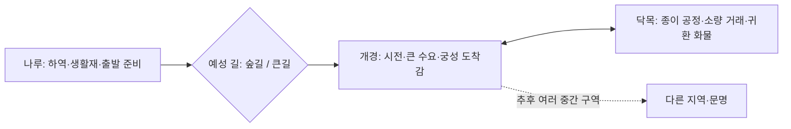

# 고려 전체 디자인·고증 검토

> **날짜 기준 검토 기록:** 본문의 구현 판정·검사·미완료는 당시 시점이다. 이후 구현 상태는 [진행표](../Archive/DevelopmentStatus.md)에서 확인한다. 고증/요구/검사 근거는 기록으로 보존한다.

> 현재 구현/검사는 [진행표](../Archive/DevelopmentStatus.md), 문서 우선순위는 [문서 안내](../README.md)를 따른다.

> **공간/시설 범위 교정:** 아래 네 맵 도식은 기존 기준선이다. 목표는 수도1+마을 최소4·등급/신용별 시설 이용이며 [고려 제작 명세](GoryeoRegionSpec.md)와 [전체 재대조](../Archive/FullRequirementsReview_2026-10-17.md)를 따른다. 두 마을 추가·시설/지역 등급·Q시나리오 개편은 아직 미구현이다.

> **10월17일 최신 기준:** [변경 요약](DesignUpdate_2026-10-17.md)을 우선한다. 주행 낙하 제외·감속 중심과 정보/적재/판매/범용 이동 역할이 후속 결정이다. 아래 이전 구현·자동 주행·회수 기록은 새 목표의 승인/완료를 뜻하지 않는다.

검토일: 2026-10-15. 대상: 원본 《Guild & Cargo — 출신 상인과 성장 구조 계획》 15쪽 전체, 현행 개발 문서, 맵 생성 원본 네 구역, 상품·퀘스트·시장·이동·위험·NPC 코드와 최근 실행 화면. 이번 판단은 디자인 검토이며 이용자 재미 검증 완료를 뜻하지 않는다.

## 1. 유지할 원본 설정

원본 1·12·13쪽: **대항해시대 이전, 대략 8~15세기의 상인 문화를 하나의 가상 교역 대륙에 모은다.** 918~1066년은 고려·아라비아·베네치아·바이킹의 활동 시기가 겹친다는 설명이며 게임의 단일 기준 연도가 아니다. 고려 지역을 임의로 12세기 복원으로 바꾸지 않는다. 12세기 유물도 11세기 교류 기록도 출처와 시기를 구분해 모티브로 쓸 수 있다.

원본은 실제 교류와 게임 각색을 백과 카드에서 구분하고, 실존 인물을 플레이 캐릭터로 쓰지 않으며, 보부상 호칭과 뿔 달린 바이킹 투구 등을 피한다고 명시한다. 동물 캐릭터는 사용자의 후속 설정으로 유지한다. 원본의 ‘고려 단독 시연·멀티는 확장’은 이후 사용자의 네 스타팅 지역·4주 최종 2~4명 멀티 목표로 대체됐다. 길 개척도 현 제작 기준의 사전 지정 도로와 구분한다.

원본의 시대 설명은 보존하되 ‘동시대였다’가 모든 상품·계약·복식·운송 능력이 같은 시기에 존재했다는 뜻으로 확대되지 않게 한다. 검토되지 않은 원본 인용은 사실 확정으로 복사하지 않는다. 특히 고려의 정보 특혜는 게임 능력이며 민족의 타고난 특성이나 실증된 보편적 상업 관행으로 소개하지 않는다.

## 2. 총평과 가장 큰 빈 곳

현재 네 구역은 매매·운반·귀환을 시험할 수 있는 골격이다. 나루의 하역, 숲길/큰길, 수도의 장터, 닥목 작업장이 서로 연결된 점은 유지할 만하다. 하지만 **거점별로 다른 일을 하고, 정보를 얻어 다음 여행을 바꾸고, 돌아왔을 때 변화를 알아보는 경험**은 아직 충분하지 않다. 지금 상태를 ‘고려 전체 완성’이라고 선언할 수 없다.

핵심 문제는 다음과 같다.

1. 나루→길→수도→생산 마을의 거의 선형 연결이다. 예성 길 두 경로 외에는 목적지·매입처 선택이 쉽게 고정될 수 있다.
2. 가격 차이에는 계산이 있지만 왜 그 물건이 그곳에 모이고 필요한지가 시각·정보·수요에서 덜 드러난다. 수도를 모든 품목의 실제 산지로 읽게 하는 표현도 있다.
3. 개경은 면적과 건물 수로 규모를 보여 주지만 시장·궁성·주거의 기능 분리와 지형에 따른 도착감이 약하다. 현 타일은 복원 자료로 만든 고려 건축이 아니다.
4. 장부는 마지막 확인값만 저장한다. 정보의 신선도·거짓 소문 방지·고려 정보 강점은 아직 구현되지 않았다.
5. 발견할 장소와 다시 찾아갈 이유가 부족하다. 돈을 줍는 반복 보상이나 긴 대사를 채우는 방식으로 해결하면 교역 게임의 목적을 흐린다.
6. 휴식·안전·경로 위험을 출발 전에 판단하는 지원이 약하다. 풀밭 낙하가 강한 것과 이동이 재미있는 것은 다른 문제다.
7. 사용자 간 시장 경쟁·동행·혼잡은 현재 검증할 수 없다. 로컬 NPC가 움직이는 화면을 멀티 생활감의 증거로 세지 않는다.

## 3. 고증 판정과 적용 지침

판정은 **근거 있음 / 게임 각색 / 근거 부족 / 수정 필요**로 나눈다. 출처가 현재 모습을 설명하는지, 당시 기록인지, 학자의 해석인지도 구분한다. 아래 신뢰도는 해당 주장에 한정하며 전체 자산의 고증 인증이 아니다.

| 항목 | 판정·신뢰도 | 현행 연결 | 조치 |
|---|---|---|---|
| 개경 시전·시장 감독 경시서 | 근거 있음·높음. 시기별 제도 차이 존재 [S1] | 수도 장터·시전 거리 | 시전 행랑과 계량·장부를 수도 모티브로. 후기 제도를 전기 일반 관행처럼 단정하지 않기 |
| 벽란도·송 및 대식국 교류 | 근거 있음·높음. 내왕 기록과 전체 상인 신원/상시 직항은 별개 [S2] | 나루·뱃사공 대사 | 나루는 가상의 예성강권 소규모 거점. 벽란도 자체의 복원이 아니며 모든 배를 외국 배로 만들지 않기 |
| 고려 종이 | 근거 있음·높음. 구체 생산지 위치는 별개 [S3] | 닥목·종이 상품 | 닥목은 창작 생산 마을. 연못에 종이를 담그면 완성되는 설명 금지. 재료 준비·가공·뜨기·건조를 구분 |
| 나전칠기 | 근거 있음·높음. 국립중앙박물관이 12·13세기 유물 소개 [S4] | 상품 `najeon`·개경 공급 | 자개 장식 칠기로 유지. 철기나 도자기로 혼동 금지. 수도는 집산/판매 거점으로 각색 가능 |
| 개경 인삼 | 광역 교역품과 개별 생산지는 구분 필요·중간 | `originTown=gaegyeong`, 튜토리얼 산지 설명 | 가격 기준 공급지를 실제 재배지와 동일시하지 않기. 특정 시기의 개성 재배·가공 독점을 추가 주장하지 않기 |
| 공통 화폐 ‘냥’ | 게임 각색·높음. 실제 은병·포·금속 화폐의 병용과 다름 [S5] | 지갑·모든 장터 | 환율 시스템은 추가하지 않고 공통 정산 단위임을 백과에서 밝히기. 은병·전·냥을 같은 동전명으로 취급하지 않기 |
| 검은 갓 캐릭터 | 형태 검토 필요·높음. 넓은 의미의 입은 오래됐지만 익숙한 조선 흑립과 세부가 다름 [S6] | `Tools/ArtGen/chars.py` HAT | 동물 캐릭터의 식별용 각색으로 유지 가능. ‘고려 행상의 정확한 복식’이라고 설명 금지. 다음 아트에서 소박한 삿갓/두건 표본과 비교 |
| 개경 객주 | 고려 기원설이 유력하나 기원 정설 없음·중간 [S7] | `gaekju` NPC·배달 | 즉시 오류로 삭제할 필요 없음. 조선 후기 객주의 금융·길드·독점 기능까지 통째로 가져오지 않기 |
| 궁성·만월대 | 궁궐터와 송악산 남쪽 구릉 입지 근거 있음·높음 [S8] | 북쪽 단상·대사 | 고도·궁성 경계·시장과의 거리를 읽게 한다. 당시 일상 명칭은 별도 확인 전 단정하지 말고, NPC는 ‘궁성’, 안내 백과는 ‘만월대 유적을 참고’로 구분하는 방향 |
| 현재 남문 | 실제 개성 남대문은 1391년 착공, 1394년 완공 자료·높음 [S9] | 남쪽 성문 타일 | 게임의 가상 남문으로 유지 가능. 특정 실물/단일 연도 복원임을 주장하지 않기. 원본의 8~15세기 각색 범위와 구분 |
| 5일마다 장날·모든 물건 수요 상승 | 게임 규칙. 고려 전체 보편 사실로 확인하지 않음 | GameClock·MarketState | 편의 규칙으로 표시. 후속 개선은 마을/품목별 수요로 구분하고 시계 HUD를 다시 넣지 않기 |
| 산·수레·소바리 | 지형 모티브와 구체 사용 비율은 다른 주장 | 손수레2종, 소바리 미구현 | 고려에서 수레가 없었다거나 소바리만 썼다고 단정 금지. 현 수레는 게임 운반 수단이며 지역별 원형 조사는 별도 |
| 초가·기와·꽃나무·장독·배 | 사용 자산만으로 고증 확인 불가 | Ninja Adventure 재조합 | 현재는 임시 시각 자산. 처마·기단·담장·문·선형·작업 도구 표본을 자료와 대조해야 함. 일반 동아시아 느낌을 고려 고증으로 세지 않기 |
| 종교·계층·생활 | 현재 공간에서 비중 작음 | 선비·주민·작업자 | 작은 불교 생활 흔적과 다양한 직업의 등장 후보를 검토. 궁궐/양반/남성 상인만으로 고려 일상을 대표하지 않기. 역사 속 불평등을 게임상 출입 제한으로 강제할 필요 없음 |

## 4. 전체 공간 설계안

아래는 현재 네 맵의 기준선 도식이며 목표 지역의 전체 구조가 아니다. 기존 ID/출구를 보존하며 최소 두 마을과 연결 구간을 추가해야 한다. 실제 개성 지도·리수·강폭의 복원이 아니다. 표지판의 ‘25리/5리’는 검증된 지리 수치가 아닌 세계관 거리 표현으로 취급하고, 현재 게임 구역 수와 혼동되지 않게 한다.

| 구역 | 플레이어가 할 판단 | 장면·동선 | 필요한 구현/보완 | 과하게 만들지 않을 것 |
|---|---|---|---|---|
| 나루 | 소금·생활재를 얼마나 싣고 어디로 갈지, 돌아올 물건은 무엇인지 | 강과 하역장→장터·게시판→출구를 시야로 연결. 배·짐꾼은 흐름의 배경 | 처음 매매까지 동선, 출구 전 준비 정보, 화물 없는 첫 자금 복구 | 국제항 전체·조선소·직접 항해를 시작 마을 필수로 추가 |
| 예성 길 | 등짐 샛길 또는 수레 큰길, 위험 감수 또는 안전 확보 | 분기 전 양쪽 노면/목적지, 숲의 압축→물과 다리→수도 성문이 순차로 드러남 | 노면 감속/우회 예고, 주막의 실제 휴식/정보 기능, 선택형 전망 지점 1곳, 수레 통행 | 갈 때마다 도적·낙하 강제, 긴 무입력 이동·미니게임 반복 |
| 개경 | 대량 판매 또는 소량 분산, 다음 상품과 목적지, 수레 구매 시점 | 성문 도착→시전 행랑·계량/보관 흔적→골목·궁성의 높이 차이. 주요 거래처는 길에서 보임 | 수도 대표 타일 세트, 시장/주거/궁성 경계, 거래 정보, 선택형 역사 관찰점 | 작은 촌락을 몇 분 만에 역사적 수도로 건설하는 서사, 궁궐 내부 전체 |
| 닥목 | 종이 매입과 소금·땔감 귀환 판매, 가벼운 짐 또는 수레 적재 | 물·재료 적치→가공 흔적→뜨는 공간→건조대→출하 마당 | 작업 단계가 다른 소품, 무의미한 연못과 구분, 수요와 귀환 화물의 실제 가치 검사 | 생산 미니게임·제작 레시피 전체를 교역보다 먼저 구현 |

선형 지역을 곧바로 거대한 순환 도로망으로 확장하지 않는다. 먼저 같은 나루↔개경 왕복에서도 상품/적재/수단/시장 상태에 따라 판단이 바뀌는지 확인한다. 이후 닥목의 대안 진입로·내부 우회 등 하나의 분기를 추가할지 결정한다. 새 길은 통행·지도·저장·온라인 통합 비용을 함께 계산한다.

## 5. 재미 요소의 누락표와 완료 조건

‘모든 흥미 요소’는 모든 아이디어를 한꺼번에 구현한다는 뜻으로 관리할 수 없다. **게임이 약속한 경험을 빠짐없이 검사하는 표**로 관리한다. 각 행은 구현 증거와 사람의 플레이 결과가 있어야 완료된다. 다른 행이 동작한다는 이유로 대신 완료하지 않는다.

| ID | 경험 | 현재 상태 | 고려 지역의 최소 완료 조건 | 순서 |
|---|---|---|---|---|
| GY-01 | 스스로 첫 장사 시작 | 장터·게시판·튜토리얼 존재, 무설명 플레이 미검증 | 퀘스트 체인을 안 따라도 구매→판매→다음 계획 가능. 첫 매매 위치/가격/적재를 이해 | 필수1 |
| GY-02 | 조건에 따른 경로 선택 | 예성 길 두 경로와 수단별 시간 차이 검증 | 사람이 조건을 바꿔 두 길을 선택하고 이유를 설명. 샛길=무조건 손해/큰길=항상 정답을 피함 | 필수1 |
| GY-03 | 위험을 예측하고 대처 | 흔들림·도적·회수 존재, 위험 예고/피로 미검증 | 진입 전 노면/위험을 알고 감속·우회를 선택. 주행 낙하/회수는 제외, 도적 범위는 별도 결정 | 필수1 |
| GY-04 | 정보로 다음 거래 변경 | 방문 장부·원가·손익 구현 | 오래된 값이 보장 가격이 아님을 이해. 같은 상품 독점만 반복하지 않는지 관찰. 신선도·소문은 후속 | 필수1 |
| GY-05 | 돌아올 화물 선택 | 품목은 있음, 왕복 밸런스 미검증 | 종이/인삼/생활재 조합의 실제 지출·수입·감속과 운반 시간을 기록. 빈손 귀환도 합리적인 경우 허용 | 필수1 |
| GY-06 | 운반 성장의 체감 | 수레·상자 표현·적재량 구현 | 구매 전후 적재·속도·노면 선택 변화가 보이고 감속 원인 이해. 소바리/마차는 확장 | 필수1 |
| GY-07 | 지역을 알아보는 발견 | 지도·소품·선택형 백과 구현. 현장 관찰점/발견 기록 미구현 | 나루 운송·궁성 전망·종이 공정 중 자발적으로 한 곳을 보고 기억. 정답 퀴즈·보상 줍기 필수화 금지 | 필수2 |
| GY-08 | 쉬거나 되돌아갈 판단 | 걷기/정지 회복만 있음. 주모는 대사 | 큰길 거점에서 회복 또는 신뢰할 경로 정보 하나를 실제 제공. 생존 수치 다수 추가하지 않기 | 필수2 |
| GY-09 | 내가 거래한 곳의 변화 | 거래액 성장·짐 소품 구현 | 이미 발전한 거점의 등급/시설 차이와 개인 신용 해금 전후가 보임. 거래량 성장과 별개로 검사 | 필수2 |
| GY-10 | 다른 상인의 존재와 경쟁 | 로컬 NPC, 실제 온라인 없음 | 2~4명 거래가 공유 재고에 반영되고 다리/장터에서 통행 가능. 자기 메뉴가 남의 세계를 정지하지 않음 | 팀 멀티 필수 |
| GY-11 | 실패해도 다시 장사 | 배달 존재, 파산 복구 시나리오 미검증 | 돈 0·빈짐·계약 실패 상태에서 재시작/무료 돈 버튼 없이 합법적 복구. 채무 무한 누적 검사 | 필수1 |
| GY-12 | 고려 문화의 발견 | 상업 백과 7개 카드와 공급지 표현 교정 이번 적용. 전체 시각 자산 고증/플레이 검증은 미완료 | 선택형 상업 백과에서 근거와 각색 구분. 실제 생산지/역사적 복식으로 오인시키는 문장 교정 | 필수2 |

보급·비·안개·파손·부패·매복·임시 수요·상단·개인 거래는 원본/장기 후보로 추적하되, 앞의 경험을 검증하기 전에 전부 구현해야 하는 목록으로 바꾸지 않는다. 날씨를 넣을 때에는 외형만 비가 오는 단계와 길/가격/서버 상태가 바뀌는 단계를 나눠야 한다. 날씨가 없어도 최소 지역 루프는 끝낼 수 있어야 한다.

## 6. 아트 제작 기준과 순서

1. 같은 화면 배율로 나루 대표 구역의 강·흙길·집·배·인물 크기 표본을 확정한다. 원근을 바꾸지 않고 길·전경·높낮이·소리의 변화로 도착감을 시험한다.
2. 수도용으로 기단/담장/성문/행랑의 작은 공통 세트를 만든다. 황궁은 높은 후경 실루엣, 시장은 낮고 밀집한 전경으로 구별하되 통행 폭과 상호작용 시야를 지킨다.
3. 닥목은 재료/가공/건조/출하 네 장면을 구분한다. 범용 상자 대신 닥나무 재료·작업 통·건조 종이 중 식별 가능한 표본부터 개선한다.
4. 복식은 16×24 동물 가독성을 유지하며 계층별 전면 의상 제작보다 두건·삿갓·짐 형태를 소수 표본으로 비교한다. 임의의 화려한 단청/조선 궁궐 외형을 고려 정답으로 넣지 않는다.
5. 계절은 현재 고정된 자연 표현의 일관성부터 확인한다. 익은 곡식·봄꽃·만개한 꽃나무의 공존은 의도한 판타지 팔레트인지 정한다. 계절 시스템이 있는 것처럼 설명하지 않는다.

완료 증거: 대표 장면 전후 캡처, 출처/시기/각색 자산 표, 통행·가림·축척 검사, 지명을 숨긴 지역 구분 플레이 기록. 자료 사진은 참고 링크이며 출처 사이트의 이미지를 게임 자산으로 재배포할 권리가 자동으로 생기지 않는다. 기존 CC0 에셋과 직접 생성 자산의 출처 기록은 유지한다.

## 7. 작업 순서와 팀 전달

첫 묶음: 시대 설정을 최신 문서로 복원, 산지/집산지 표현 교정, 상업 백과의 역사/각색 분리. 수치와 저장 ID는 유지한다.

다음 묶음: GY-01·03·05·11의 실제 왕복/실패 테스트. 안내 없는 첫 교역과 파산 복구에서 막히는 부분을 먼저 수정한다. 자동 검사로 ‘재미’가 통과했다고 처리하지 않는다.

그다음: 개경 대표 장면과 길 위 선택형 거점, 닥목 생산 공정 표본을 작게 적용한다. 새 특산품/계절/날씨를 동시에 늘리기보다 같은 왕복의 판단 수와 반복 피로가 개선되는지 확인한다.

네트워크 담당에게 장부는 개인 관측 정보, 시장·돈·화물·적재·이주는 서버 승인 상태, 백과/작업 연출/시각 자산은 표현임을 전달한다. 관측을 위해 원격 시장을 읽거나 장식 NPC가 재고를 생성하지 않게 한다. 새 회복·보상 명령은 로컬 지갑 직접 변경 패턴을 추가하지 말고 서버 연결 계약부터 맞춘다.

## 8. 짧은 플레이 검토표

팀원 3명이 각각 나루 시작→개경 거래→선택한 귀환을 해 보고 설명을 받지 않은 지점을 기록한다. 다음 회차에는 수단 또는 짐을 바꾼다. 기록 항목: 첫 거래에서 막힌 곳, 품목/목적지/길 선택 이유, 감속·우회·정지 이유, 실제 손익, 기억한 장소, 지루했던 구간, 다시 바꾸고 싶은 선택. 기준 ‘15분’ 같은 강제 완료시간은 먼저 확정하지 않는다.

결과가 있어야 ‘흥미 요소 구현 완료’를 판단한다. 지역 식별은 되지만 길을 고를 이유가 없으면 경로 설계, 돈은 벌지만 재이동하기 싫으면 반복 피로, 대사는 읽히지만 생산지는 모르겠으면 시각 연출을 수정한다. 모두를 시스템 추가로 해결하지 않는다.

## 9. 참고 자료

2026-10-15 확인. 아래 내용은 짧게 요약했으며, 원문 전문이나 이미지의 재배포가 아니다.

- S1: 국사편찬위원회 [고려시대 경시서 운영과 시전의 변화](https://contents.history.go.kr/front/hm/view.do?levelId=hm_058_0070). 번역 사료와 연구 해설을 구분. 『고려도경』의 ‘시장 없음’을 그대로 일반화하지 않는 설명도 확인.
- S2: 국사편찬위원회 [고려와 대식국의 교류](https://contents.history.go.kr/front/hm/view.do?levelId=hm_048_0120). 1024·1025·1040년 내왕 기록과 해석. 역사상의 장거리 해상 연결을 게임의 연속 육로 지도와 동일시하지 않음.
- S3: 한국학중앙연구원 [종이](https://encykorea.aks.ac.kr/Article/E0052996). 고려 종이의 대외 공급과 인쇄 수요를 확인. 창작 마을의 실제 위치를 증명하는 자료는 아님.
- S4: 국립중앙박물관 [나전칠공예 전시품 소개](https://www.museum.go.kr/MUSEUM/contents/M0701040000.do?arcId=2770&catCustomType=post&catId=93&cp=163&schM=view&sv=). 12·13세기 나전칠기와 자개 장식 사례.
- S5: 국사편찬위원회 [고려사 식화지 화폐](https://db.history.go.kr/goryeo/itemLevelKrList.do?parentId=kr_079r_0010_0030&types=r), [고려 말기의 화폐제도 정비 시도](https://contents.history.go.kr/front/hm/view.do?levelId=hm_059_0050). 은병 등 실제 화폐와 게임 공통 정산 단위 구분.
- S6: 한국학중앙연구원 [갓](https://encykorea.aks.ac.kr/Article/E0000945), [모자](https://encykorea.aks.ac.kr/Article/E0018539). 고려의 여러 관모와 후기 입 관련 기록, 조선 흑립 형태의 변천. ‘갓 전체가 고려에 없었다’는 단정도 피함.
- S7: 한국학중앙연구원 [객주](https://encykorea.aks.ac.kr/Article/E0001769). 기원에 여러 견해가 있음을 확인. 특정 후기 기능까지 입증하지 않음.
- S8: 한국학중앙연구원 [개성 만월대 유적](https://encykorea.aks.ac.kr/Article/E0001650). 궁궐터·지형·발굴 자료. 당시 일상 명칭과 현 유적명은 별도 확인.
- S9: 국립문화유산연구원 국가유산 지식이음 [개성 남대문](https://portal.nrich.go.kr/kor/gaesongView.do?idx=14&menuIdx=). 검색 결과에 제시된 1391~1394년 축조 정보 확인. 본문 직접 열람은 도구 오류가 있어 세부 구조 복원 근거로 쓰지 않음.

원본 PDF는 저장소 밖 `팀 프로젝트/기획 문서/GuildAndCargo_출신상인_성장구조계획.pdf` 1·12·13쪽의 설정과 2·5~11·14~15쪽의 시스템 계획을 검토했다. 최신 사용자 요구가 원본보다 우선한다. 다른 세 문명의 고증 전체를 이번 고려 검토만으로 승인하지 않는다.

## 10. 이번 적용·검증 기록

원본 세계 설정을 GameDesign·README·CLAUDE·결정 목록에 연결했다. 상업 백과 7개 카드를 Esc 메뉴에 추가하고 역사적 모티브/게임 각색/여행 힌트/참고 링크를 분리했다. 긴 본문은 스크롤하며 카드 선택 시 맨 위로 돌아온다. 닫으면 입력을 돌려주고 다른 창과 겹쳐 열리지 않는다. 백과는 고정 설명이고 발견 상태·보상·저장 데이터를 추가하지 않는다.

장터와 장부의 ‘산지’를 ‘기준 공급지’로 바꿔 실제 재배·제작 위치로 오인할 여지를 줄였다. 인삼 튜토리얼의 공급지·확정 이익·완료 후 이익 가정 문구와 떠돌이 상인의 무조건 싼 가격 주장을 교정했다. 상품 ID·가격 공식·매입 수량/가격·보상·저장 형식은 유지했다. 문구 원본 StarterBuilder와 실제 T3_Profit 에셋을 함께 수정했다. 다른 맵을 일괄 재생성하지 않았다.

Unity 실행 중 카드 7개 로딩, 다른 모달 중 열기 거절, 입력 차단, 비활성화 시 잠금 해제, 지갑/화물 불변을 검증했다. 실제 Esc 메뉴→상업 백과→카드 선택→스크롤→Esc 닫기 후 메뉴가 다시 열리지 않는 것도 확인했다. 외부 링크는 내용 출처 확인에 사용했으며 버튼으로 브라우저를 여는 동작은 자동 실행하지 않았다. 로컬 근거는 `output/goryeo-design-review/commerce-guide.png`, 검사 결과·원본 12~13쪽 렌더다. 이것으로 GY-01~12나 전체 고증이 완료된 것은 아니다.

Mac Player 빌드 성공(오류 0, 경고 1). 경고는 Unity Cloud 심볼 업로드 인증 토큰 부재이며 실행 파일은 `Builds/validation-goryeo-design/`의 로컬 검증용이다. 기존 배포 파일은 갱신하지 않는다.
