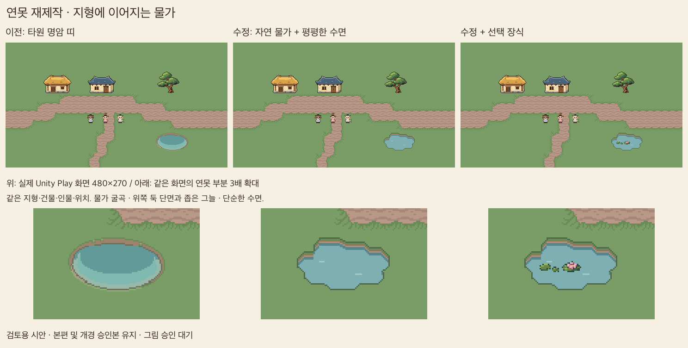

# 연못 제작 과정과 재사용 절차

2026-10-27, C7 자연 물가 연못 v13 기준. 은샘의 “훨씬 좋다”는 피드백과 제작 과정 정리 요청을 반영했다. 이 기록은 제작 방법이며 본편 교체 승인 기록은 아니다. 최종 그림체 기준은 [ArtGuide](../ArtGuide.md)와 팀 베네치아·아라비아 에셋이다.

## 1. 이번에 무엇을 고쳤나

| 단계 | 관찰·피드백 | 다음 수정 |
|---|---|---|
| 개경 승인 연못을 풀밭에 시험 | 돌포장 맥락과 풀밭 맥락이 달랐다. 가운데 줄 양끝도 삐죽했다 | 포장을 제거해 확인하고 풀밭용을 별도 제작 |
| 둥근 타원 v10·장식 v11 | 돌출부는 줄었으나 연못 자체가 어색했다 | 장식과 본체를 분리해 원인 확인 |
| 흙둑·깊이 v12 | 타원 안에 색 띠가 겹쳐 대야처럼 보였다. 사용자가 그늘·테두리·모양 수정 요청 | 더 색칠하기 전에 비슷한 시점의 실제 게임 아트 조사 |
| 자연 물가 v13 | 굴곡 있는 지형 구멍, 위쪽 둑 단면과 좁은 그늘, 평평한 수면. 사용자 “훨씬 좋다” | 이 구조를 제작 절차로 기록하고 최종 선택·교체 승인과 구분 |



큰 명암 띠나 연꽃을 더하는 것만으로 기본 형태의 어색함은 해결되지 않았다. 먼저 **땅과 물이 어떻게 맞닿는지**를 정하고, 장식은 나중에 얹는 순서가 유효했다.

## 2. 참고 이미지 선정

실사 연못이나 단독 아이콘보다, 같은 탑다운 시점·비슷한 픽셀 크기의 게임 장면을 찾는다. 물가 옆 캐릭터와 풀·길이 같이 보이는 장면이 크기와 경계 판단에 도움이 된다.

- [Mystic Woods: Water Decorations](https://game-endeavor.itch.io/mystic-woods/devlog/336576/water-decorations): 단순한 색면, 굴곡 있는 지형 경계, 평면 수면을 주로 참고했다.
- [PixiVan: Top Down Forest Tileset](https://pixivan.itch.io/top-down-forest-tileset): 풀 아래 흙 단면과 물 바로 위 경계 구조를 보조 참고했다. 잔 질감까지 따르지는 않는다.
- 원본 확인 경위와 관찰: [참고 조사 기록](../../ArtReview/C7-SunkenPond-20261027/References.md).

외부 그림의 픽셀·윤곽을 복제하지 않는다. 구조를 관찰한 뒤 우리 지형·색·개체 크기에서 새로 설계한다. 위쪽 흙 단면은 카메라에 보이는 면의 표현이다. 이를 광원 방향으로 단정하거나 모든 방향에 같은 두께로 반복하지 않는다.

## 3. 기본 물가 설계

1. **배치 맥락부터 고정한다.** 풀밭인지 돌마당인지, 길과 겹치는지 확인한다. 비교 시 위치·배경·카메라를 고정한다.
2. **장식 없는 윤곽을 만든다.** 완벽한 타원 대신 넓은 굴곡과 들어가는 부분으로 지형에 난 구멍처럼 설계한다. 작은 돌출부나 반복되는 톱니로 자연스러움을 대신하지 않는다.
3. **둑과 물을 나눈다.** 풀 가장자리, 보이는 흙 단면, 물 접촉 그늘, 수면을 구분한다. v13은 위쪽 둑 단면을 두고 가까운 아래쪽은 얇은 경계로 남겼다.
4. **그늘을 둑 가까이에 제한한다.** v13의 접촉 그늘은 위쪽 물가 바로 아래 최대2px다. 수면 중앙을 큰 어두운 타원으로 채우거나 밝은 띠로 둘레를 감싸지 않았다. 이 수치는 이번 크기의 예이며 다른 연못에 그대로 강제하지 않는다.
5. **수면은 단순하게 둔다.** 기본 물색과 짧게 끊어진 물결2개로 읽히게 했다. 깊은 물색·물결·반사를 한꺼번에 늘리지 않는다.
6. **게임 크기에서 확인한 뒤 장식을 추가한다.** 민 연못이 먼저 자연스러워야 한다. 잎·꽃은 별도 완전 개체로 두며 본체를 가리는 해결책으로 쓰지 않는다.

이번 시험은 실제80×48px, PPU16, Point 필터, 후보7색과 이진 알파다. 후보색은 D3 공통 팔레트 확정을 뜻하지 않는다. 큰 연못·호수·강은 이 작은 연못을 늘이거나 이어 붙이지 않고 별도 조립 세트를 설계한다.

## 4. 실제 제작 파일과 역할

| 파일 | 역할 |
|---|---|
| [개념안](../../ArtReview/C7-NaturalPond-20261027/Concept/generated.png) | built-in imagegen으로 만든 별도 형태 탐색안. 최종 게임 PNG로 직접 축소하지 않음 |
| [개념안 출처](../../ArtReview/C7-NaturalPond-20261027/Concept/provenance.json) | 도구·용도·제작 조건 기록 |
| [Aseprite 제작 원본 스크립트](../../Tools/ArtTrials/c7_natural_pond.lua) | 실제80×48 윤곽·둑·수면 제작. 최종 픽셀의 재현 원본 |
| [편집 원본](../../ArtReview/C7-NaturalPond-20261027/pond.aseprite) | 둑과 수면을 별도 레이어로 보관 |
| [정리·등록·비교판 도구](../../Tools/ArtTrials/c7_natural_pond_review.py) | A5 정리, A2 검토용 등록, 실제 캡처 비교판 생성 |
| [Unity 촬영 도구](../../Assets/PocketCaravan/Editor/C7NaturalPondReview.cs) | 격리된 previewOnly Play 씬에서 이전/수정/장식 화면 촬영 |
| [검사](../../Tools/Integration/test_c7_natural_pond.py) | 조립·픽셀·원본 재출력·장식 위치·실제 화면 차이 확인 |

이번에는 AI 개념 생성과 네이티브 제작을 병행했다. 생성 결과를 보고 순서대로 축소·추적한 제작으로 기록하지 않는다. 최종 그림은 별도 Aseprite 스크립트에서 설계했다. 향후 AI 사용은 선택이며, 편집 가능한 픽셀 원본·출처·검토 결과를 남기는 것은 동일하다.

## 5. 재현 순서

저장소 루트에서 Pillow가 설치된 Python과 Aseprite를 사용한다. Python 실행 파일 이름은 환경에 맞춘다.

```sh
# 1. 픽셀 원본 생성
/Applications/Aseprite.app/Contents/MacOS/aseprite -b \
  --script-param root="$PWD/ArtReview/C7-NaturalPond-20261027" \
  --script Tools/ArtTrials/c7_natural_pond.lua

# 2. A5/A2 등록만 먼저 실행 — 아직 화면 캡처가 없으므로 비교판은 만들지 않음
PYTHONPATH=Tools/ArtTrials python3 -c \
  "from c7_natural_pond_review import OUT,COLORS,register; register(OUT,'c7_natural',[tuple(bytes.fromhex(c)) for c in COLORS],str((OUT/'inner-corner.png').relative_to(__import__('c7_round_pond').ROOT)))"

# 3. 이 worktree의 Unity 에디터가 닫힌 상태에서 검토 Play 촬영
/Applications/Unity/Hub/Editor/6000.3.26f1/Unity.app/Contents/MacOS/Unity \
  -projectPath "$PWD" --burst-disable-compilation -job-worker-count 2 \
  -executeMethod PocketCaravan.EditorTools.C7NaturalPondReview.Run \
  -logFile /tmp/pocket-c7-naturalpond-review.log

# 4. 촬영 완료 후 A5/A2 재확인 및 비교판 생성
python3 Tools/ArtTrials/c7_natural_pond_review.py

# 5. 관련 검사
python3 -m unittest discover -s Tools/Integration -p 'test_c7*pond*.py' -v
python3 -m unittest discover -s Tools/Integration -p 'test_c7_team_style.py' -v
```

위 명령은 v13 재현용으로 기존 검토 산출물을 덮어쓴다. 새 수정안을 만들 때는 원본·출력 폴더·등록 ID·촬영 폴더를 새 버전으로 분리해 이전 그림과 승인 이력을 보존한다. Aseprite 원본을 직접 손질했다면 스크립트에도 반영하거나 수정한 원본을 재현 기준으로 명시한다. 스크립트를 재실행해 손질을 지우지 않는다.

## 6. 조립·검사·제출

- 이번 연못은80×48 전체를16×16 렌더 조각15개로 나눈 **고정5×3 프리셋**이다. 일부 조각만 쓰거나 임의로 연결하는 범용 물 세트가 아니다. 안쪽 모서리 파일은 존재하지만 이번 프리셋에는 배치하지 않는다.
- `water-mask.png`는 장식 위치 검사 전용이다. 잎·꽃의 불투명 픽셀이 모두 물 위에 놓이는지 확인한다. 마스크를 렌더 에셋으로 쓰지 않는다.
- A5에서 실제 크기·허용 후보색·이진 알파를 검사하고, A2에서 허용 지형·길 금지·누락 조각·승인 상태를 검사한다.
- PNG 동일성은 **크기와 디코딩한 RGBA 픽셀**로 비교한다. PNG 파일 바이트는 인코더·환경에 따라 달라질 수 있다.
- 실제 Unity480×270에서 이전/수정/수정+장식을 같은 조건으로 찍고, 실제 크기와 최근접 정수 확대를 함께 제출한다. 연못 밖 화면이 바뀌지 않았는지도 확인한다.
- 기술 검사 통과는 그림 승인이 아니다. 사용자 피드백·선택한 장식안·교체 승인 범위를 별도로 기록한다. 승인 전에는 본편과 개경 A4 승인본을 유지한다.

v13에서 실행한 관련 검사는20개 통과했다. [검사 기록](../Validation/C7-NaturalPond-2026-10-27/README.md)에 실제 Unity 촬영과 기존 SearchDatabase 예외1회도 구분해 적었다. 실제 보행·수동 플레이·저장 회귀·전체 통합·게임 빌드는 실행하지 않았다. 본편 적용 시에는 충돌·이동 확인을 추가해야 한다.
