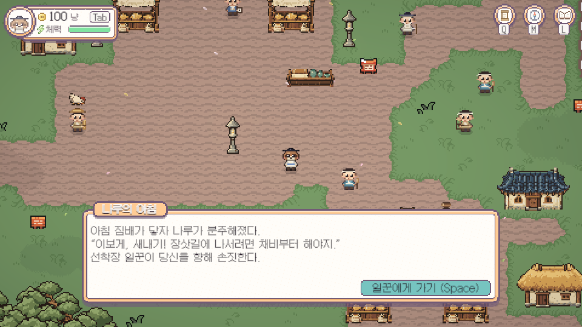
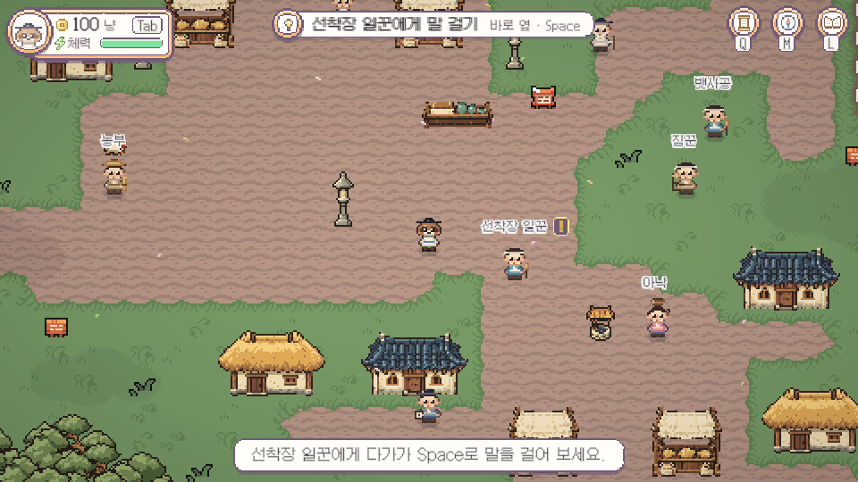

# 고려 첫 시작 이야기

2026-11-08 Codex. 사용자가 북유럽처럼 처음 하단에서 인물이 부르는 이야기를 요청했다. 로컬 구현/검사 완료, 새 화면 사용자 확인·원격 반영은 대기다.

## 재현과 원인

기존 코드에도 추상적인 `나루의 아침` 대사는 있었지만 실제 새 시작에서 누락될 수 있었다. GameDatabase의 기본 출신이 고려여서 문명 선택 전 GoryeoIntro.Start가 먼저 Arrive를 시작했다. 선택 화면이 열린 채 goryeo:intro=1이 기록되고 대사가 DialogueUI에 예약됐다. 선택 시 UIState.Reset/씬 변경으로 예약은 취소되지만 진행 메모는 남는다. 이후 FreshStart의 Started 조건 때문에 다시 시작되지 않는다. 북유럽은 선택 전 기본 출신과 다르므로 같은 선행 시작이 없었다.

Unity에서 선택창 열림/intro메모없음 상태에 기존 Start를 호출하여 선택 중 step1·예약1, 선택창 닫기/Reset/MapEntered 후 step1·예약0·대화닫힘을 재현했다. 이것은 실제 입력 장치로 문명 카드 키를 누른 재현이 아니라 해당 실행 순서를 메모리 격리 환경에서 호출한 검사다.

## 변경

- 문명 선택 화면 중에는 도입 인물/이야기를 시작하지 않는다. 실제 BeginNewGame/맵 입장 후 시작한다.
- 시작 때 하단 공용 DialogueUI에 아래 이야기3줄을 한 페이지로 보여 준다.

> 아침 짐배가 닿자 나루가 분주해졌다.
> “이보게, 새내기! 장삿길에 나서려면 채비부터 해야지.”
> 선착장 일꾼이 당신을 향해 손짓한다.

`일꾼에게 가기`를 누르면 하단5초 알림 `선착장 일꾼에게 다가가 Space로 말을 걸어 보세요.`가 이어진다. 기존 상단 목표는 유지한다.

- 새 goryeo:intro_opening 메모는 이야기 선택지를 닫았을 때만 기록한다. 이전 오류로 step1에 남은 저장은 한 번 복구하고, 이미 도입을 확인했거나 단계2~11/본편 의뢰를 시작한 저장은 다시 진행시키지 않는다.
- 중복 Start가 진행 중인 이야기를 취소하지 않도록 하고, 맵 이동/컴포넌트 비활성화 시 이전 예약 코루틴을 취소한다. 다른 출신/다른 맵에 대사가 따라오지 않는다.
- 퀘스트·NPC ID/원래8단계/보상/다른 지역 전용 파일/아트/맵/씬은 변경하지 않았다.

## 검사와 범위

- Unity 컴파일/최종콘솔오류0.
- 선택창 동안 메모/예약0 → 실제 BeginNewGame 호출/Travel → 하단 이야기 열림·step1·실제 페이지1 확인. 문명 카드 선택은 모드만 반영하고 실제 BeginNewGame을 사용했으며 물리 키 입력 완주로 세지 않는다.
- 선택지 클릭 동작/확인메모/Space 안내, 확인한 뒤 재입장 재생없음, 단계2/4/7/10/11 보존, 옛step1 실제 대사 복구, 중복Start 보존, 맵 이탈 취소/예약0, 다른출신 재생없음을 확인했다. 실제 실행한 주요 코드 조각은 setup/selection/saves-check.cs.txt에 있다.
- 서버 안전 조건: 별도 시험 저장칸에서 돈·짐/전체 업로드 플래그를 강제로 켠 뒤 Update가 모두 끄는지, welcome 수신이 예약되지 않는지 확인했다. 일반 저장칸의 welcome 경로는 메모리에서만 슬롯 프레임을 잠시 바꾸고 수신되는 것을 검사했다. 실제 서버 업로드로 검사하지 않았다.
- 최종 Python431개 통과/23skip(`static.txt`), 세계883출구/오류0(`world.txt`), 개인 저장9파일 SHA동일(`preservation.json`). 최신main포함·로컬만·설정/3D실험 보존.
- 8단계 전체 실키완주/시연5분/모든지역전체플레이/빌드는 이번에 실행하지 않았다. 후속 화면 캡처/검사는 로그인 억제·Offline/SaveOFF 상태에서 했다. 시작 이야기는 새 시안이므로 사용자 확인을 완료로 대신하지 않는다.

## 검사 중 자동접속과 보호 보완

첫 재현/검사에서 StartScreen을 열자 기억된 계정의 자동로그인이 재개됐다. 초기 Offline 확인만으로 충분하다고 판단한 Codex의 검사 격리 누락이다. Online 상태를 발견한 즉시 NetSave/NetLogin을 비활성화하고 연결을 끊었다. 전체 저장은 별도 슬롯 조건으로 업로드되지 않았지만, NetSave.live/lastSent로 돈·짐 요약 전송이 발생한 것은 확인했다(`login-incident.json`). 기존 서버 요약 값과의 차이/복구는 확인하지 못했다. 원격 저장 전체가 변경되지 않았다는 주장은 하지 않으며, 로컬 개인 저장9개는 동일하다.

NetSave는 설명상 지역 시험 저장을 계정에 올리지 않는 구조였지만 그 조건이 전체 저장에만 적용되고 옛 돈·짐 요약에는 빠져 있었다. 공용 `Scripts/Net/NetSave.cs`에 별도 슬롯의 welcome 처리/Update 전송을 함께 차단하는9줄을 추가했다. 이는 게임 중 온라인 인물 표시/채팅을 차단하는 것이 아니라 시험 저장의 계정 동기화만 막는다. 일반 본편 슬롯의 동기화 경로/서버 제품 코드에는 새 규칙을 추가하지 않았다. 이후 모든 검사/최종 캡처는 NetLogin을 메모리에서 억제한 Offline 상태로 다시 실행했다.
