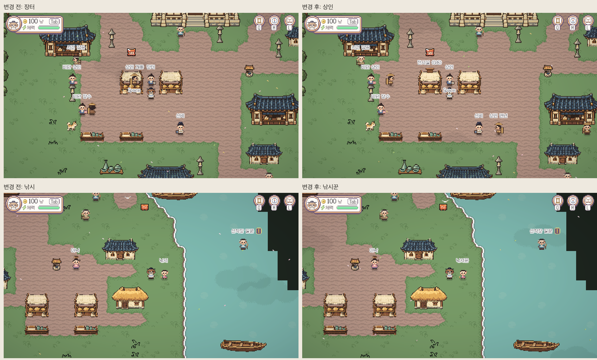

# 고려 NPC 표시 호칭 정리

2026-11-08 Codex. 사용자 “장터 NPC는 상인으로, 직업/사람 호칭이 아닌 이름도 정리” 지시.

| 대상 | 이전 이름표 | 수정 이름표 | 원본 식별/기능 이름 |
|---|---|---|---|
| TownMarket의 사람 그림 | 장터 | 상인 | 개경 상인 등 기존 DisplayName 유지 |
| 나루 낚시 아이 | 낚시 | 낚시꾼 | 나루 낚시 유지 |

`GoryeoPlaceLabels`에서 표시 별칭만 바꿨다. 이름 겹침 예약과 실제 그리기가 같은 표시 문자열을 쓰게 했다. 기존 가까이 표시/고정 위치/Space/퀘스트 아이콘 정책은 바꾸지 않았다. 저장·호감도·퀘스트·시장·시설 ID와 원본 DisplayName은 보존했다. 다른 지역의 공용 TownMarket 이름은 고치지 않았다. 맵/씬/그림 변경이 아니므로 생성물을 다시 만들지 않았다.

고려5맵과 담당 중앙동쪽8맵의 원본 인물 이름/등록 NPC·주민 목록도 확인했다. 촌장·아낙·객주 주인·돈돌·장수·짐꾼·일꾼·선비·뱃사공·농부·길손·나그네·어부·안내인 등은 사람 호칭/이름이라 유지했다. 우물·공방·의뢰 게시판·전시실·장승은 사람 NPC가 아닌 시설/물체이므로 유지했다. 전시실/장승은 실제 개경 Interactable에 CharacterAnimator가 없는 것도 확인했다. 화면에 보이는 행상(상인 개똥/언년 등)도 직업+사람 이름이라 유지했다.

## 실행한 검사

- 기존 Python 이름표 검사2개 통과(`static.txt`). 전체 회귀/빌드는 다시 실행하지 않았다.
- Unity 컴파일 error0. 개경에서 LabelFor/실제 DrawnNames가 `상인`, 나루에서는 `낚시꾼`을 반환/표시했다. 먼 곳에서는 빈 이름으로 유지하며 원본 DisplayName `개경 상인`/`나루 낚시`는 그대로다.
- 실제 게임 전후 캡처4장. 첫 컴파일 직후 개경 촬영 검사는 Game 뷰가 아닌 상태의 DrawnNames로 실패했다. Game 뷰를 선택하고 다시 관찰/촬영해 `상인` 표시를 확인했다. 제품의 렌더링 정책을 바꾸지는 않았다. 지나가는 NPC 위치는 실행마다 다르므로 화면 전체가 동일 픽셀이라는 주장은 하지 않는다.
- SaveOFF·별도 슬롯·Offline으로 검사. 개인 저장9파일 전후 SHA256 동일. 최종Unity는 본편나루에서 정지.
- 사람의 실제 상호작용/호감도/퀘스트 완주·온라인·전체13씬 Play·FPS는 검사하지 않았다. 13맵 인물 이름 목록 확인은 정적 조사다.

최신 main 포함·로컬 커밋만. push/PR/integration 반영은 하지 않았다.
