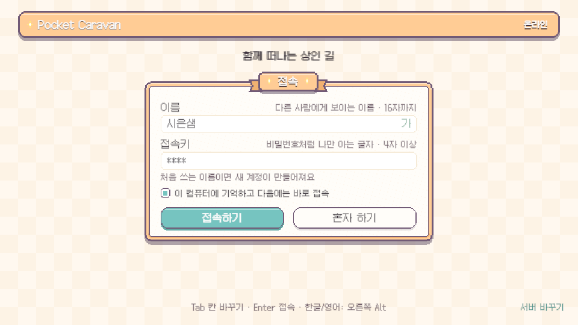

# 최신 integration 수신·이름 입력 화면 점검

2026-11-08 Codex. 최신 `origin/integration`의 아라비아 추가 커밋 `e9bfb03f1`을 작업 브랜치에 병합했다(`bee640a09`, 충돌0). 현재 Unity는 동일한 PocketCaravan 프로젝트/6000.3.26f1을 열고 있다. 최신 main도 포함한다. 수신한 타지역 전용 파일을 다시 생성하거나 수정하지 않았다.

## 확인한 동작

- 현재 열린 본편 나루 씬은 빌드 index0이다. Play 시작 씬 강제 지정도 없다.
- `net.remember`가 켜져 있고 저장된 이름과 접속키가 있다. 값은 보고서/로그에 적지 않았다.
- `NetLogin.OpenStart()`는 기억 설정·이름·4자 이상 접속키가 있으면 `Submit(auto:true)`를 부른다. 성공하면 `UpdateStart()`가 `CloseStart()`로 입력 화면을 닫는다. 사용자에게 매번 이름을 다시 묻는 정책이 아니다.
- 실제 관찰에서는 메모리에만 1회 `autoTried=true`를 두어 자동 서버 접속을 막았다. 개인 PlayerPrefs는 바꾸지 않았다. 나루 Play에서 시작 화면/로그인 화면 모두 열림, panel Start, Offline, 오류0을 확인했다(`runtime.json`). 실제 서버 로그인 성공/실패를 재시험한 것은 아니다.
- 개경(index30)에서 직접 Play하면 시작/로그인 화면이 모두 열리지 않았다(`non-start.json`). `GameManager.OnSceneLoaded()`가 비시작 씬을 개발용으로 취급하기 때문이다. 아라비아는 별도의 RegionTestSession도 있어 첫 화면을 건너뛴다(아라비아 시험은 코드 조사만 했으며 개인 시험 저장에 쓸 수 있어 이번에 직접 Play하지 않았다).
- 팀원이 안내한 `Pocket Caravan > 아라비아 > 1. 첫 구간 데이터 갱신 (DB 보존·추가)` 메뉴의 위치를 확인했다. 최신 커밋의 붉은 염료 돌은 이미 GameDatabase에 등록되어 있다. 메뉴를 실행했다고 보고하지 않는다.

## 결론·현재 상태

이 환경에서 이름 입력 화면이 없는 구버전/컴파일 실패는 확인되지 않았다. 기억한 계정 자동 접속 또는 비시작 맵 직접 Play가 화면을 생략하는 정상 경로다. 매번 직접 이름을 넣으려면 이름 입력 화면의 `이 컴퓨터에 기억하고 다음에는 바로 접속` 체크를 끈다. 기존 사용자 설정을 임의로 바꾸지는 않았다.

제품 로그인 코드·정책은 수정하지 않았다. 관찰용 메모리 설정/이벤트를 정리하고 Unity를 본편 나루 씬에서 정지해 뒀다. 다시 Play하면 기존 기억 설정이 그대로 적용된다.

## 검사

- 최신 수신 후 Python424개: 실패0·skip23(`static.txt`).
- 세계883출구: 오류0(`world.txt`).
- Unity 나루 로그인/개경 비시작 직접 Play 관찰·최종 콘솔 error0.
- 개인 저장9파일 SHA256 전후 동일·로그인 설정 SHA256 전후 동일(`preservation.json`). 접속키 원문은 저장/출력하지 않았다.
- 실제 서버 자동 로그인/서버 저장, 새 아라비아 미니게임 전체 플레이, 장시간 성능, 빌드는 미검사.
