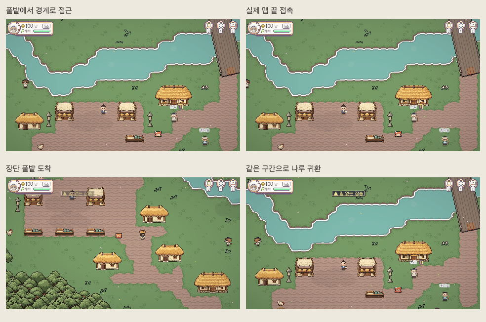

# T3 승인 경계 본편 적용

2026-11-08 Codex. 사용자 “이대로 확정”을 승인으로 기록했다. **로컬 본편 완료, 원격 미반영.** 브랜치 `codex/team-system-audit-20261107`, 승인 입력 커밋 `9536d0d29`. 최신 `origin/main`을 받아 병합했고 already up to date였다.

## 적용

- 기존13맵 ID·기능 ID/세계 위치·마을/건물/주요 숲/논을 유지하고 사각형 실제 외곽635출구로 재생성했다. 길과 풀밭 모두 이동한다. 안전한 접근이 없는 면·외부 출구 예약 구간은 제외한다. 서쪽 끝4칸 축소는 승인안 그대로다.
- 기존 CameraFollow·MapExit·페이드 정책은 바꾸지 않았다. 새 씬에는 이웃 지형 CameraBackdrop을 만들지 않아 현재 맵 끝이 실제 보이는 끝이 된다. 화면 끝 전환의 체감은 사람 확인이 별도로 남아 있다.
- 장터·생활 연출·장소/소리 이름표·발소리·우물·앉기·나룻배·통나무·범람 좌표를 새 구획에 맞췄다. 건물/배/논 등의 원본 그림은 수정하지 않았다. 잘라야 하는 장터 그림/생활 경로는 없었다. 논의 논리 깊이 사각형은 경계에서 나누되 실제 세계의 칸 합집합을 보존했다.
- `layoutVersion=3`: v2는 옛 원점/저장 높이에서 세계 위치를 구한 뒤 새 소유맵·로컬 위치로 변환한다. 유효한 위치는 동일하게 유지하고 잘린4칸·막힘/고립 영역·출구 위는 주 통행 영역의 안전한 자리로 옮긴다. v0·v1/옛 ID는 기존 M4 도착 정책을 거쳐 변환한다. 떨어진 짐의 위치만 옮기며 상품/계약/원가 정보·돈·짐·퀘스트 필드는 그대로다. 모든 위치 계산이 성공한 뒤에만 메모리 DTO를 바꾸고, 반복 이주는 하지 않는다.
- 기존 내부 spawn ID도 안전한 S0 별칭으로 남겼다. 외부3곳의 상대 씬·출구·도착 ID/폭은 보존했다. `region_links.json`은 고려 쪽 좌표/생성기와 고려 표지판2곳의 좌표만 변경했다. 상대 쪽 항목은 동등하다.
- WorldIndex는 우리13항목과 우리 places만 갱신했다. 다른지역41맵·76 places 불변, 타지역 맵/씬·빌드 목록 불변. 지도(M)의 구역/현재 위치 핀과 전체/고려 확대 그림을 새 좌표로 다시 생성했다.

[13맵 실제 화면](../../../ArtReview/T3-Production-20261108/13maps-game-mosaic.png) · [전체 지도](../../../ArtReview/T3-Production-20261108/M-full.png) · [고려 확대](../../../ArtReview/T3-Production-20261108/M-regional.png)

## 검사 결과

| 구분 | 실제 실행 결과 |
|---|---|
| 전체 Python 회귀 | 424개, 실패0·23개 skip. Aseprite를 실행할 수 있는 승인된 제한 밖 환경에서 재검사. `full-static.txt` |
| 신규 경계/본편 원본 | 21개 통과. 실제 외곽·풀밭 누락/중복0·기능 ID/지형 보존·27출력 재현·물리 좌표/정책 보존·타담당 연결표 보존·변조된 과거검토 입력 거부. `static-t3.txt` |
| 등록 세계 | 883출구, 오류0. 담당635 + 다른지역248. `world.txt` |
| Unity 컴파일·직렬화 | 최종 console error0. 13본편씬/635출구/누락스크립트0. `scenes.json` |
| Unity 본편 지형/경계 | 2,717확인. 635출구 연속모터 접근·2칸 전 미전환·외곽접촉·13렌더표본·풀밭왕복·기존 GameManager로 외부3곳 왕복·우물/3앉기/발소리/이름표 설치·실제 지도2장. `unity.json` |
| Unity 실제 맵 이동 | 201확인. 담당17쌍/34방향 모두 실제 GameManager 이동·도착 안전. 나룻배3구간 실제 출항/도착·8냥 결제·도착 안전. `routes.json` |
| Unity 저장 이주 | 143,720확인. v0·v1·v2 표본·옛 별칭·새소유맵3014표본·v2막힘 등4681복구·유효한 세계 위치 보존·mapHeight누락·미등록상품 짐 보존·다른지역 저장·v3/반복 불변·잘못된 위치 무변경 거부. `save-migration.json` |
| 물리 교역 거리 | 동일한 기존 8방향/코너 자르기 없는 척도로 동결 이전맵과 새맵36쌍 비교, 최대 차0초. 기존 TownRoutes 참고값은 이번 변경 전에도 최대0.88초 차이가 있어 별도 기록. 경제 거리/보수/기한 재조정 없음. 페이드·로딩 시간은 거리 측정에 포함하지 않는다. `distance.json` |
| 범위 보존 | 타지역 맵/씬 변경0·WorldIndex 타항목 보존·기존 카메라/출구/페이드·빌드 목록 불변. 각 런타임 검사는 previewOnly에서 SaveOFF 시작·랜덤 격리 슬롯 미생성 확인. 개인 저장 전체 세션 지문 비교를 했다는 주장은 하지 않는다. `preservation.json` |

최초 회귀 실패도 보존했다. 오래된 검토 그림/배치 검사가 예전 로컬 좌표를 기대해 생긴 실패는 승인 직전 입력을 **명시적으로** 재현하도록 구분했다. `t3_history.py`는 현재 맵/리소스의 설치 지문이 달라지면 과거 입력으로 바꿔 검사를 통과시키지 않고 거부한다. 새 본편의 물리 좌표/재생성/전수 보존 검사는 별도 `test_t3_production.py`에 있다. Aseprite의 제한 환경 SIGABRT27건은 실제 제한 밖 재실행으로 확인했으며 skip으로 바꾸지 않았다. `initial-full-failures.txt`·`historical-regression-iteration.txt`는 최종 성공 기록이 아니다.

공용 코드 변경은 `GameManager.TryApplySave`의 선행 위치 이주, `SaveSystem.PositionFor`의 동일 이주 호출, `MapRoot`의 v3 주 통행 영역 안전복원, 공용 `MapJsonBuilder`의 v3표식/승인 이정표 연결이다. 경제·UI 로직·DB는 수정하지 않았다.

## 재생성

1. NumPy·SciPy·Pillow 환경에서 `python Tools/WorldLayout/t3_install.py --write --worldmaps`.
2. Unity에서 `PocketCaravan.EditorTools.T3Production.Build()`. 우리 등록13씬만 재생성하고 우리 WorldIndex항목만 갱신한다. 빌드 목록은 다시 쓰지 않는다.
3. `T3Production.Review()`는 SaveOFF 본편 캡처/경계검사, `T3Production.Review(true)`는 실제 이동/나룻배 검사, `T3SaveChecks.Run()`은 합성 저장 이주 검사다. 검토는 기존 격리 preview씬에서 시작하고 본편13씬으로 이동한다.
4. `python Tools/Routing/t3_boundaries_check.py`, `python Tools/WorldLayout/t3_production_report.py`로 거리 보고/캡처 모자이크를 재현한다.

원본은 `t3_boundaries.json`의 승인 구획과 `t3_baseline.json.gz`의 동결 입력이다. 생성물 수동 수정 금지. 본편에 새로운 팀 변경이 들어오면 설치 지문과 다르므로 자동 덮어쓰기 전에 원본을 재검토해야 한다. 옛 M4 전체 본편 내보내기/옛 좌표 생활 덧붙이기는 승인 T3를 덮지 않도록 중단한다.

## 미확인

사람의 WASD 체감, Q1 전체 수동 완주, 실온라인/서버 저장 왕복, 장시간 성능/FPS, 공개 빌드는 실행하지 않았다. 이번 커밋은 push·PR·GitHub integration 병합을 하지 않았다. 기존 개인 설정/패키지 변경·3D 실험 폴더는 보존하고 커밋에서 제외했다.
