<p align="center">
  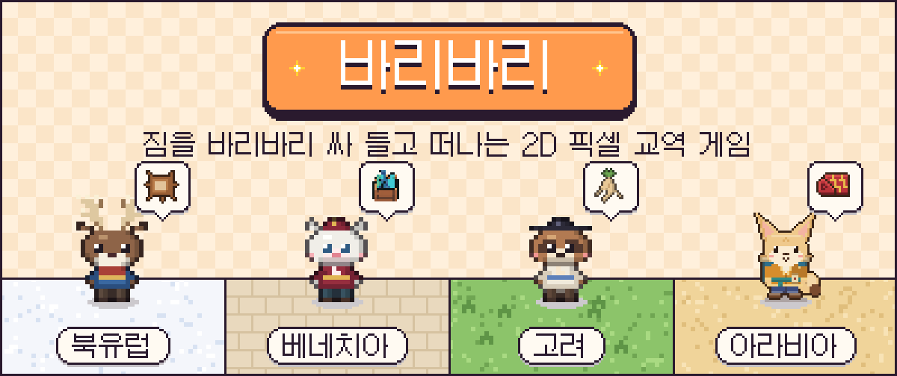
</p>

<p align="center">
  <b>대항해시대 이전, 네 문명 가운데 한 곳의 동물 상인이 되어<br>
  마을마다 다른 특산품을 사서, 길을 골라, 직접 걸어 나르고, 다른 마을에 팔아 재산을 불리는 게임</b>
</p>

<p align="center">
  
  
  
  
  
</p>

<p align="center">
  <a href="#이렇게-놀아요">이렇게 놀아요</a> ·
  <a href="#네-문명">네 문명</a> ·
  <a href="#게임-화면">게임 화면</a> ·
  <a href="#온라인-함께-쓰는-시장">온라인</a> ·
  <a href="#조작">조작</a> ·
  <a href="#만든-사람들">만든 사람들</a> ·
  <a href="#개발">개발</a>
</p>

<p align="center">
  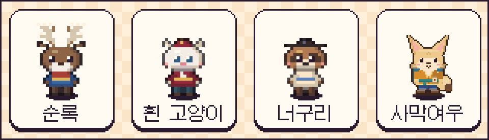
</p>

> **바리바리**는 짐을 잔뜩 싸서 꾸린 모양을 뜻하는 우리말이에요.<br>
> 짐을 꾸려 길을 떠나는 상인의 모습을 그대로 이름에 담았어요.

| | |
|---|---|
| **장르** | 2D 교역 MMORPG (전투 없음) · 혼자서도, 온라인으로 함께도 |
| **그래픽** | 탑다운 16px 픽셀 아트, 캐릭터 16×24 · 4방향 걷기 |
| **목표** | 시세 차이로 재산을 불려 더 먼 교역으로 나아가기 |
| **규모** (11/8) | 맵 55개 · 마을 31곳 · 교역품 56종 · 퀘스트 55개 · 운반 수단 4종 |

<br>

## 이렇게 놀아요

<p align="center">
  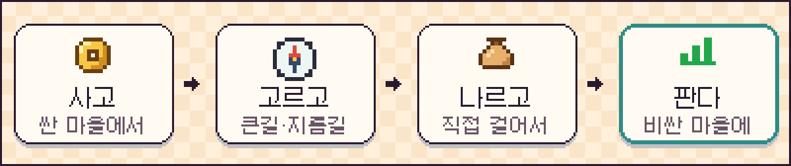
</p>

| 단계 | 플레이어가 하는 일 | 게임의 규칙 |
|---|---|---|
| **사고** | 어디서 무엇을 살까 | 마을마다 시세가 달라요. 재고가 적으면 비싸요. |
| **고르고** | 큰길로 돌까, 지름길로 갈까, 도적 길을 지날까 | 길마다 시간 · 위험 · 노면이 달라요. |
| **나르고** | 직접 걸어요 | 짐이 무거울수록, 길이 거칠수록 느려져요. |
| **판다** | 어느 마을에 팔까 | 팔면 그 마을 값이 떨어져요. 번 돈으로 더 큰 짐, 더 먼 장터로! |

<details>
<summary><b>조금 더 자세히: 시세 · 운반 · 긴장감 · 성장</b></summary>

<br>

**팔수록 떨어지고, 시간이 지나면 돌아와요.**
한 마을에 연달아 팔면 10번째 물건은 첫 값의 55%만 받아요. 이틀이 지나도 88%까지만 돌아와서, 한곳에 몰아 팔지 않고 다른 마을과 다른 길을 찾게 돼요.
장날(5일마다 수요 1.15배), 하루 한 마을씩 돌아가는 큰 장(팔 때 덤 20%), 오늘의 특가, 흥정이 마을마다 다른 기회를 만들어요.

**교역 장부(L)** 에는 내가 직접 가 본 마을의 시세만 적혀요. 언제 본 값인지도 판단에 들어가요.

| 운반 수단 | 짐칸 | 값 | 특징 |
|---|---|---|---|
| 등짐 | 10칸 | — | 처음 시작 |
| 손수레 | 30칸 | 150냥 | 어느 장터에서나 |
| 순록 썰매 | 40칸 | 320냥 | 북유럽, 눈길에 강해요 |
| 낙타 | 45칸 | 300냥 | 아라비아, 장터 1등급부터 |

**잃을 것이 있어요.** 도적은 짐 실은 걸음보다 빠르고 달리기보다 느려요. 잡히면 통행료를 내거나 가장 비싼 짐을 뺏겨요. 의뢰 짐을 뺏기거나 기한을 넘기면 배상 · 신용 · 평판이 깎여요.

**성장은 레벨 대신 돈 · 신용 · 평판 · 운반 수단으로.** 거래가 쌓이면 마을도 촌락 → 장터 → 마을 → 상업 → 고을로 커져요.
NPC 상인 넷(쇠돌 · 막순 · 개똥 · 언년)도 같은 규칙으로 사고팔아서, 사람이 적어도 시장이 움직여요.

</details>

<br>

## 네 문명

시작 화면에서 문명을 하나 고르면, 그 문명의 동물 상인으로 그 수도에서 출발해요. 혼자서도 네 문명과 가운데 중앙 대륙을 모두 오갈 수 있어요.

<table>
  <tr>
    <td width="50%" valign="top">
      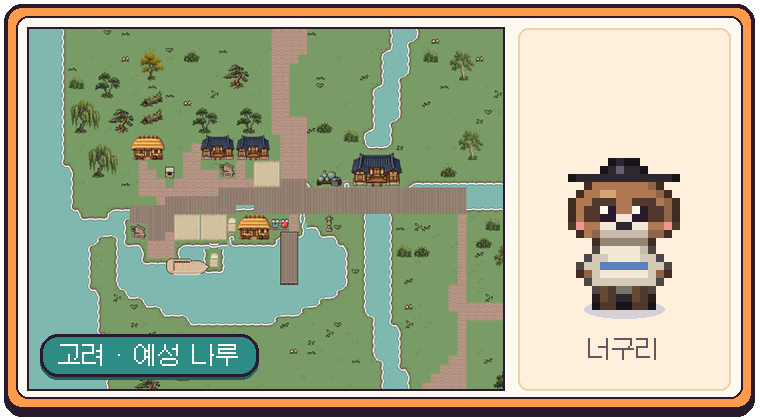
      <h3>고려 · 너구리</h3>
      <b>강점</b> 장부에 적은 시세가 두 배 오래 가요<br>
      <b>대표 물건</b> 인삼, 나전칠기, 한지, 소금, 약재<br>
      <sub>산맥 · 논 · 숲 지형과 예성 나루를 중심으로 한 뱃길. 수도 개경에서는 연등회가 열려요.</sub>
    </td>
    <td width="50%" valign="top">
      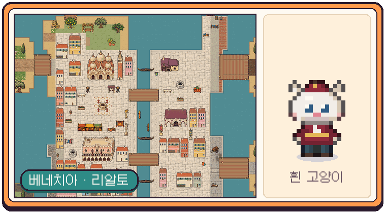
      <h3>베네치아 · 흰 고양이</h3>
      <b>강점</b> 다른 지역 물건을 팔아도 값이 덜 떨어져요<br>
      <b>대표 물건</b> 유리그릇 · 유리 장식, 레이스, 석호 소금, 포도주<br>
      <sub>석호의 다섯 섬과 본토로 이루어진 물의 도시. 곤돌라 나루는 짐이 7할을 넘으면 탈 수 없어요.</sub>
    </td>
  </tr>
  <tr>
    <td width="50%" valign="top">
      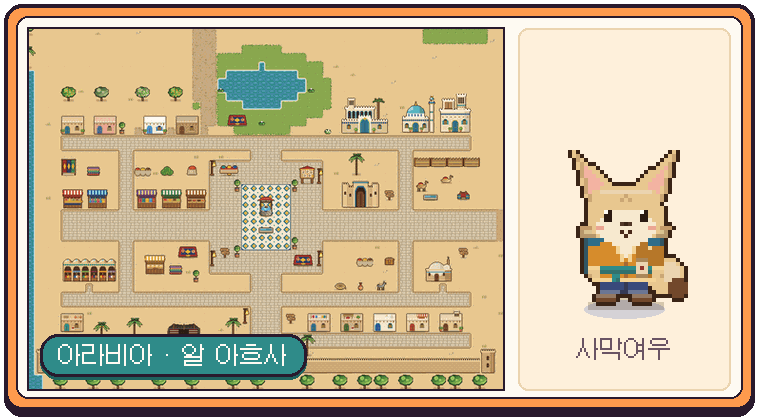
      <h3>아라비아 · 사막여우</h3>
      <b>강점</b> 멀리 가져가서 팔면 +5%<br>
      <b>대표 물건</b> 향신료, 유향 · 향유, 양탄자, 커피, 대추야자, 진주<br>
      <sub>이어지는 사막과 향료길. 모래바람과 오아시스의 대상 행렬, 수도 사나의 향료 밤시장.</sub>
    </td>
    <td width="50%" valign="top">
      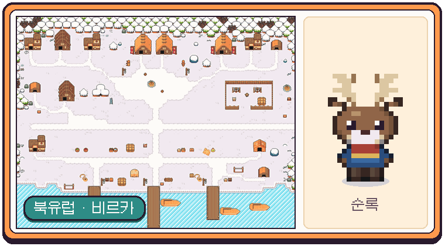
      <h3>북유럽 · 순록</h3>
      <b>강점</b> 이동이 빨라요 (길 없는 곳에서 더)<br>
      <b>대표 물건</b> 모피 · 털옷, 꿀술, 황금 연어, 얼음 대구, 호박<br>
      <sub>날씨가 길을 바꾸는 겨울 교역. 눈보라가 치면 걸음이 느려지고 순록 썰매가 빛나요.</sub>
    </td>
  </tr>
</table>

<br>

## 게임 화면

<table>
  <tr>
    <td width="50%">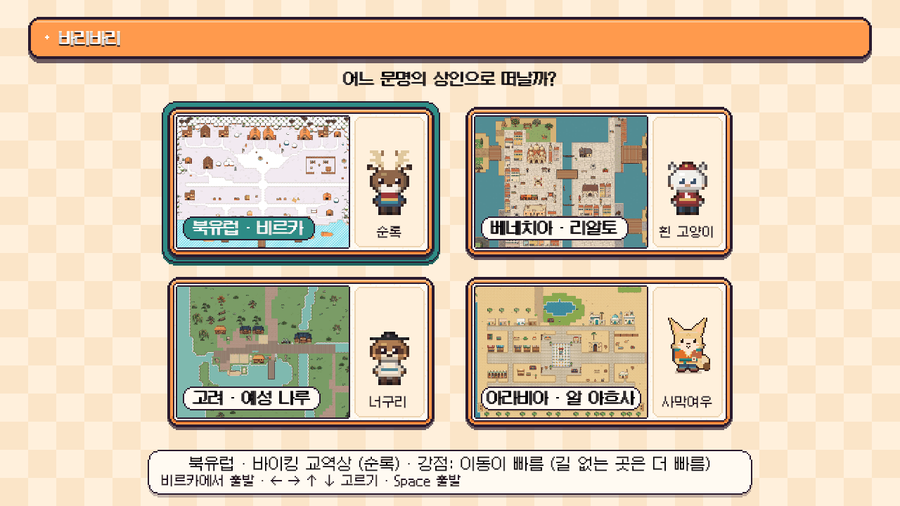<p align="center"><sub>시작 화면 · 네 문명 가운데 하나를 골라요</sub></p></td>
    <td width="50%">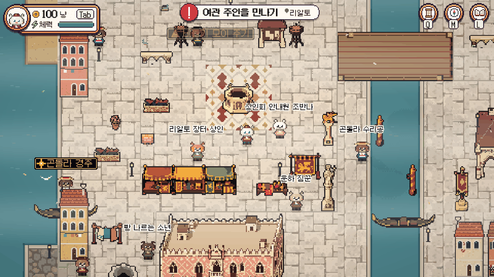<p align="center"><sub>베네치아 · 리알토 장터</sub></p></td>
  </tr>
  <tr>
    <td>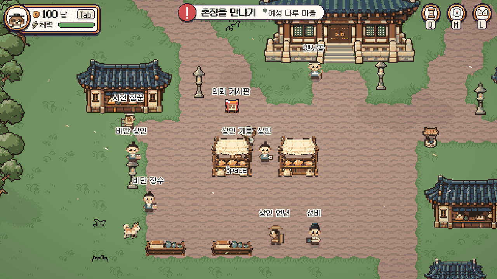<p align="center"><sub>고려 · 수도 개경</sub></p></td>
    <td>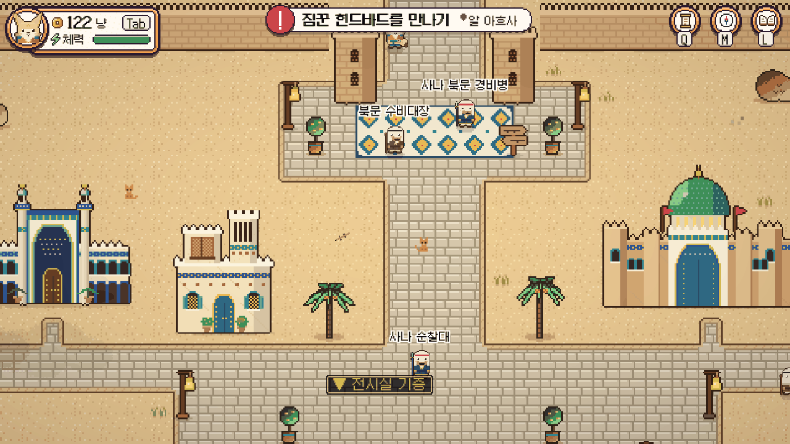<p align="center"><sub>아라비아 · 수도 사나</sub></p></td>
  </tr>
  <tr>
    <td>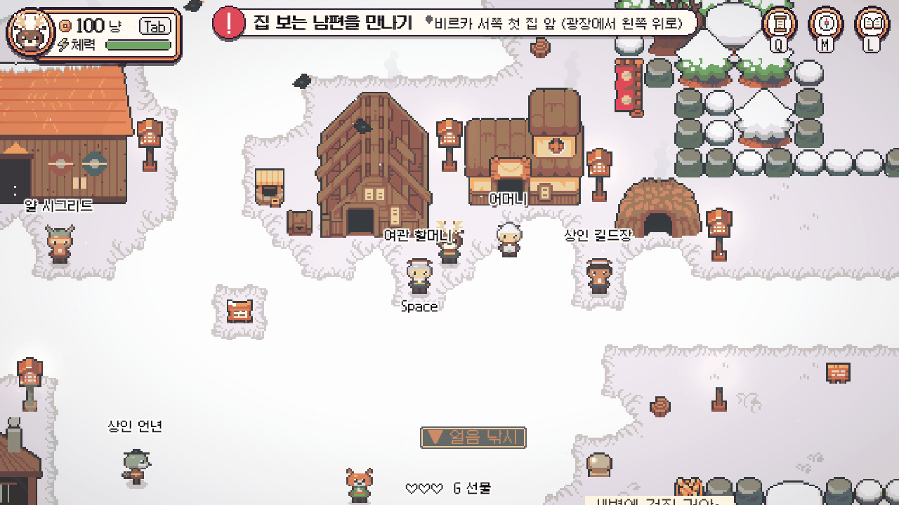<p align="center"><sub>북유럽 · 비르카</sub></p></td>
    <td>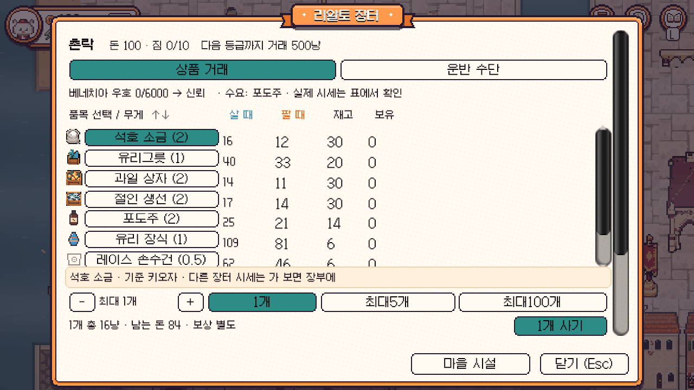<p align="center"><sub>장터 · 물건별 사는 값 · 파는 값 · 재고와 흥정</sub></p></td>
  </tr>
  <tr>
    <td>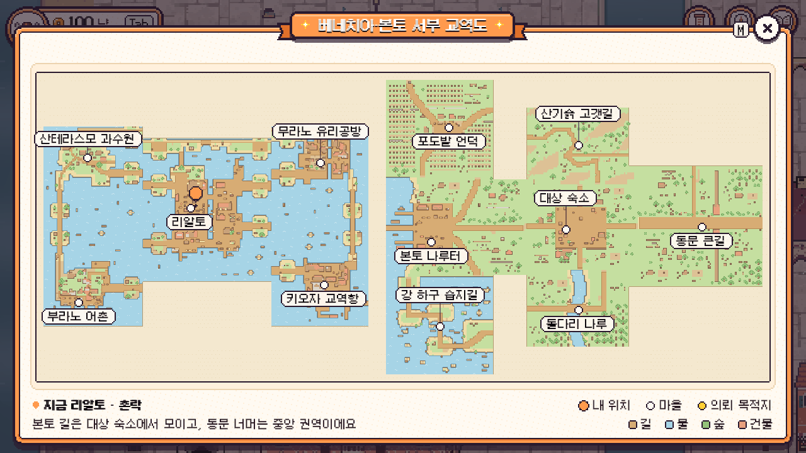<p align="center"><sub>지도(M) · 마을과 길, 지금 위치</sub></p></td>
    <td>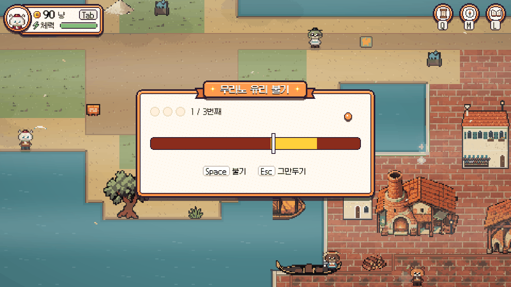<p align="center"><sub>지역 놀이 · 무라노 유리 불기</sub></p></td>
  </tr>
</table>

### 지역 놀이

교역만 하면 단조로울 수 있어서, 문명마다 그 문화를 살린 짧은 놀이를 두었어요. 결과는 돈 · 물건 · 기록으로 바뀌어 교역과 이어져요.

| 문명 | 놀이 |
|---|---|
| 베네치아 | 곤돌라 경주 · 무라노 유리 불기 · 부라노 그물 던지기 |
| 북유럽 | 얼음 낚시 · 썰매 언덕 · 나룻배 노 젓기 · 눈싸움 · 룬돌 언덕 · 장작 패기 |
| 아라비아 | 대추야자 따기 · 낙타 경주 · 모래바람 짐 지키기 · 모래 배 돛 돌리기 |
| 고려 | 낚시 · 우물 물 긷기 · 평상에서 쉬기 |

리액션 바퀴(R)로 인사 · 박수 · 춤을 하고, 마을 사람과 친해져 선물(G)하고, 사진(P)으로 여행 장면을 남길 수 있어요.

<br>

## 온라인: 함께 쓰는 시장

혼자서도 재밌는 교역 위에, 여러 사람이 **같은 재고와 시세를 함께 쓰는 시장**을 얹었어요. 싸우지 않고 시장으로 부딪치는 MMO가 목표예요.

<table>
  <tr>
    <td width="50%">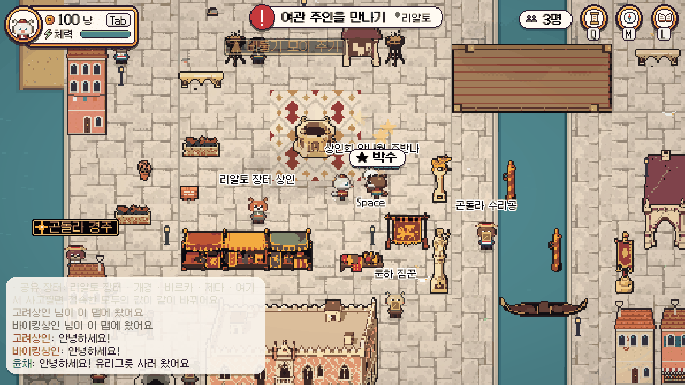<p align="center"><sub>같은 장터의 상인들과 채팅 · 리액션</sub></p></td>
    <td width="50%">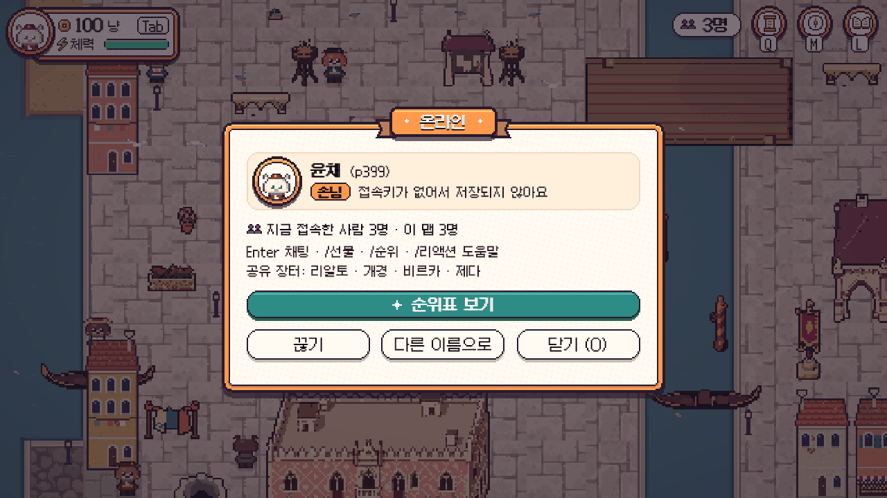<p align="center"><sub>온라인 창(O) · 접속 인원 · 순위표</sub></p></td>
  </tr>
</table>

| 기능 | 설명 |
|---|---|
| **같은 세계** | 같은 맵의 사람이 각자 고른 문명의 동물 상인으로 보여요. 손수레 · 썰매 · 낙타, 앉은 모습도 함께 보여요. 모두 같은 게임 시간을 써요. |
| **공유 장터** | 네 문명의 큰 장터(리알토 · 개경 · 비르카 · 제다)의 재고를 서버가 들고 모두가 함께 써요. 다른 사람이 많이 팔면 내가 팔 값도 떨어져요. |
| **채팅 · 리액션** | 채팅은 머리 위 말풍선으로도 보이고, 리액션 동작이 다른 사람 화면에도 나와요. |
| **계정 · 서버 저장** | 이름과 접속키로 계정을 만들면 진행 전체가 서버에 저장돼서 다른 컴퓨터에서 이어 할 수 있어요. |
| **순위표 · 선물** | 놀이 최고 기록과 부자 상인 순위를 겨루고, 접속한 사람에게 돈이나 물건을 선물해요. |

서버는 Cloudflare Workers와 Durable Object(SQLite) 하나로 돌아가요. 비용 0원, 24시간 켜짐, 매일 자동 백업(7일치).

<br>

## 조작

| 키 | 기능 | 키 | 기능 |
|---|---|---|---|
| `WASD` / 방향키 | 이동 | `Shift` | 달리기 |
| `Space` | 말 걸기 · 확인 | `Tab` | 내 상태 펼치기 |
| `I` | 소지품 | `Q` | 여정 수첩 (퀘스트) |
| `M` | 지도 | `L` | 교역 장부 |
| `R` | 리액션 바퀴 | `P` | 사진 찍기 |
| `G` | 친한 주민에게 선물 | `F` | 친구 수첩 |
| `O` | 온라인 창 | `Enter` | 채팅 |
| `Esc` | 메뉴 · 닫기 | 🖱️ 마우스 | 창 단추 · X 닫기 · 놀이 화면 클릭(= Space) |

<br>

## 만든 사람들

| | 이름 | 맡은 문명 | 함께 맡은 일 |
|:---:|---|---|---|
|  | **은샘** | 고려 (너구리) · 중앙 대륙 동쪽 | 맵 생성과 세계 배치, 공유 장터 재고 · 공용 세상 시계 |
| 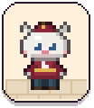 | **윤채** | 베네치아 (흰 고양이) | 온라인 서버와 멀티플레이, 공용 화면(UI) 디자인 |
| 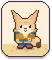 | **은인** | 아라비아 (사막여우) | 아라비아 그림과 미니게임 창 |
|  | **기우** | 북유럽 (순록) | 네 문명의 시작 이야기와 배우기, 공용 소지품 창, 큰 장 규칙 |

<sub>README 그림(머리 그림 · 상인 · 문명 카드 · 놀이 흐름 · 얼굴)은 게임 속 그림과 갈무리 글꼴로 [Tools/Readme/make_readme_images.py](Tools/Readme/make_readme_images.py)가 그려요.</sub>

<br>

---

## 개발

작업 이름은 Pocket Caravan이라 저장소·코드(namespace `PocketCaravan`)·에디터 메뉴·서버 주소에는 그 이름이 남아 있다.
지역 담당: 은샘 고려 · 윤채 베네치아 · 은인 아라비아 · 기우 북유럽.

**작업을 시작하는 사람과 에이전트는 [AGENTS.md](AGENTS.md)부터 읽는다.** 지역별 작업 안내는 그 문서에서 고른다.

고려·중앙 대륙 동쪽(은샘 담당) 문서:

| 알고 싶은 것 | 문서 |
|---|---|
| 확정 방향(아트, 에셋 규칙, 세계 면적, 고려 구조) | [Docs/Direction.md](Docs/Direction.md) |
| 할 일과 결정 대기 | [Docs/Plan.md](Docs/Plan.md) |
| 지금 구현된 것 | [Docs/CurrentState.md](Docs/CurrentState.md) |
| 문서 전체 목록 | [Docs/README.md](Docs/README.md) |

> 2026-10-24 기준으로 고려·중앙 대륙 동쪽의 맵과 아트를 새 방향에 맞춰 다시 만드는 중이다. 지금 맵과 그림은 이전 버전이다.

### 실행

1. Unity Hub에서 **6000.3.26f1 (Unity 6.3 LTS)** 를 설치한다. 팀 전원이 같은 버전을 쓴다.
2. 저장소를 받아 Unity Hub → Add로 이 폴더를 연다.
3. `Assets/PocketCaravan/Scenes/Goryeo/Naru.unity`를 열고 Play한다. 메뉴 `Pocket Caravan > 1. 시작 세트 만들기`는 데이터를 초기화하므로 평소에는 쓰지 않는다.

조작: 방향키/WASD 이동 · Shift 달리기 · Space 말 걸기·확인 · Q 퀘스트 · M 지도 · L 교역 장부 · Esc 메뉴

### 검사

```sh
python -m pip install "Pillow>=10,<13"
python Tools/Integration/validate_world.py
python -m unittest discover -s Tools/Integration -p 'test_*.py'
```

### 폴더

```
Assets/PocketCaravan/
  Art/          그림 (지역별)
  Data/         ScriptableObject 데이터 (지역별)
  Maps/         생성된 맵 JSON (직접 고치지 않음)
  Resources/    GameDatabase, 지도 이미지, 폰트, 소리
  Scenes/       맵 하나 = 씬 하나 (생성물)
  Scripts/      게임 코드 (namespace PocketCaravan)
  Editor/       에디터 도구와 검사
  World/        지역·맵 등록 JSON
Server/         온라인 서버 (Cloudflare Workers + Durable Object, TypeScript)
Tools/
  MapGen/       맵 생성기 (Python)
  ArtGen/       코드로 그린 캐릭터·아이콘
  Integration/  자동 검사
  WorldLayout/  세계 배치 계산 (검토안)
  Readme/       README 그림 만들기
Docs/           문서 (Docs/README.md 참고)
```

### 협업

- `main`은 항상 실행되는 상태로 둔다. 기능은 브랜치에서 작업하고 PR로 합친다.
- 씬 파일은 한 사람만 고친다.
- Unity 버전을 올리지 않는다.

### 라이선스와 출처

- 현재 일부 타일과 소리: Ninja Adventure 에셋 팩 (CC0). 새 아트 기준에 따라 교체할 예정이다.
- UI 폰트: 갈무리 (OFL).
